# ARPEZATOR

**A chord, arp, melody and bass idea machine.** Pick a mood, press GENERATE, shape the notes, and drag the MIDI into your song. Version 3.1.0. Formats: VST3, AU, CLAP and a Standalone app.

## Contents

- 1. What ArpEZator is
- 2. Your first idea in 5 minutes
- 3. The screen at a glance
- 4. Moods and flavours
- 5. The header
- 6. The transport row
- 7. The four lanes
- 8. The lane controls
- 9. The piano roll
- 10. Lane tools
- 11. Editing chords by hand
- 12. Locks
- 13. The preview sound
- 14. YOUR SAMPLE
- 15. HOOK LAB
- 15A. MUTANT ARP
- 16. LISTEN
- 17. The MORE panel
- 18. EVOLVE and the ENERGY strip
- 19. Tempo, SYNC and playback
- 20. ArpEZator in FL Studio
- 21. Drag-out: MIDI and audio
- 22. SAVE, LOAD and STARTERS
- 23. The four looks and the professor
- 24. Demo and full version
- 25. Recipes
- 26. Troubleshooting
- 27. Questions and answers
- 28. Glossary
- Reference A. Every control, area by area
- Reference B. Keyboard and mouse
- Reference C. Tooltips
- Reference D. Parameters your DAW can automate
- Reference E. Where files are saved

---

## 1. What ArpEZator is

ArpEZator writes musical ideas for you. You pick a mood, press one button, and you get a full loop: chords, an arpeggio, a melody and a bass line, all in the same key and all fitting together. Then you shape it. You can change one bar or one note, lock what you love, and let ArpEZator rewrite everything else. When you like it, you drag it into your song as MIDI. The notes are then yours to edit, re-sound and arrange.

**What you can do with it**

- **Beat the blank page.** Press GENERATE until something makes you nod. Each press is a new idea.
- **Pick a style.** Five moods: SUNRISE (happy and bright), DUSK (bittersweet), MIDNIGHT (dark and hypnotic), TRAP and HIP HOP. TRAP and HIP HOP each come in several flavours, such as DRILL, EMO or BOOM BAP.
- **Edit like a piano roll.** Every lane opens in a piano roll. Add, move and delete notes, even in the chords.
- **Vary instead of starting over.** VARY makes a small change. NEW RHYTHM keeps the notes and changes the rhythm. NEW NOTES keeps the rhythm and changes the notes. Locked notes and bars never change.
- **Find a hook.** HOOK LAB writes 16 melodies over your chords at once. Listen, star the best ones, mix them, and grow one into a 16 or 32 bar melody.
- **Write to your own song.** LISTEN hears a song (a file, or audio sent to the plugin) and writes a new idea in its tempo, key and chords.
- **Play your own sound.** YOUR SAMPLE plays any lane with a sample you load, for example a vocal chop.
- **Drive any synth.** ArpEZator plays its own preview sound, and it also sends live MIDI. Your favourite synth can play the idea while you edit it.

**How it fits into your song**

ArpEZator is an **instrument**. In your DAW you load it like a synth. It plays its own preview sound so you can hear the idea at once. It also has a MIDI output, a MIDI input (for FOLLOW MY KEYS and the ON NOTES play mode) and an extra stereo input for LISTEN.

The usual way to work: generate, shape, then **drag the MIDI** into your DAW and play it with the instruments of your choice. You can also drag a rendered **WAV** of the preview sound.

**The four lanes**

| Lane | What it plays |
|---|---|
| **CHORDS** | The harmony: one chord per bar or per two bars. |
| **ARP** | An arpeggio: the notes of each chord played one after another in a repeating pattern. |
| **MELODY** | The lead line, the part people hum. |
| **BASS** | The low notes: chord roots, an 808 or a sub bass. |

> **Note:** Words like *arpeggio*, *voicing* or *swing* are explained in the Glossary (chapter 28).

The free demo does everything except export. The sound drops out for 2 seconds every 20 seconds, and drag-out is off until you unlock. See chapter 24.

---

## 2. Your first idea in 5 minutes

This short tour takes you from an empty project to your first MIDI clip. The steps are for FL Studio, but they work the same way in any DAW.

### Step 1. Load ArpEZator

1. Install ArpEZator, then open FL Studio.
2. If FL Studio does not list it yet, rescan your plugins: **Options > Manage plugins**, then **Find installed plugins**. (Menu names can differ a little between FL Studio versions.)
3. In the **Channel rack**, click the **+** button and pick **ArpEZator**. It loads as an instrument (FL calls it a *generator*).

The ArpEZator window opens. You can make it bigger or smaller by dragging its corner: it keeps its shape from 60 % to 200 % of its normal size.

### Step 2. The welcome hints

The first time ArpEZator opens in a project, three numbered hints show the whole idea: **1 pick a mood**, **2 GENERATE**, **3 drag the MIDI into your DAW**. Click anywhere to close them.

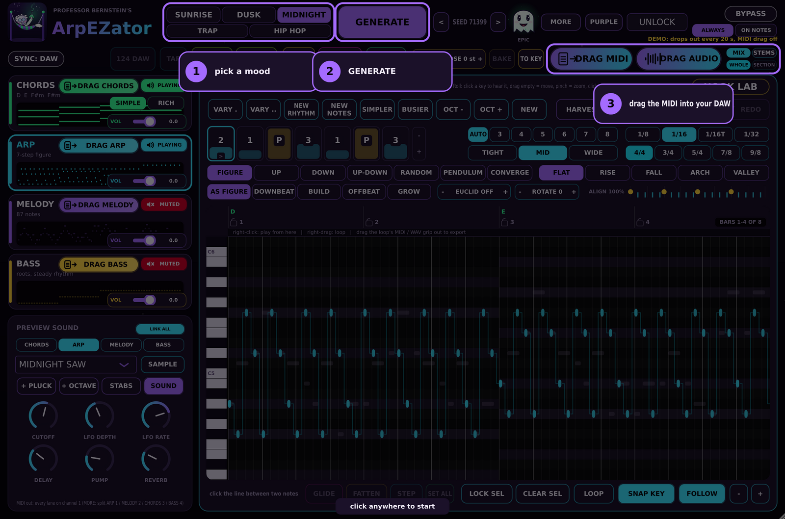{: .medium}

A new ArpEZator starts in the **MIDNIGHT** mood with the **ARP** lane open, and it already has an idea ready.

### Step 3. Pick a mood

At the top, click a mood. For a bright, happy start, click **SUNRISE**.

### Step 4. Press GENERATE

Press the big **GENERATE** button. In a moment you have a new idea with four lanes. The four cards on the left are the lanes. In SUNRISE the **ARP** and **BASS** cards say **MUTED**: they are written, but you do not hear them yet. That keeps the first idea clear.

{: .medium}

> **Try this:** Press GENERATE a few times. The small **<** and **>** buttons next to the seed number take you back to the ideas you passed.

### Step 5. Listen

The quickest way to listen, in any DAW:

1. Click **SYNC: DAW** in the second row. It changes to **SYNC: OWN**. ArpEZator now plays by itself.
2. Press **PLAY**. The button changes to **STOP**. Press it again to stop. The **space bar** does the same.

You hear the CHORDS and the MELODY through ArpEZator's own preview sound. To hear a muted lane, click its **MUTED** button so it reads **PLAYING**.

> **Note:** With **SYNC: DAW** (the default), ArpEZator follows your DAW's play button instead. In FL Studio's pattern mode the pattern loops; if the pattern is shorter than the idea, you only hear the start. Chapter 20 shows how to set this up.

### Step 6. Look at a lane

Click the **MELODY** card. The big area on the right now shows the melody's notes in the **piano roll**, and the controls above it change to the melody's controls.

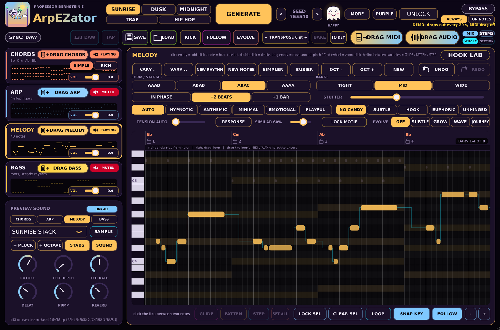{: .medium}

Click a note to hear it. Click an empty spot to add a note. Double-click a note to delete it.

### Step 7. Shape it

The row of tool buttons changes the open lane:

- **VARY .** makes one small change. **VARY ..** makes a few.
- **NEW RHYTHM** keeps the notes and changes the rhythm. **NEW NOTES** does the opposite.
- **SIMPLER** removes notes. **BUSIER** adds notes.
- Changed your mind? **UNDO** (at the right end of the row) steps back.

> **Tip:** Like a bar? Click the small padlock next to its bar number above the piano roll. The tools leave locked bars alone, so you can keep rolling the dice on the rest.

### Step 8. Drag it into your song

At the top right, grab **DRAG MIDI** and drop it into FL Studio's playlist or a piano roll. One MIDI file with all four lanes arrives.

To drag a single lane, use the **DRAG** button on that lane's card, for example **DRAG MELODY**.

> **Warning:** In the demo, drag-out is off. The UNLOCK button blinks and a message says "Drag-out is part of the full version (UNLOCK)". See chapter 24.

### Step 9. Save the idea

Press **SAVE**, type a name, and press **SAVE** on the card. The idea is now in your saved ideas, and **LOAD** brings it back in any project. Saving works in the demo too.

You have made your first idea. The rest of this manual explains each part in detail. Chapter 25 has short recipes for common jobs.

---

## 3. The screen at a glance

This map shows where everything is. The numbers match the table under the picture.

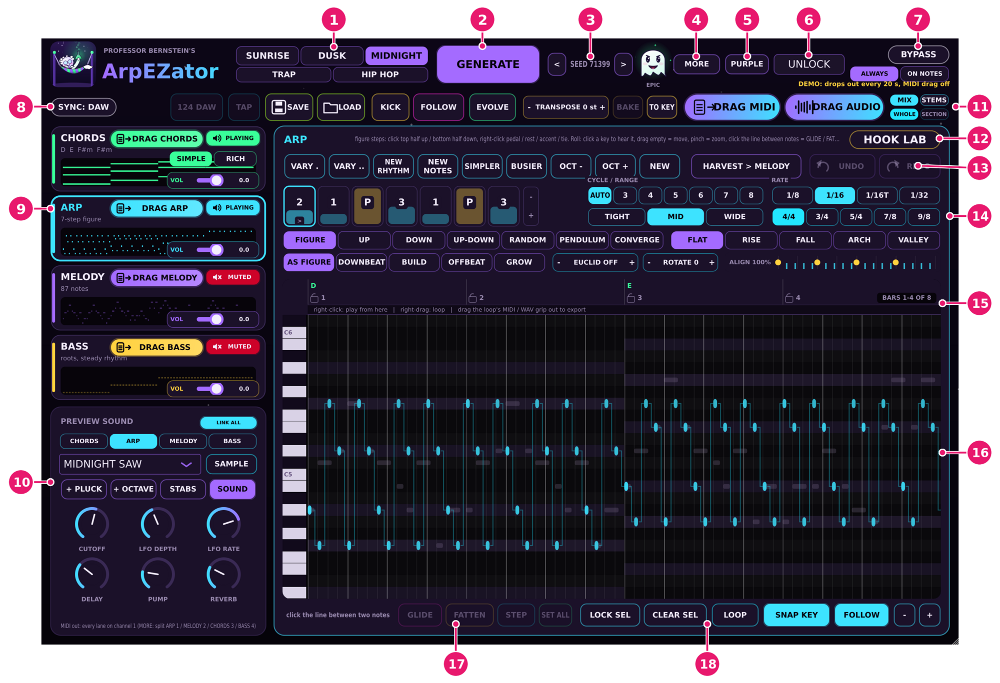{: .breakafter}

| No. | Name | What it is for | Chapter |
|---|---|---|---|
| 1 | Mood buttons | Pick the style of the whole idea. | 4 |
| 2 | GENERATE | Write a new idea in the current mood. | 5 |
| 3 | < SEED > | Step back and forward through your ideas. | 5 |
| 4 | MORE | Open the panel with the deeper settings. | 17 |
| 5 | Look button | Change the colours. It names the next look. | 23 |
| 6 | UNLOCK | Enter your license key. | 24 |
| 7 | BYPASS, ALWAYS / ON NOTES | Silence the plugin; choose when it plays. | 5 |
| 8 | Transport row | SYNC, PLAY, tempo, SAVE, LOAD, KICK, FOLLOW, EVOLVE, TRANSPOSE. | 6 |
| 9 | Lane cards | The four lanes: select, mute, volume, drag. | 7 |
| 10 | PREVIEW SOUND | ArpEZator's own sound. | 13 |
| 11 | Drag-out | DRAG MIDI, DRAG AUDIO, MIX / STEMS, WHOLE / SECTION. | 21 |
| 12 | HOOK LAB | Open the 16-hook generator. | 15 |
| 13 | Tool buttons | Change the open lane. UNDO and REDO sit at the right end. | 10 |
| 14 | Lane controls | The open lane's own settings. | 8 |
| 15 | Bar numbers and timeline strip | Lock bars, set the play start, make a loop. | 9 |
| 16 | Piano roll | See and edit the open lane's notes. | 9 |
| 17 | Line buttons | GLIDE, FATTEN, STEP, SET ALL for the line between two notes. | 9 |
| 18 | Roll buttons | LOCK SEL, CLEAR SEL, LOOP, SNAP KEY, FOLLOW, zoom. | 9 |

Panels such as MORE, HOOK LAB and YOUR SAMPLE open over the big lane area on the right. Short messages appear at the bottom centre after many actions.

---

## 4. Moods and flavours

A mood is the style of the whole idea: its scales, chord loops, rhythms and sounds. There are five moods in two rows. The first row holds the three melodic moods. The second row holds TRAP and HIP HOP, which have their own flavours.

**Each mood keeps its own idea.** Switch from SUNRISE to TRAP and back, and your SUNRISE idea is still there ("SUNRISE: back to your idea"). Only GENERATE replaces it. The first time you open a mood, it writes a fresh idea.

When you switch to a mood, it also sets up its starting point: which lanes are muted, the chord length and rhythm, and the preview sound (chapter 13). Pressing GENERATE again in the same mood keeps your current lane settings.

The lane that opens when you switch: MELODY for SUNRISE, TRAP and HIP HOP; ARP for DUSK and MIDNIGHT.

### 4.1 SUNRISE, DUSK and MIDNIGHT

| Mood | The feel | Starting point |
|---|---|---|
| **SUNRISE** | Euphoric and feel-good, mostly major. Sometimes a minor "lift" loop. | One chord per bar, stabbed chords (SYNCOPATED). The melody starts 2 beats late (STAGGER +2 BEATS) with bouncy repeats (STUTTER 0.35). ARP and BASS start muted. Sound: SUNRISE STACK with STABS on. |
| **DUSK** | Bittersweet: major and minor mixed, with borrowed notes. | One chord per bar, held chords (SUSTAIN), a light STUTTER (0.15). BASS starts muted. Sound: DUSK PLUCK. |
| **MIDNIGHT** | Dark and hypnotic: minor, dorian or phrygian. | Two bars per chord, held chords. MELODY and BASS start muted, so the hypnotic arp leads. Sound: MIDNIGHT SAW, with a slow filter movement in time with the music. |

Typical SUNRISE chord loops are I V vi IV, vi IV I V, IV I V vi and I vi IV V. (In C major, I V vi IV is C, G, Am, F.)

> **Tip:** A muted lane still has its notes. Click its **MUTED** button to hear it, or add a note to it, which unmutes it too.

### 4.2 TRAP

Half-time minor motifs, a breathy flute lead, 808 slides and rolls. The ARP lane plays rolls and arpeggios in the gaps of the melody. Nothing starts muted. Sound: TRAP FLUTE on the melody, BELL on the arp, 808 BASS on the bass (EMO uses its own sounds, see the table).

**The flute melody (3.2.1).** New TRAP ideas in DARK, TRIUMPHANT, HYPNOTIC and DRILL get the slow, singing flute line measured from a
trap-flute reference: short phrases of two to seven notes, mostly 1/8s and 1/4s, that end on a long held note (a quarter to a whole bar,
with the flute's vibrato), a breath of a beat or more between them, mostly stepwise motion with one expressive leap per phrase, repeated-note
stabs, 1/16 runs only as ornaments into a held note, grace notes that scoop in, trills and slides. A four-bar phrase is a two-bar call that
ends open (the 3rd, 5th, 2 or 4) and a two-bar answer that lands on 1 or 5; the phrase repeats with a small change (an octave echo, the
ending resolved to the root). HYPNOTIC loops one bar with tiny changes; RATCHET keeps its kick-locked stabs; EMO has its own singer. The
MELODY card names the gesture ("sigh", "climb", "lilt", "turn", "stabs", "pickup cry", "hold", "octave echo", "falling line", "question",
"drill bounce", "two stabs", "run up"). **Sessions saved before 3.2.1 keep their melodies exactly**: the idea remembers which writer made
it, and only GENERATE or a NEW melody take moves it to the new one.

The tempo, key, scale, swing, chord loop, 808 pattern and melody rhythm all come from the **FLAVOUR** and the **DARKNESS** (both in MORE, chapter 17). With FLAVOUR on AUTO, TRAP picks DARK (40 %), DRILL (35 %) or EMO (25 %).

| Flavour | What it does |
|---|---|
| **DARK** | Sparse and heavy. Long 808s and octave drops, harmonic minor, minor and phrygian colour. 136 to 150 BPM, swing 50 to 52 %. |
| **TRIUMPHANT** | Bright, singing two-bar phrases with pickups over moving minor chord loops. The 808 sits on the roots with frequent slides. 140 to 150 BPM. |
| **HYPNOTIC** | Short cells of two to four notes that loop with tiny changes. A steady 808 with double hits and slides. 130 to 145 BPM. |
| **DRILL** | Syncopated bell figures with a glide-heavy 808. Harmonic minor and phrygian. 140 to 145 BPM. |
| **RATCHET** | Full-time feel at 92 to 104 BPM, minor or pentatonic, short stabs locked to the kick. Chords start on OFFBEAT. |
| **EMO** | Major-key loops that sound minor, a fingerpicked guitar on the ARP lane, a singable sad melody and a softer 808 on the roots. 140 to 170 BPM, half-time, almost straight. Sounds: SAD PAD on the chords, CLEAN GUITAR PLUCK on the arp, 808 BASS, and a soft lead or the guitar on the melody. |

The cards tell you what you got: the MELODY card shows the flavour, the BASS card the 808 pattern ("808: ..."), and the ARP card "rolls in the rests" (or "guitar: ..." for EMO).

### 4.3 HIP HOP

Swung loops that repeat and vary, dusty keys and a round sub. The ARP lane starts muted. Sound: DUSTY KEYS on the melody; the chords and bass depend on the flavour. With FLAVOUR on AUTO, each of the five flavours is equally likely.

| Flavour | What it does |
|---|---|
| **BOOM BAP** | Slow and swung: 86 to 95 BPM, swing 56 to 62 %. Dorian, minor and pentatonic, seventh chords. About 1 in 8 ideas is in double time. Chords: SOUL ORGAN. Bass: ROUND SUB. |
| **MEMPHIS** | 135 to 150 BPM, phrygian and minor, one dark chord loop. Chords: WARM PAD KEYS. Bass: 808 BASS. |
| **WEST GLIDE** | 90 to 100 BPM, swing 54 to 58 %. Mixolydian, dorian and minor, seventh chords, a higher melody. Chords: SOUL ORGAN. Bass: ROUND SUB. |
| **UNDERWATER** | 120 to 150 BPM, minor and dorian, seventh chords. Chords: WARM PAD KEYS. Bass: 808 BASS. |
| **JAZZ SOUL** | 80 to 98 BPM, swing 54 to 60 %. Dorian with minor and mixolydian, jazzy seventh and ninth chords. About 1 in 10 ideas is in double time. Chords: WARM PAD KEYS. Bass: ROUND SUB. |

In double time the tempo is doubled into the 160 to 200 BPM range.

### 4.4 DARKNESS

DARKNESS (in MORE) only works in TRAP and HIP HOP. It runs from 0 to 100. It starts at **70 in TRAP** and **40 in HIP HOP**; double-click the slider to go back to that.

Turning it up gives phrygian or harmonic minor scales, flat-2 and flat-5 notes, lower and sparser melodies, longer 808s, slower slides, darker chords and a darker preview sound. At 0 you get a brighter minor (dorian or pentatonic). Changing DARKNESS or FLAVOUR writes a new idea.

### 4.5 PUSH FURTHER

With PUSH FURTHER on, each GENERATE moves away from your last 3 ideas: another melody shape, rhythm, scale and bass pattern. It is always on in TRAP and HIP HOP (the button shows lit and greyed). In the other moods you can turn it on in MORE.

---

## 5. The header

The header is the top strip. Here you pick a mood, generate ideas, step through them, and reach the settings, the looks and the license.

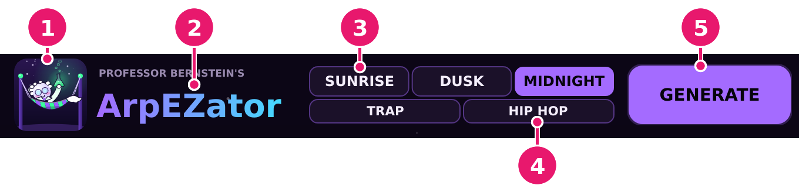

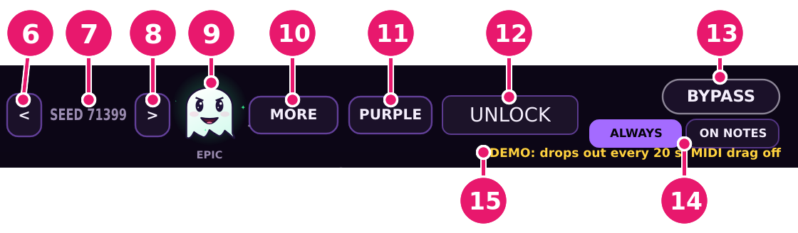

| No. | Control | What it does |
|---|---|---|
| 1 | Professor | The mascot. He changes with the mood (chapter 23). |
| 2 | Title | "PROFESSOR BERNSTEIN'S ArpEZator". |
| 3 | **SUNRISE**, **DUSK**, **MIDNIGHT** | The melodic moods (chapter 4). |
| 4 | **TRAP**, **HIP HOP** | The urban moods. |
| 5 | **GENERATE** | A new idea in the current mood. It reads GENERATING... for a moment. |
| 6 | **<** | Back to your previous idea. |
| 7 | **SEED** | The number behind the idea. Click it to type a seed. |
| 8 | **>** | Forward again. Past your newest idea it generates a new one. |
| 9 | Mood ghost | A little ghost whose face follows the feel of the chords, with a word under it such as HAPPY, EPIC or TENSE. Just for show. |
| 10 | **MORE** | Opens the MORE panel. Press again (or CLOSE) to hide it. |
| 11 | Look button | Changes the colours. It shows the name of the **next** look. |
| 12 | **UNLOCK** | Enter your license key. Reads LICENSED when unlocked. |
| 13 | **BYPASS** | Silences the plugin. Reads BYPASSED while on. |
| 14 | **ALWAYS** / **ON NOTES** | When ArpEZator plays: always with the transport, or only while you hold a MIDI note. |
| 15 | Demo line | "DEMO: drops out every 20 s, MIDI drag off". Shown only in the demo. |

**The history (< and >).** ArpEZator remembers up to 60 ideas. The list is shared by all moods, and an idea you step back to plays in the mood you are in now. Stepping back rebuilds the idea from its seed, so hand edits are not brought back; use UNDO for those.

**BYPASS.** Silence, no MIDI out, and incoming MIDI is ignored, while the clock keeps running. Turning it on stops every note.

**ALWAYS / ON NOTES.** ALWAYS plays with the transport. ON NOTES plays only while a MIDI note is held (any key). So if you mute the channel in your DAW, ArpEZator stops, and the next note starts it again in time. With FOLLOW on, the held keys also set the chord. BYPASS always wins.

> **Try this:** Set ON NOTES and draw one long note per pattern in your DAW. ArpEZator plays only where that note is. A quick way to arrange where the idea plays.

---

## 6. The transport row

The second row holds playback, tempo, saving, a few live switches, transposing and the drag-out buttons.

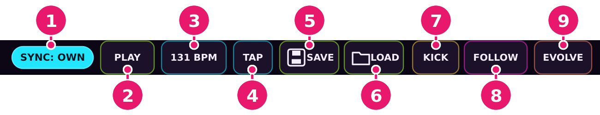

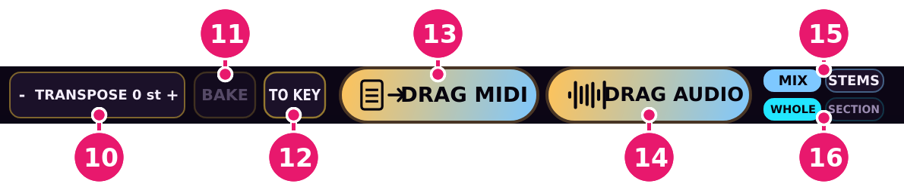

| No. | Control | What it does |
|---|---|---|
| 1 | **SYNC: DAW** / **SYNC: OWN** | Follow the DAW, or play by itself (chapter 19). |
| 2 | **PLAY** / **STOP** | ArpEZator's own playback. Hidden in SYNC: DAW when a DAW is present. |
| 3 | Tempo box | Shows "NNN BPM", or "NNN DAW" when the tempo comes from the DAW. Click to type a tempo. |
| 4 | **TAP** | Tap the tempo. Off while the DAW sets the tempo. |
| 5 | **SAVE** | Save the idea (chapter 22). |
| 6 | **LOAD** | Open your saved ideas and the starters (chapter 22). |
| 7 | **KICK** | A little kick on every beat, for timing and fun. A volume fader appears next to it while it is on. Never in the MIDI. |
| 8 | **FOLLOW** | FOLLOW MY KEYS: hold a chord on your MIDI keyboard and the arp and melody move onto it. |
| 9 | **EVOLVE** | A long take that changes slowly (chapter 18). |
| 10 | **- TRANSPOSE +** | Move the whole output up or down in semitones. |
| 11 | **BAKE** | Write the TRANSPOSE into the notes. |
| 12 | **TO KEY** | Move the idea to your song's key. |
| 13 | **DRAG MIDI** | Drag all lanes into your DAW as MIDI. |
| 14 | **DRAG AUDIO** | Drag the preview sound as a WAV. |
| 15 | **MIX** / **STEMS** | One file, or one file per lane. |
| 16 | **WHOLE** / **SECTION** | The whole idea, or only the loop section. |

### 6.1 TRANSPOSE, BAKE and TO KEY

**TRANSPOSE** moves every lane, the live MIDI out, the drag-outs and HOOK LAB, from -24 to +24 semitones (0 by default). Click **-** or **+**, use the mouse wheel, double-click for 0, or right-click to type a number.

It is a live offset. GENERATE, the moods and HOOK LAB keep writing in the original key, and the offset is added on the way out. A note that would leave the playable range is folded by an octave, and a message says how many were folded.

**BAKE** writes the TRANSPOSE into the notes and chords (one undo step) and sets TRANSPOSE back to 0. It is greyed out while TRANSPOSE is 0.

**TO KEY** opens a menu "TO KEY (from Eb)" with the 12 keys, each with the move it needs, for example "Eb -> G (+4)". Pick your song's key and ArpEZator takes the smallest move (-5 to +6 semitones). A major idea stays major and a minor idea stays minor. Under "Lanes that follow TRANSPOSE" you can tick which lanes move (all four are ticked by default).

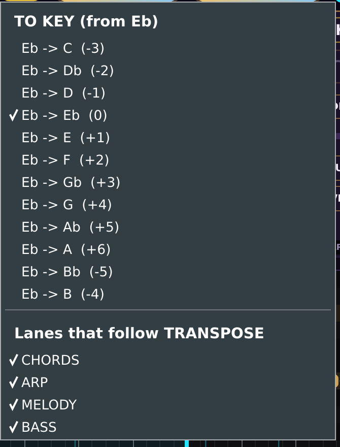{: .small}

### 6.2 FOLLOW MY KEYS

With **FOLLOW** on, hold a chord on your MIDI keyboard: the arp and melody re-voice onto it. The chord lane itself is not re-voiced, but the preview chord sound plays the keys you hold.

Good to know:

- With FOLLOW on and no keys held, nothing plays: no sound and no MIDI.
- The keys you play are not passed to the output. They only steer ArpEZator.
- While following, glides, pitch bend and the extra controller messages are left out of the MIDI out, and TRANSPOSE does not apply to the followed lanes.

---

## 7. The four lanes

Each lane is a card in the left column. Click a card to open that lane in the piano roll; the open card has a bright outline. Each lane has its own colour, which changes with the mood and the look.

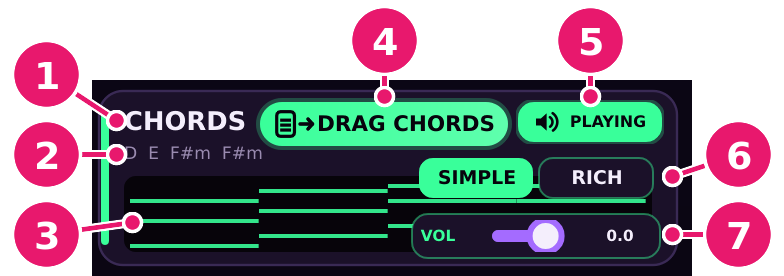{: .medium}

| No. | Item | What it does |
|---|---|---|
| 1 | Lane name | CHORDS, ARP, MELODY or BASS. Click the card to open the lane. |
| 2 | Sub-line | A short note about the lane (see below). |
| 3 | Mini picture | A tiny view of the lane's notes. Dim when muted. |
| 4 | **DRAG** button | Drag this lane alone into your DAW (chapter 21). |
| 5 | **PLAYING** / **MUTED** | Mute or unmute the lane. |
| 6 | **SIMPLE** / **RICH** | CHORDS card only: plain or colourful chords. |
| 7 | **VOL** | The lane's volume. |

**The sub-line** tells you about the lane:

- CHORDS: the first four chord names.
- ARP: "N-step figure", or "rolls in the rests" in TRAP and HIP HOP, or "guitar: ..." in EMO. "(edited)" is added once you edit the arp's notes by hand.
- MELODY: the number of notes (and the flavour in TRAP and HIP HOP), or "empty: HARVEST from the arp" if it has no notes.
- BASS: "808: ..." in TRAP, "sub: ..." in HIP HOP, otherwise "roots, steady rhythm".

**PLAYING / MUTED.** A muted lane is left out of the preview sound, the live MIDI out, the audio drag-outs and the STEMS drag-outs. Your notes stay. Adding a note to a muted lane unmutes it. When you open a muted lane, a red bar over the roll says so and offers an **UNMUTE** button.

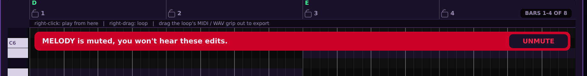

> **Warning:** The MIX **DRAG MIDI** file and the lane **DRAG** buttons still contain a muted lane's notes. To leave a lane out of a MIDI file, use STEMS, or turn its VOL all the way down (with VOL SCALES VELOCITY on, see below).

**VOL.** From -inf (off, at -60 dB) up to +6 dB; 0 dB by default. Double-click for 0 dB. It sets the lane's preview level. With **VOL SCALES VELOCITY** on (MORE, on by default) it also scales the MIDI velocity, and a lane turned down to about -54 dB or lower is left out of the MIDI. Your DAW can automate the four lane volumes.

**SIMPLE / RICH** (CHORDS card). SIMPLE gives classic big-room or progressive triads, for example Am F C G. RICH gives colourful, jazzy chords: sevenths, ninths, sus chords and slash basses. Switching rebuilds the chords.

---

## 8. The lane controls

Above the piano roll sit the open lane's own controls. Each lane has a different set. The tool buttons in the top row are explained in chapter 10.

### 8.1 CHORDS

These controls decide how the chords are built and how they move.

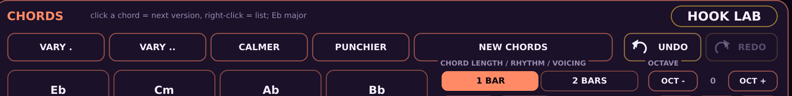

| Control | Choices | What it does |
|---|---|---|
| Chord chips | | One chip per chord, with its name, its number in the key (for example vi) and its version. Borrowed chords are pink; the playing chord lights up. Click a chip for the next version of that chord; right-click for the list (chapter 11). |
| Chord length | **1 BAR**, **2 BARS** | How long each chord lasts. Rebuilds the chords and rewrites ARP, MELODY and BASS (locked notes stay, hand edits are replaced). |
| Rhythm | **SUSTAIN**, **OFFBEAT**, **SYNCOPATED** | Held chords, offbeat stabs, or syncopated stabs. |
| VOICING | **SMOOTH**, **POWER**, **WIDE**, **WEB** | How the chord notes are stacked. SMOOTH moves each note as little as possible from chord to chord. POWER plays root and fifth only (the chords are then named like "A5"). WIDE spreads the notes open. WEB uses the voicing of the ArpEZator web version. The other lanes are fitted to the new chords. |
| OCTAVE | **OCT -**, number, **OCT +** | Moves the whole chord lane an octave down or up, from -2 to +2. The chord names and the other lanes stay as they are. It stops at ±2, or when a chord note would leave the range (message "CHORDS: highest octave" or "CHORDS: lowest octave"). |

### 8.2 ARP

The arp repeats a short **figure**: a pattern of 3 to 8 steps that climbs a ladder of chord notes. These controls shape the figure, its speed and its accents.

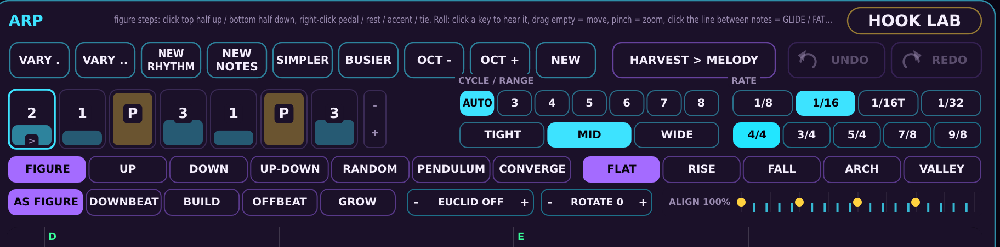

| Control | Choices | What it does |
|---|---|---|
| Figure editor | 3 to 8 steps | One box per step. Click the upper half of a box to raise the step, the lower half to lower it; the wheel works too. The small **-** and **+** at the end shorten or lengthen the figure. |
| **CYCLE** | **AUTO**, **3** to **8** | The figure length. Odd lengths drift against the 16-step bar (a polymeter) and line up again at phrase starts. |
| **RANGE** | **TIGHT**, **MID**, **WIDE** | How far the ladder of chord notes spreads: 1, 2 or 3 octaves. |
| **RATE** | **1/8**, **1/16**, **1/16T**, **1/32** | The step speed (1/16T = sixteenth-note triplets). |
| Meter | **4/4**, **3/4**, **5/4**, **7/8**, **9/8** | Accents in groups that phase against the 4/4 bars (7/8 = 2+2+3). EUCLID uses the same cycle. |
| Direction | **FIGURE**, **UP**, **DOWN**, **UP-DOWN**, **RANDOM**, **PENDULUM**, **CONVERGE** | The order the figure's notes play in. The notes stay the same. |
| Contour | **FLAT**, **RISE**, **FALL**, **ARCH**, **VALLEY** | The arp's shape across the whole chord loop. |
| Accent | **AS FIGURE**, **DOWNBEAT**, **BUILD**, **OFFBEAT**, **GROW** | Which steps lean in, and how the emphasis develops. |
| **EUCLID** | OFF, then 1 up to the cycle's steps | Keeps only this many evenly spread steps of the cycle (shown as "EUCLID 5/16"). The figure's order stays. |
| **ROTATE** | 0 up to steps minus 1 | Shifts the EUCLID rhythm by steps. Only works while EUCLID is on. |
| ALIGN | display | Shows where the figure starts again (ticks) against the chord changes (bars). Gold means they meet: the phrase lines up with the chords. |

**The step menu.** Right-click a step box for: Pedal note (stays put), Rest, Accent, Tie (legato), Octave up, Octave down, Plain ladder note. A box shows its ladder step as a number, **P** for a pedal note, **-** for a rest, **+8** or **-8** for an octave, **~** for a tie and **>** for an accent.

> **Note:** Changing the figure rewrites the arp and replaces any notes you edited by hand in the ARP roll.

In TRAP and HIP HOP (and when the ARP lane's LANE MOOD is TRAP or HIP HOP), the arp is made of rolls and arpeggios in the melody's rests. The figure editor is replaced by a short text. Edit those arps in the roll, and use VARY or NEW to reshape them.

Related settings in MORE: ARP GATE, ARP RE-SYNC, HOLD PEDAL and REGISTER.

### 8.3 MELODY

These controls shape how the melody is built: its phrase plan, its range, its style and its little surprises. HOOK LAB uses the same ideas (chapter 15).

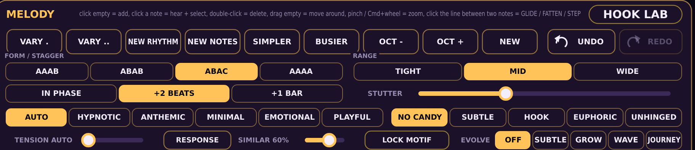

| Control | Choices | What it does |
|---|---|---|
| FORM | **AAAB**, **ABAB**, **ABAC**, **AAAA** | The phrase plan. Each letter is a phrase; AAAB means three alike and one different. |
| STAGGER | **IN PHASE**, **+2 BEATS**, **+1 BAR** | Starts the melody's phrase late against the chord loop, so the loop keeps pulling forward. |
| RANGE | **TIGHT**, **MID**, **WIDE** | How wide the melody moves. |
| **STUTTER** | slider, 0 to 1 | Bouncing repeats. Applies when you let go of the slider. Same value as in MORE. |
| Style | **AUTO**, **HYPNOTIC**, **ANTHEMIC**, **MINIMAL**, **EMOTIONAL**, **PLAYFUL** | How the melody behaves, whatever the mood. TRAP adds **DARK**, **TRIUMPHANT**, **HYPNO LOOP**, **EMO**; HIP HOP adds **BOOM BAP**, **SOULFUL**, **LAID BACK**. |
| Ear candy | **NO CANDY**, **SUBTLE**, **HOOK**, **EUPHORIC**, **UNHINGED** | Rare special moments: grace notes, octave answers, run-ups, ratchets. A small budget per 4 or 8 bars. |
| **TENSION** | AUTO, then 0 to 100 % | Left: calm chord notes. Right: passing notes, suspensions, ninths, sevenths and resolved chromatic notes. Far left (or double-click) is AUTO. |
| **RESPONSE** | button | Rewrites the second half of the phrase as an answer to the first (call and response), fitted to the chords. |
| **SIMILAR** | 0 to 100 %, starts at 60 % | How close the answer is. Right: it copies the call's rhythm and shape. Left: a fresh answer. |
| **LOCK MOTIF** | button | The selected melody notes (or the strongest motif) come back in every phrase, through EVOLVE and regenerating. Reads MOTIF LOCKED while on; press again to unlock. Your own note locks stay. |
| **EVOLVE** | **OFF**, **SUBTLE**, **GROW**, **WAVE**, **JOURNEY** | The EVOLVE shape (chapter 18). |

The TRAP and HIP HOP styles write the melody in a flavour: DARK, TRIUMPHANT, HYPNO LOOP and EMO give the TRAP flavours DARK, TRIUMPHANT, HYPNOTIC and EMO; BOOM BAP, SOULFUL and LAID BACK give the HIP HOP flavours BOOM BAP, JAZZ SOUL and UNDERWATER.

> **Note:** Style, ear candy and TENSION do not rewrite a melody you edited by hand. Use NEW NOTES or VARY on it, or GENERATE.

Related settings in MORE: MELODY PHRASE, MELODY GRID, REGISTER and MASTER.

### 8.4 BASS

In SUNRISE, DUSK and MIDNIGHT the bass has one switch, its rate: **1/8**, **1/16** or **OFFBEAT**. Changing it writes a new bass and unmutes the lane.

In TRAP and HIP HOP the bass plays the flavour's own 808 or sub patterns instead, and the card names the pattern. The rate switch does not change those patterns.

The TRAP 808 patterns: anchor, and-of-2 push, post-snare answer, octave slide up, bar-end drop, stab bounce, rolling, glide run, half-bar breathe, syncopated three, chord follower, tension b2, dead stop, ratchet bounce, steady double-hit, steady slide home, bouncy follower. EMO uses its own set. The HIP HOP sub patterns: root on the kick, dotted push, late entry, two-note soul, funk glide, walking, sustain b2, slow slide, octave pops, turnaround walk, kick shadow.

---

## 9. The piano roll

The piano roll shows the open lane: time runs left to right, pitch bottom to top, and the keyboard on the left tells you which note is which. Every lane edits the same way, including CHORDS.

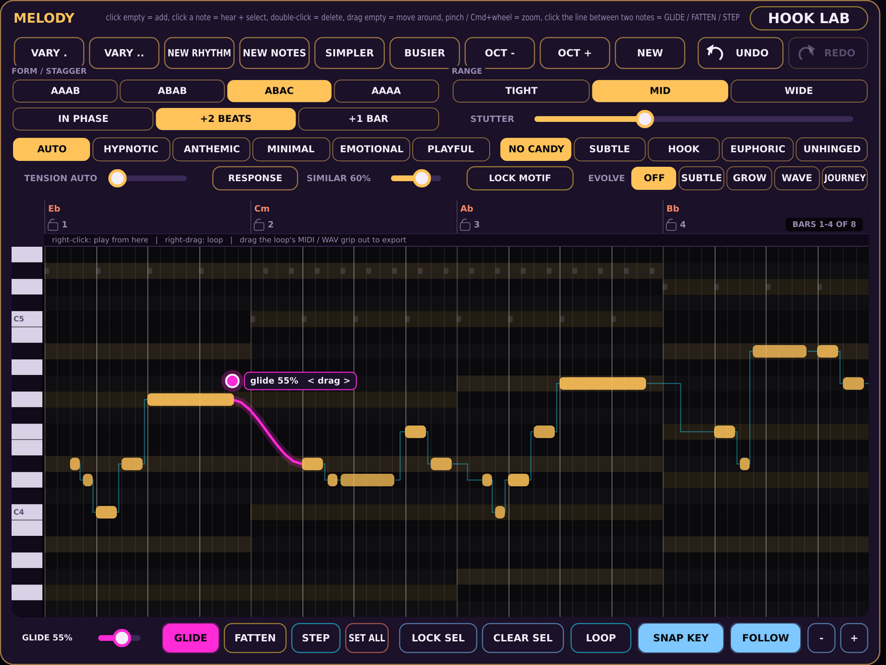

### 9.1 Editing notes with the mouse

| Do this | What happens |
|---|---|
| Click a note | Selects it and plays it. |
| Shift-click a note | Adds it to the selection, or removes it if it was selected. |
| Click an empty spot | Adds a note on the lane's grid, on a note of the key and chord when SNAP KEY is on. It unmutes the lane. |
| Drag a note | Moves it in time and pitch. With SNAP KEY on, it lands only on notes of the key and chord. A moved note replaces whatever was on its step (in CHORDS, only a note of the same pitch). Only the note you grab moves. |
| Double-click a note | Deletes it. A locked note refuses: "That note is locked (right-click > Unlock)". |
| Drag on an empty spot | Moves the view (the hand tool). |
| Shift-drag or Cmd-drag on an empty spot | Draws a selection box. Every note it touches is selected. |
| Right-click a note | The note menu (9.3). |
| Right-click an empty spot | The roll menu (9.3). |
| Click the keyboard on the left | Plays that key. Drag over the keys for a glissando. |

**New notes.** A new note starts on the lane's grid. Its length: on ARP the ARP GATE length, on MELODY 80 % of a step, on BASS 60 % of a step, on CHORDS one beat.

### 9.2 Moving around

| Do this | What happens |
|---|---|
| Mouse wheel | Scroll up and down through the pitches. |
| Shift + wheel (or a sideways trackpad swipe) | Scroll sideways in time. |
| Cmd/Ctrl + wheel, a trackpad pinch, or the **-** / **+** buttons | Zoom. |
| Middle-drag, or Alt + drag | The hand tool. |
| Right-click an empty spot > **Zoom: fit everything**, **Zoom: 4 bars**, **Pitch: fit the notes** | Quick views. |

**FOLLOW** (next to the zoom buttons, on by default) keeps the playhead in view: the roll jumps a page when the playhead leaves it.

### 9.3 The menus

**The note menu** (right-click a note) has: Lock (tweaks keep it) or Unlock (tweaks may change it), Delete, Louder, Softer, Longer, Shorter, Octave up, Octave down, and UNLOCK ALL (bars + notes of this lane). When notes are selected, a **Transpose selected** submenu adds +1 semitone (UP), -1 semitone (DOWN), +1 octave (SHIFT+UP) and -1 octave (SHIFT+DOWN).

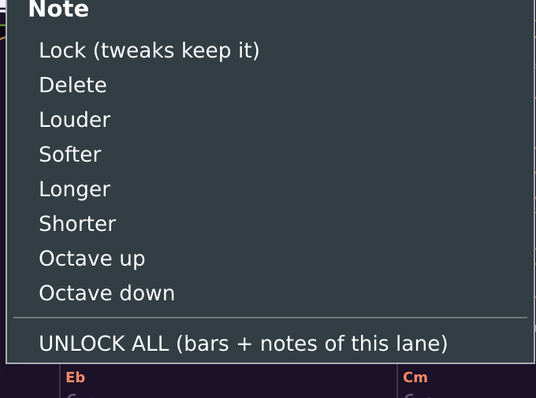{: .small}

- Louder and Softer change the velocity by 15 points out of 100.
- Longer makes the note 1.5 times longer; Shorter divides by 1.5.
- Octave up and Octave down stop at the edge of the range, so a note near the edge may move less than an octave.

**The roll menu** (right-click an empty spot) has UNLOCK ALL (bars + notes of this lane), Zoom: fit everything, Zoom: 4 bars, Pitch: fit the notes, and the same Transpose selected submenu.

### 9.4 Keys

Click in the roll first, so it has the keyboard focus.

| Key | What happens |
|---|---|
| Up / Down arrow | Moves the selected notes a semitone. With Shift, an octave. |
| Delete / Backspace | Deletes the selected notes. Locked notes stay. |
| Esc | Clears the loop section. |

### 9.5 The buttons under the roll

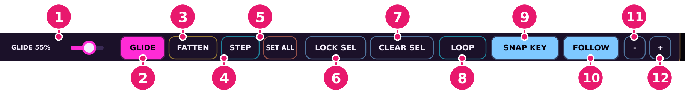

| No. | Button | What it does |
|---|---|---|
| 1 | Hint or amount slider | Says "click the line between two notes". While a GLIDE or FATTEN line is selected it becomes the amount slider ("GLIDE 55%" or "FAT 50%"). |
| 2 | **GLIDE** | Make the selected line a glide. |
| 3 | **FATTEN** | Make the selected line a FATTEN. |
| 4 | **STEP** | Make the selected line a plain jump. |
| 5 | **SET ALL** | Copy the selected line to every line in the lane. |
| 6 | **LOCK SEL** | Lock the selected notes or bars. Reads UNLOCK SEL when the selection is already locked. |
| 7 | **CLEAR SEL** | Clear the selection. |
| 8 | **LOOP** | Loop section on or off. Reads LOOP ON while on. |
| 9 | **SNAP KEY** | On by default. Added and dragged notes land only on notes of the key and chord. |
| 10 | **FOLLOW** | On by default. The roll follows the playhead. |
| 11 | **-** | Zoom out. |
| 12 | **+** | Zoom in. |

Buttons 1 to 5 appear on ARP, MELODY and BASS. CHORDS has no lines between notes.

### 9.6 Lines between notes: GLIDE, FATTEN and STEP

On ARP, MELODY and BASS, a thin line joins each pair of neighbouring notes. You can turn that line into a slide or a swell.

1. Click a line to select it.
2. Press **GLIDE**, **FATTEN** or **STEP** under the roll, or right-click the line for its menu.
3. Drag the handle on the line, or the amount slider, to set the amount.

| Line type | What you hear |
|---|---|
| **GLIDE** | The first note slides into the next. Drag the pink dot left or right to say where the slide starts. |
| **FATTEN** | The next note comes in louder and fatter. Drag the gold ball up or down to say how much. |
| **STEP** | A plain jump, no link. |

The line menu ("Line between two notes") also has Glide early + long, Glide late + quick, Set ALL lines like this one, and Reset ALL lines to STEP.

In the MIDI, MELODY and BASS glides become pitch bend (when GLIDES AS PITCH BEND is on in MORE), and FATTEN becomes expression swells (controller CC11). ARP glides are not written as pitch bend.

### 9.7 Bars, locks and the play cursor

Above the roll are the bar numbers and, under them, a thin **timeline strip**.

- **Click a bar number** to select that bar. Shift-click to extend the selection. Click the same bar again to clear it. The tools, HARVEST and LOCK SEL use bar selections.
- **Click the small padlock** at the start of a bar to lock it ("Bar 3 locked: tweaks leave it alone (click the padlock again to unlock)"). A locked bar reads "3 LOCKED".
- **Right-click in the timeline strip** to move the PLAY cursor there. It does not start playback: "PLAY from 3.1 (SPACE starts here; HOME = back to the start)".
- **Home** sends the PLAY cursor back to the start (or to the loop section's start). The small corner left of the bar numbers does the same.

### 9.8 The loop section

A loop section plays one part of the idea over and over, and it can be dragged out on its own.

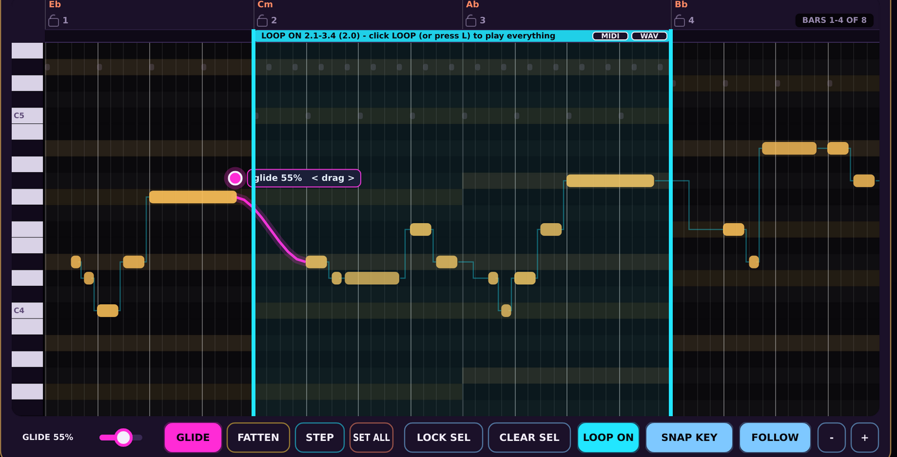

- **Make one:** right-drag in the timeline strip. The length snaps to a beat; hold Shift for the lane's grid step, or Alt for whole bars. On a trackpad, a two-finger drag usually counts as a right-drag.
- **Or press L** (or click **LOOP**) when there is no section yet: ArpEZator makes one from the selected bars, or else from the bars on screen, and turns it on.
- **Change it:** drag its ends to resize it, or its middle to move it.
- **Turn it off and on:** press L or click LOOP. The section stays where it is.
- **Clear it:** double-click it, or press Esc in the roll.
- **Drag it out:** use its **MIDI** and **WAV** grips, or set **SECTION** next to DRAG MIDI (chapter 21).

Each mood keeps its own loop section.

---

## 10. Lane tools

The tool buttons change the open lane without starting over. They respect locks: locked notes and bars stay as they are. If you select notes (or bars that hold notes), most tools work only on the selection. Every tool press clears the selection afterwards. **UNDO** and **REDO** are at the right end of the row.

### 10.1 ARP, MELODY and BASS

| Button | What it does |
|---|---|
| **VARY .** | One small change, everywhere it repeats. |
| **VARY ..** | A few changes plus one rhythm change. |
| **NEW RHYTHM** | A new rhythm with the same notes. |
| **NEW NOTES** | New notes on the same rhythm. |
| **SIMPLER** | Fewer notes. |
| **BUSIER** | More notes. |
| **OCT -** / **OCT +** | The lane an octave down or up. |
| **NEW** | Writes a new take of the whole lane (locked bars and notes stay). Every press gives a different take, also on a lane you have not edited, BASS included; UNDO goes back one take. This ignores a selection. Use it to get back from heavy hand edits to a generated take. |
| **HARVEST > MELODY** | ARP only. Copies the selected arp bars or notes into the MELODY lane. |

**On an unedited ARP** (in SUNRISE, DUSK and MIDNIGHT) the tools change the repeating figure, so the arp stays hypnotic and the same everywhere. OCT - and OCT + then move the shared register of the arp and melody. Once you edit the arp's notes by hand (or select notes), the tools work on the notes. In TRAP and HIP HOP the arp is always edited as notes.

**HARVEST > MELODY.** Select arp bars (click the bar numbers, Shift for more) or notes (Shift-drag), then press it. The melody's notes are replaced only in that time span (locked melody notes stay), and MELODY is unmuted. With nothing selected it asks: "Select arp bars (click bar numbers, shift = more) or notes (shift-drag), then HARVEST".

> **Tip:** NEW and **NEW TAKE** in MORE (chapter 17) step through the same takes of a lane: the take is saved with the idea, and the next press after reopening gives the same next take. A new BASS take keeps its shape (octave jumps, fifths, rests or passing notes) when the chords change. In TRAP and HIP HOP the arp only plays in the melody's rests, so with no rests there is no arp for NEW to change.

### 10.2 CHORDS

The CHORDS lane has its own five tools. They work on the whole chord lane (a selection does not limit them).

| Button | What it does |
|---|---|
| **VARY .** / **VARY ..** | In SIMPLE: another classic chord loop. In RICH: one (VARY .) or two (VARY ..) chords change to another version. |
| **SIMPLER** / **RICHER** | In RICH: plainer or more colourful chords. |
| **CALMER** / **PUNCHIER** | In SIMPLE (these replace SIMPLER and RICHER): a calmer chord rhythm (from stabs towards held chords) or a busier one. The chords stay plain triads. |
| **NEW CHORDS** | A brand-new chord loop. The other lanes keep their rhythm. |

---

## 11. Editing chords by hand

The chord lane edits like any other lane. Use it to fix a voicing, add a note for colour, or write your own chords.

- **Select:** click a note. Shift-click adds or removes. Shift-drag draws a selection box.
- **Add:** click an empty spot. A new chord note lasts one beat and joins the chord (it only replaces a note of the same pitch).
- **Delete:** double-click a note, or select it and press Delete.
- **Move:** drag a note. With SNAP KEY on, it lands on notes of the key and the chord.
- **Transpose:** Up and Down move the selected notes a semitone; with Shift, an octave.
- **Menus:** the same note and roll menus as the other lanes. There are no lines (no GLIDE or FATTEN) between chord notes.

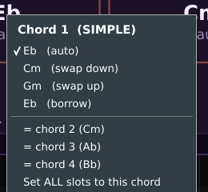{: .small}

**Chord versions.** Click a chord chip (or the chord name above the roll) for the next version of that chord. Right-click it for the list, with the resulting names and the current one ticked. The list also has "= chord 2 (Cm)" items to copy another chord into this slot, and **Set ALL slots to this chord**. Each slot keeps its own length.

- SIMPLE chords have four versions: auto, swap down, swap up, borrow.
- RICH chords have eight: auto, sus, 7th, lush, over 3rd, swap down, swap up, borrow.
- Some chords offer three: as heard, plain triad, no slash bass.

### 11.1 What keeps and what replaces your chord edits

Your edits stay when you use other lanes' tools, change the arp rate, use the chord OCTAVE, or make the idea longer. CHORDS OCT moves your edited notes along.

These actions **rebuild** the chords: VOICING, SIMPLE / RICH, the CHORDS tools, chord length, rhythm, changing a chord's version, CHORD COLOUR, CHORD LOOP, KEY, SCALE and MELODY PHRASE (in MORE). A rebuild replaces your edited chord notes but keeps locked notes and locked bars. It only replaces them when the chords really change. A message tells you:

- "CHORDS rebuilt - your edited notes were replaced"
- "CHORDS rebuilt - kept locked notes"

**GENERATE** and **IDEA WORDS** write a whole new idea: every lane is replaced, locks included.

The ARP, MELODY and BASS follow the generated chords, not your edited chord notes. Edited chord notes are saved with the idea, sent to the MIDI out and written into dragged MIDI files. UNDO brings them back after a rebuild.

---

## 12. Locks

Locks protect what you like while you keep changing the rest.

- **A note:** right-click it > Lock (tweaks keep it).
- **A bar:** click the padlock at the start of the bar.
- **A selection:** select notes or bars, then press **LOCK SEL**. On a locked selection the button reads **UNLOCK SEL**. The message: "Locked: VARY and friends leave it alone (UNLOCK SEL undoes it)".
- **Everything in the lane:** right-click > **UNLOCK ALL (bars + notes of this lane)**.

The lane tools, EVOLVE and the chord rebuilds leave locked notes and bars alone. GENERATE does not: it writes a new idea and clears all locks.

> **Note:** Locks protect against the tools, not against your own hand. You can still drag a locked note, delete it from the note menu, or replace it by putting another note on its step. Double-click and the Delete key do respect locks.

---

## 13. The preview sound

The PREVIEW SOUND card is ArpEZator's built-in synth, so you can hear ideas at once. It never goes into the MIDI. If you play the idea with your own synths, you can switch it off.

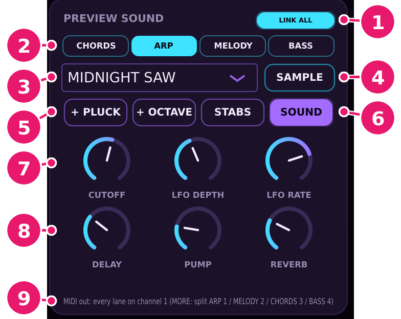{: .medium}

| No. | Control | What it does |
|---|---|---|
| 1 | **LINK ALL** | On: one sound for every lane. Off: each lane can have its own sound. |
| 2 | Lane tabs (**CHORDS**, **ARP**, **MELODY**, **BASS**) | The lane the sound menu changes. It follows the lane you are editing until you pick a tab. Picking a tab turns LINK ALL off ("LINK ALL off: each lane can have its own sound now"). |
| 3 | Sound menu | The 18 sounds, plus YOUR SAMPLE. |
| 4 | **SAMPLE** | Opens the YOUR SAMPLE panel (chapter 14). |
| 5 | **+ PLUCK**, **+ OCTAVE**, **STABS** | Add a pluck layer or an octave layer to the lead. STABS plays chords as wide supersaw stabs instead of a soft pad. |
| 6 | **SOUND** | The preview sound on or off. |
| 7 | **CUTOFF**, **LFO DEPTH**, **LFO RATE** | The filter's brightness, and a filter movement in time with the music (its depth and speed). |
| 8 | **DELAY**, **PUMP**, **REVERB** | A dotted-eighth ping-pong echo, a quarter-note "pumping" duck, and reverb. |
| 9 | MIDI out line | Shows how the MIDI out channels are set (chapter 20). |

**Defaults.** CUTOFF 60 %, LFO DEPTH 30 %, LFO RATE 2 bars (choices 1/4, 1/2, 1 bar, 2 bars, 4 bars), DELAY 35 %, PUMP 25 %, REVERB 30 %. The layers and STABS are off. Double-click a knob to reset it; right-click to type a value.

**With LINK ALL off,** each lane's menu starts with a LINKED entry: the shared sound for ARP and MELODY, a classic pad for CHORDS ("LINKED (classic pad)") and a classic bass for BASS ("LINKED (classic bass)"). Turning LINK ALL back on puts every lane back on the shared sound.

**Each mood sets its own sound** when you switch to it. Every mood switch also turns + PLUCK and + OCTAVE off.

| Mood | Lead sound | STABS | CUTOFF | LFO DEPTH | LFO RATE | DELAY | PUMP | REVERB |
|---|---|---|---|---|---|---|---|---|
| SUNRISE | SUNRISE STACK | on | 60 % | 6 % | 1 bar | 32 % | 35 % | 34 % |
| DUSK | DUSK PLUCK | off | 60 % | 10 % | 1 bar | 38 % | 22 % | 28 % |
| MIDNIGHT | MIDNIGHT SAW | off | 55 % | 42 % | 2 bars | 32 % | 22 % | 28 % |
| TRAP | TRAP FLUTE | off | 60 %* | 0 % | 2 bars | 30 % | 12 % | 42 % |
| HIP HOP | DUSTY KEYS | off | 50 %* | 0 % | 2 bars | 20 % | 10 % | 26 % |

\* At the default DARKNESS. More DARKNESS lowers the cutoff. TRAP and HIP HOP turn LINK ALL off and give each lane its own sound (chapter 4); going back to a melodic mood turns it on again.

The master **VOLUME** (80 %) and **REVERB** knobs are in MORE, and so are the per-lane effects (DRIVE, TONE, ECHO, SPACE).

**Dropping files.** Drop an audio file on the sound card or the YOUR SAMPLE panel to use it as YOUR SAMPLE. Drop an audio file anywhere else on the window to LISTEN to it (chapter 16). Drop an .arpz idea file anywhere to load it.

### 13.1 The 18 sounds

| Sound | Character |
|---|---|
| **NEON PLUCK** | Seven detuned saws, bright, with a fast filter pluck. The plugin's basic default sound. |
| **BRIGHT PIANO** | A piano with two slightly detuned strings; the high overtones die first. |
| **PLUCK** | A short plucky lead: two close saws and a square an octave below. |
| **SUPERSAW** | A wide stack of detuned saws. |
| **SOFT KEYS** | Soft, mellow keys with a gentle filter. |
| **BELL** | A bell with a long ring. |
| **ACID** | A single saw with a strong resonance and a quick filter sweep. |
| **SUNRISE STACK** | A wide seven-saw stack with a soft piano attack inside: open and euphoric. |
| **DUSK PLUCK** | Two close saws and a soft sine an octave up: round, short and warm. |
| **MIDNIGHT SAW** | Three dark, resonant saws; the moving filter does the hypnotic part. |
| **TRAP FLUTE** | A breathy low pan flute with a soft attack and a late vibrato; legato notes slide. |
| **808 BASS** | A deep sine 808 with a short click, a fast pitch drop and a long decay. Plays one note at a time, so notes slide into each other. |
| **DUSTY KEYS** | Mellow keys with a short pluck, a dark top, tape wobble and a faint vinyl crackle. |
| **ROUND SUB** | A clean sine sub that holds while the note is held and glides. |
| **SOUL ORGAN** | A drawbar organ with a soft key click and a slow rotary wobble. |
| **WARM PAD KEYS** | A soft electric-piano body with a slow attack and a long, dark release. |
| **CLEAN GUITAR PLUCK** | A plucked string with body resonance and chorus. |
| **SAD PAD** | Two saws a few cents apart, spread wide, over a triangle an octave down; a slow swell. |

---

## 14. YOUR SAMPLE

YOUR SAMPLE lets any lane play your own sound: a vocal chop, a guitar note, a texture, a drum break. Open it with **SAMPLE** on the sound card, or pick YOUR SAMPLE in the sound menu.

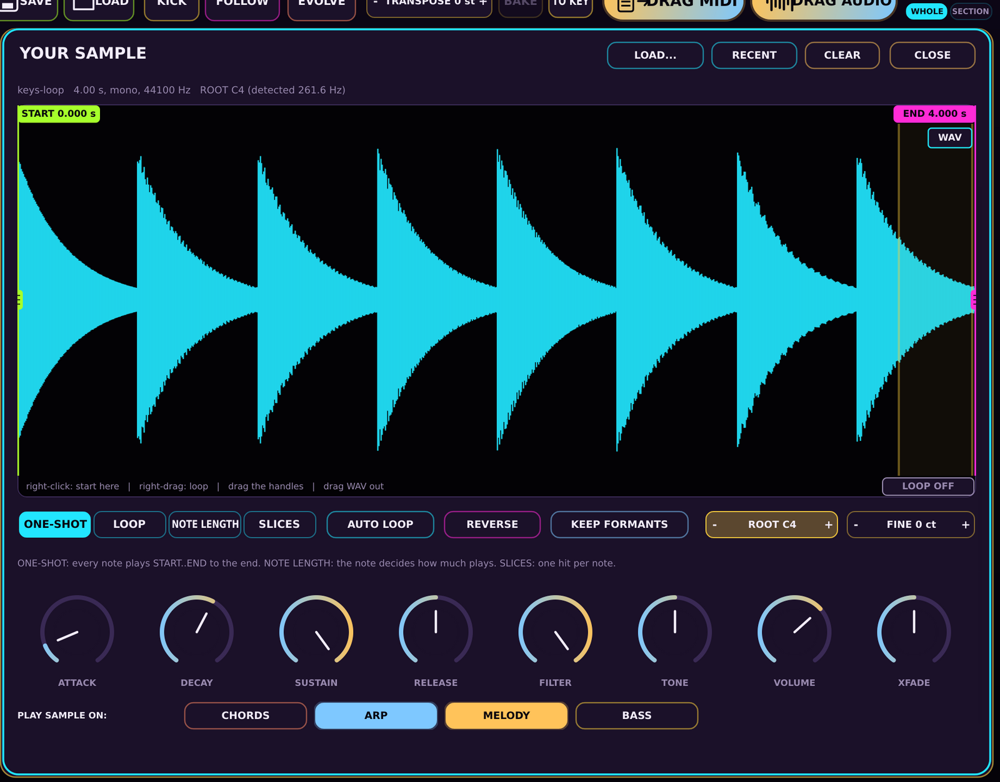

### 14.1 Loading

- **LOAD...** picks a file: WAV, AIFF, FLAC, OGG or MP3 (MP3 works on every computer). Or drop a file on the panel or the sound card.
- Up to 60 seconds are used; a longer file gives "Long file: the first 60 s are used."
- **RECENT** lists your last 8 samples. **CLEAR** removes the sample, and the lanes go back to their own sounds. **CLOSE** hides the panel.
- The line under the title shows the file, its length and its detected pitch ("ROOT C4 (detected 261.6 Hz)").
- When no lane plays your sample yet, loading one sets it up for you: the shared sound when LINK ALL is on, otherwise the selected lane.

### 14.2 The waveform

- Drag the **START** and **END** handles to choose the part that plays.
- Click to hear it at the ROOT pitch. Right-click to set START there.
- Right-drag makes a loop; the **LOOP ON / LOOP OFF** pill (or a double-click on the loop) turns it on and off.
- The **WAV** grip drags the region (or the loop) out as a WAV file. Full version only.

### 14.3 Modes and controls

| Control | Choices and defaults | What it does |
|---|---|---|
| Mode | **ONE-SHOT**, **LOOP**, **NOTE LENGTH**, **SLICES** | ONE-SHOT: every note plays START to END (a vocal phrase rings out). LOOP: holds inside the loop points, crossfaded. NOTE LENGTH: the note's length decides how much plays. SLICES: the sample is chopped at its hits, one slice per note. |
| **AUTO LOOP** | | Finds a seamless loop between START and END, and switches to LOOP. |
| **REVERSE** | off | Plays the region backwards. |
| **KEEP FORMANTS** | off | Changes pitch without the chipmunk or giant effect: a voice stays a voice. |
| **ROOT** | a note name | The note at which the sample plays at its own pitch. Detected on load (C4 if no clear pitch is found). |
| **FINE** | -100 to +100 cents | Fine tuning. |
| **ATTACK** | 0.0005 to 2 s, default 0.003 | How fast a note fades in. |
| **DECAY** | 0.01 to 4 s, default 0.5 | How fast it falls to the sustain level. |
| **SUSTAIN** | 0 to 1, default 1 | The level while the note is held. |
| **RELEASE** | 0.005 to 4 s, default 0.25 | How long it rings after the note ends. |
| **FILTER** | 0 to 1, default 1 | A low-pass filter: lower is darker. |
| **TONE** | -1 to +1, default 0 | Darker to brighter. |
| **VOLUME** | -24 to +12 dB, default 0 | The sample's level. |
| **XFADE** | 0.002 to 0.25 s, default 0.03 | The crossfade at the loop point. |
| **PLAY SAMPLE ON** | **CHORDS**, **ARP**, **MELODY**, **BASS** | Lit: that lane plays your sample. Off: the lane's own sound. Clicking these turns LINK ALL off. |

**In NOTE LENGTH mode** a second row appears:

- **TRIM** / **STRETCH**: TRIM plays at the key's pitch and stops where the note ends. STRETCH time-stretches START to END to fill each note exactly; the pitch still follows the key.
- **HOLD IN LOOP**: a note longer than START to END keeps playing inside the loop points (otherwise it stops at END).
- **END FADE**: 1 to 500 ms (default 20 ms). How fast a note fades when it ends.

**In SLICES mode** the second row has:

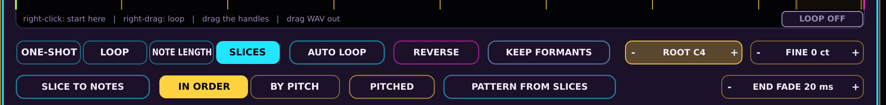

- **SLICE TO NOTES**: chop START to END at its hits. Click again to re-slice; right-click for finer slices. Switching to SLICES slices by itself if needed.
- **IN ORDER** / **BY PITCH**: IN ORDER (the default) plays slice 1 on the 1st note, slice 2 on the 2nd, and so on. BY PITCH: the note's distance from ROOT picks the slice (C = 1, C# = 2, ...).
- **PITCHED**: off by default, so every slice plays at its own pitch, like a chopped break. On: slices follow the notes' pitch.
- **PATTERN FROM SLICES**: writes the open lane's notes on the slices' own rhythm (one undo step). With CHORDS open, it writes the MELODY lane.
- **END FADE**: as above.

> **Try this:** Load a drum break, choose SLICES, open the MELODY lane and press PATTERN FROM SLICES. Then use VARY and NEW RHYTHM to remix the break.

---

## 15. HOOK LAB

HOOK LAB writes 16 melodies (hooks) over your chords at once, so you can audition many ideas fast and pick the best one. Press **HOOK LAB** at the top right of the lane area to open it. **CLOSE** or Esc closes it. The first time it opens, it fills its 16 tiles straight away.

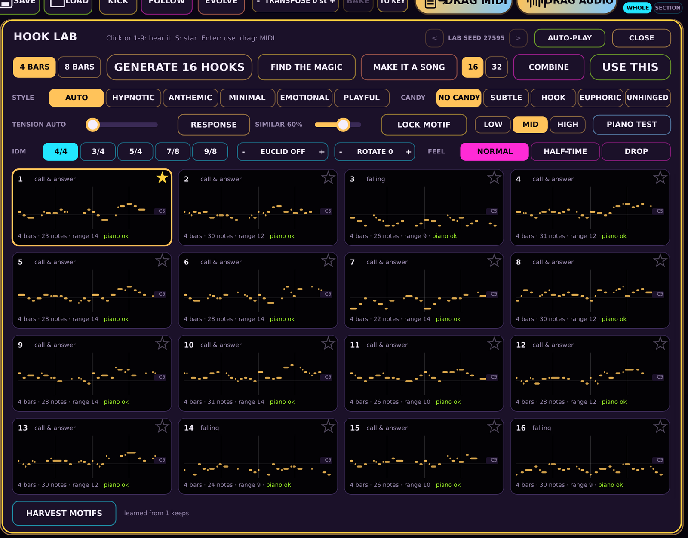

### 15.1 Working with tiles

- **Click a tile** to hear it from bar 1; click again to stop. Or press the keys 1 to 9 (and 0 for tile 10).
- **The star** keeps a tile when you generate again. Press S to star or unstar.
- **USE THIS** (or Enter) puts the selected hook into the MELODY lane and unmutes it. UNDO brings the old melody back.
- **Right-click a tile** for: Use this (MELODY lane), Find the magic, Make it a song (16 bars), Make it a song (32 bars), Star or Unstar.
- **Drag a tile out** to get its MIDI (full version only).

Each tile shows its number, a short description of its character (for example "call & answer", "falling", "rising", "riff"), the star, the notes, and a footer like "4 bars · 28 notes · range 12 · piano ok".

If you change the chords while the lab has hooks, starred tiles are refitted to the new chords and tagged **KEPT**, and the rest are cleared: "Chords changed: starred tiles were refit (KEPT), the rest cleared. GENERATE for new hooks".

### 15.2 The controls

| Control | Choices | What it does |
|---|---|---|
| **<** / **>** and LAB SEED | | The previous or next grid of hooks. |
| **AUTO-PLAY** | off | After one pass of a tile, the next one plays. |
| **4 BARS** / **8 BARS** | 4 BARS | Hook length. Used at the next GENERATE 16 HOOKS. |
| **GENERATE 16 HOOKS** | | 16 new hooks over the current chords. Starred tiles stay. A progress bar and **CANCEL** show while it works. |
| **FIND THE MAGIC** | | Variations of the selected hook that keep what makes it work (its motif rhythm, intervals, peak and shape) and change the rest. Tile 1 is your hook; each tile says how much is new. |
| **MAKE IT A SONG** with **16** / **32** | | Grows the selected hook into a 16 or 32 bar melody (A A' B A''), in the hook's register. The other lanes are looped to the new length, with your edits kept. |
| **COMBINE** | | Click three tiles: the RHYTHM comes from the first, the OPENING from the second, the ENDING from the third. The result goes into a tile without a star. |
| **USE THIS** | | Puts the selected hook into the MELODY lane. |
| STYLE | AUTO, HYPNOTIC, ANTHEMIC, MINIMAL, EMOTIONAL, PLAYFUL (plus the TRAP or HIP HOP styles) | As the melody style (chapter 8.3). |
| CANDY | NO CANDY, SUBTLE, HOOK, EUPHORIC, UNHINGED | As ear candy. |
| **TENSION** | AUTO, 0 to 100 % | As in the melody controls. |
| **RESPONSE** and **SIMILAR** | 0 to 100 %, starts at 60 % | Writes a response into the MELODY lane, as in the melody controls. |
| **LOCK MOTIF** | | As in the melody controls. |
| **LOW** / **MID** / **HIGH** | MID | Where the hooks sit. LOW: a counter-line under the arp. MID: the lead (G4 to F#5). HIGH: a top line. |
| **PIANO TEST** | off | Plays the tiles as a plain piano over the chords: flat velocity, no glides, no effects, no arp or bass. A real hook still works like this; each tile shows "piano ok" or "piano weak". |
| IDM meter | **4/4**, **3/4**, **5/4**, **7/8**, **9/8** | The hook repeats every 3/4, 5/4, 7/8 or 9/8 cycle against the 4/4 bars, so it shifts over the chords. Accents follow the meter's groups (7/8 = 2+2+3). |
| **EUCLID** | OFF, then hits per cycle | The hook's rhythm becomes this many hits spread evenly over the cycle (shown as "5/16"). OFF: the hook's own rhythm. |
| **ROTATE** | 0 up to steps minus 1 | Shifts the EUCLID rhythm by sixteenths. Only works while EUCLID is on. |
| FEEL | **NORMAL**, **HALF-TIME**, **DROP** | HALF-TIME: the hook at half speed. DROP: on a 3-3-2 kick grid, sparser, with wider leaps, a register lower. |
| **HARVEST MOTIFS** | | Shows up to four chips: the best short fragments of your arp and melody, each with a score. Click one to keep and lock it as the motif. |

Changing STYLE, CANDY, TENSION, the register, the meter, EUCLID, ROTATE or FEEL rewrites the unstarred tiles at once. A meter other than 4/4, EUCLID, or a FEEL other than NORMAL turns CANDY off.

The lab learns from what you keep ("learned from N keeps") and ranks the harvested fragments the way you like.

### 15.3 HOOK LAB keys

| Key | What it does |
|---|---|
| Arrow keys | Move the selection (left and right by one tile, up and down by a row). |
| Space | Play or stop the selected tile. |
| 1 to 9, 0 | Play tile 1 to 9, and tile 10. |
| S | Star or unstar. |
| M | FIND THE MAGIC. |
| P | PIANO TEST on or off. |
| A | AUTO-PLAY on or off. |
| Enter | USE THIS. |
| Esc | Close the lab. |

With no tile selected, Enter, S and M work on tile 1.

---

## 15A. MUTANT ARP

MUTANT ARP is a second engine for the ARP lane: a *melodic sequence generator* for the fast, futuristic, video-game-like synth lines of
modern rage, futuristic trap and hypertrap. It is not an up/down arpeggiator. It writes a short **cell** (8 to 32 steps) from musical
rules: chord tones across two or three octaves, octave jumps that turn back, a pedal note or a high "ping", neighbour and passing notes
that resolve, repeated fragments, a 3-3-2 style accent pattern, ratchets and 1/64 bursts; then it plays the cell over your chords
(CHORD FOLLOW) with a **variation every 2 or 4 bars**, and can **EVOLVE** it over 4, 8 or 16 bars. The result is an ordinary ARP lane:
the roll, the tools, the drag pills and the MIDI out all see plain notes.

Press **MUTANT ARP** (top right of the lane editor, next to HOOK LAB). The first press switches the ARP lane to the mutant engine.

**Modes** (each has its own rules and knob defaults):

| Mode | What it writes |
|---|---|
| RAGE | Fast, aggressive, octave-jumping sequences; a high ping every few steps; 1/32 retriggers |
| ALIEN | Unusual intervals, chromatic approach notes that resolve by a semitone (turn SCALE LOCK off to allow them), a longer cell |
| DIGITAL | Video-game plucks: a low pedal alternating with the line, short / long gates, glitch fills |
| DREAM | Floating, sparse, overlapping lines with glides and space |
| HYPER | Bright sugar-rush chaos: dense 16ths with 32nd stutters, accents on a club-kick grid (4-4-3-3-2), whiplash octave pops, the variation bar climbs an octave |
| CYBERPOP | Futuristic pop hooks drawn from a **style table learned from MIDI packs**: bright, catchy lines with the packs' rhythm grid, note lengths, interval mix, octave lifts, accent curve, ratchet spots and bar-to-bar repeats (A A'). The table holds aggregate statistics only (no phrases); see below |

**Buttons**: GENERATE (a new cell, locked steps kept; `G`), MUTATE (a variation: a few unlocked steps change; `M`), OCTAVE CHAOS (only the
register moves; `O`), RHYTHM CHAOS (only rests, holds, ratchets and fills change; `R`), LOCK FIRST 4 (`L`), LOCK SELECTED (the ARP notes you
selected in the roll), UNLOCK ALL, CLASSIC ARP (back to the figure engine; UNDO brings the mutant back), SEED < >, DRAG MIDI.

**Rows**: RATE 1/4 .. 1/64 · LENGTH AUTO / 8 / 12 / 16 / 24 / 32 steps (12 and 24 drift against the bar and re-sync at every variation) ·
READ FORWARD / REVERSE / PING-PONG · ROTATE · EVOLVE OFF / 4 / 8 / 16 bars · VARY AUTO / 1 / 2 / 4 bars · 2 LINES · CHORD FOLLOW · SCALE LOCK.

**The ten knobs**: NOTE DENSITY, OCTAVE JUMP, INTERVAL CHAOS, RETRIGGER, STEP SKIP, VELOCITY RANDOM, GATE, SWING, PATTERN EVOLVE, GLIDE.
The first five shape how the cell is generated (the same seed with another value gives a related cell), the last five shape how it is played.

**LOCK NOTES**: click any step in the CELL strip to lock it (gold). Locked steps are kept exactly through GENERATE, MUTATE, OCTAVE / RHYTHM
CHAOS and EVOLVE, so the opening of a line stays recognisable while the rest gets crazier.

**2 LINES** writes a second line into the MELODY lane: ANSWER (call and response: the first line plays the first half of every variation
period, the second answers in the other half an octave away, mirrored every other time), INTERLOCK (a hocket: its own cell, a register
lower, only where the first line rests) or SHADOW (a canon: the first line again, a few steps late, an octave away). B BELOW / B ABOVE
puts the second line under or over the first. Both lines keep their own sound and drag out together with DRAG MIDI (2 LINES).

**CYBERPOP and the learned table.** CYBERPOP (3.2.1) replaces the FLUTE mode's button (the trap flute now lives in the TRAP mood's own
melody, chapter 4.2). Its rules are not hand-written: `tools/learn_pack.py <folder of .mid files>` reads MIDI packs and writes
`CyberpopData.inc`, a small table of **low-order statistics**: the probability of an onset at each 1/16 of the bar, notes per bar, the
note-length shares, the distribution of moves between notes (−12 to +12 semitones), leap / octave / repeat shares and the post-leap
reversal rate, the pitch-class weights relative to the key, the tonic-triad share on strong and weak steps, the velocity curve by position,
where ratchets fall, the repeat period (1 / 2 / 4 bars), how often a bar repeats an earlier bar and how many notes change when it does, the
median range and register. The generator draws a new cell from those numbers every time; nothing from the packs is stored as notes,
phrases or n-grams, and no file, track or artist name is kept. The shipped table (3.2.2) was learned from the first pack set: four melodic
tracks from two free public packs (an organ lead, a chord pad's top line and two fan transcriptions; drums and 808s left out), which is why CYBERPOP
writes on a straight 8th grid at about five notes a bar, mostly 1/8s with a few half notes, in a one-octave band, with a leap in one move of
five and the second bar answering the first. A hook keeps its pitches over the chord loop; CHORD FOLLOW only nudges a note on a beat onto
the current chord when a chord tone sits within a tone. MUTATE changes about as many notes as the packs change when a bar repeats, in the
same vocabulary (a move redrawn, a note moved along the grid or re-lengthened). Two rules keep it from echoing the packs: the move
distribution is smoothed with a generic one (small moves more likely than big ones) before it is drawn, and a "zigzag stair" (four notes
on an even pulse going up, down, up while the line steps one way, the stock pop-hook figure) is broken on its fourth note. After every
table update run the no-copy check: `ArpEZatorTests --dump-mid <dir> [--seed-base N]` then
`tools/midi_ngram_check.py --ref <packs> --gen <dir>` (no 4-note sequence of a pack's melody may come back).
The knobs still apply: NOTE DENSITY scales the onset grid around the packs' own density, INTERVAL CHAOS flattens the move distribution toward
wilder moves, OCTAVE JUMP scales the octave bins and the register span, RETRIGGER the ratchets, VELOCITY RANDOM widens the curve.

**Older sessions with FLUTE** (3.2.0) open and play exactly as saved: no mode button is lit and the mode line says so; GENERATE keeps writing
FLUTE cells for that session, and picking any mode button moves it on.

Everything is deterministic: the same seed and settings always give the same notes. Older projects open exactly as before.

## 16. LISTEN

LISTEN hears a song and writes a **new** idea in its tempo, key and chords. Use it to write parts that fit a track you already have. Both buttons are in MORE (chapter 17).

**From a file.** Press **LISTEN TO A FILE** and pick a song (WAV, AIFF, FLAC, OGG or MP3; M4A where your computer can read it). Or drop the file anywhere on the window except the sound card and the sample panel. Files longer than 75 seconds are read from their middle. Files shorter than 3 seconds are too short.

**From your DAW (sidechain).** Send audio to ArpEZator's extra input, called **Sidechain (LISTEN)**, then press **LISTEN (sidechain)** and play the song. It listens for about 12 seconds and then works by itself; press **STOP LISTENING** to finish earlier. It needs at least 4 seconds ("Only 3 s heard. Let it listen for at least 4 s.").

While it works you see "Working out tempo, key and chords...", then a result such as "Heard 124 BPM, A minor. New idea written from scratch."

If the music is too quiet: "That was too quiet. Turn the music up, then LISTEN again." (sidechain) or "Couldn't analyse that (too quiet)." (file).

---

## 17. The MORE panel

MORE holds the deeper settings: the generator's words and dials, the chord loop length, the key and scale, per-lane moods and effects, LISTEN, and the MIDI options. Press **MORE** in the header to open it; press **CLOSE** (or MORE again) to hide it. The plugin version is shown in the bottom corner.

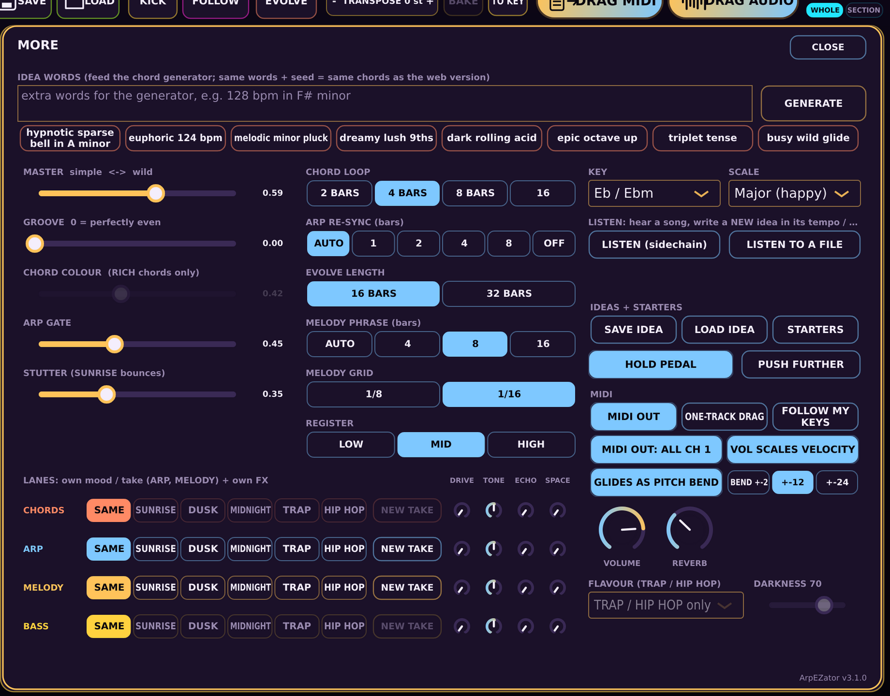

### 17.1 IDEA WORDS

Type a few words to steer the chord generator, for example "128 bpm in F# minor", then press Return or the panel's **GENERATE**. Or click an example chip: it fills the box and generates at once. The chips are: "hypnotic sparse bell in A minor", "euphoric 124 bpm", "melodic minor pluck", "dreamy lush 9ths", "dark rolling acid", "epic octave up", "triplet tense", "busy wild glide". Words write a whole new idea.

### 17.2 The generator dials (left column)

| Control | Range and default | What it does |
|---|---|---|
| **MASTER simple <-> wild** | 0 to 1, default 0.5 | How wild the generators get. Rewrites ARP and MELODY when you let go. |
| **GROOVE 0 = perfectly even** | 0 to 1, default 0 | Swing. Moves each lane's offbeat steps later (up to a third of a step) and adds a little velocity variation. Also in the MIDI. |
| **CHORD COLOUR** | 0 to 1, default 0.4 | Plain to lush. RICH chords only (dimmed in SIMPLE). Rebuilds the chords. |
| **ARP GATE** | 0.1 to 1, default 0.45 | The note length of the arp. |
| **STUTTER (SUNRISE bounces)** | 0 to 1 | Bouncing repeats in the melody. Same value as the MELODY lane slider. |

### 17.3 Lengths and register (middle column)

| Control | Choices and default | What it does |
|---|---|---|
| **CHORD LOOP** | 2 BARS, 4 BARS, 8 BARS, 16 | How many bars the chord loop lasts. Rebuilds the chords and rewrites the other lanes (locks are not kept). |
| **ARP RE-SYNC (bars)** | AUTO, 1, 2, 4, 8, OFF | How often the arp figure starts again with the chords. |
| **EVOLVE LENGTH** | 16 BARS, 32 BARS; 16 | The length of an EVOLVE take. |
| **MELODY PHRASE (bars)** | AUTO, 4, 8, 16; AUTO | The melody's phrase length. Rebuilds the chords and all lanes. |
| **MELODY GRID** | 1/8, 1/16; 1/16 | The melody's step size. |
| **REGISTER** | LOW, MID, HIGH; MID | Where the arp and melody sit. |

### 17.4 LANES: own mood, new take, own effects

Under the dials is one row per lane:

- **LANE MOOD** (SAME, SUNRISE, DUSK, MIDNIGHT, TRAP, HIP HOP): the ARP and MELODY can each compose in their own mood. SAME follows the idea's mood. CHORDS and BASS always follow the harmony, so their buttons are greyed.
- **NEW TAKE**: a new variation of just that lane (ARP and MELODY). UNDO goes back.
- Four small knobs: **DRIVE** (warm saturation on this lane only), **TONE** (left darker, right thinner, centre off), **ECHO** (send to the dotted 1/8 delay) and **SPACE** (send to the reverb). Double-click a knob to switch it off.

### 17.5 Key, LISTEN, ideas and MIDI (right column)

| Control | Default | What it does |
|---|---|---|
| **KEY** | | The key, shown as pairs like "Eb / Ebm". The notes move by the smallest step. |
| **SCALE** | | The scale, each with its feel, for example "Major (happy)". Rebuilds the chords and fits the lanes. |
| **LISTEN (sidechain)**, **LISTEN TO A FILE** | | Chapter 16. |
| **SAVE IDEA**, **LOAD IDEA**, **STARTERS** | | Save or open ideas; STARTERS is a menu of ready-made ideas (chapter 22). |
| **HOLD PEDAL** | on | Keeps the arp's pedal note (a step that stays on one note) in the figure. |
| **PUSH FURTHER** | off | Chapter 4.5. |
| **MIDI OUT** | on | The live MIDI out on or off. |
| **ONE-TRACK DRAG** | off | Dragged MIDI files hold one track instead of one per lane. |
| **FOLLOW MY KEYS** | off | Same as FOLLOW in the transport row. |
| **MIDI OUT: ALL CH 1** | on | On: every lane on MIDI channel 1. Off: ARP on 1, MELODY on 2, CHORDS on 3, BASS on 4. |
| **VOL SCALES VELOCITY** | on | The lane VOL faders also scale the MIDI velocity. |
| **GLIDES AS PITCH BEND** | on | MELODY and BASS glides are also written as pitch bend, with overlapping notes for synths that slide on legato. |
| **BEND +-2**, **+-12**, **+-24** | +-12 | The pitch-bend range the glides are written for. Set the same range on your synth. |
| **VOLUME**, **REVERB** | 80 %, 30 % | The preview sound's master volume and reverb. |
| **FLAVOUR (TRAP / HIP HOP)** | AUTO | TRAP and HIP HOP only (shows "TRAP / HIP HOP only" otherwise). AUTO shows which flavour it picked. Choosing one writes a new idea (chapter 4). |
| **DARKNESS** | 70 / 40 | TRAP and HIP HOP only. Chapter 4.4. |

---

## 18. EVOLVE and the ENERGY strip

EVOLVE turns a short loop into a long take that keeps changing a little, so it does not sound like a copy-paste. The changes are written into the idea, so you can drag the whole take out.

- The **EVOLVE** button in the transport row turns it on or off. It rewrites every lane, including lanes you edited by hand: "EVOLVE: one small change every 2-4 bars, baked into a long take (drag it out)".
- The **EVOLVE** shape switch in the MELODY controls chooses how it changes. It leaves lanes you edited by hand alone, and the message says so.
- The take is 16 or 32 bars long (EVOLVE LENGTH in MORE).

| Shape | What it does |
|---|---|
| **OFF** | No evolving. |
| **SUBTLE** | One small change every 2 to 4 bars. |
| **GROW** | More and more change as it goes. |
| **WAVE** | It breathes: builds and relaxes. |
| **JOURNEY** | It travels away and comes home. |

With GROW, WAVE and JOURNEY the strongest motif stays.

### 18.1 The ENERGY strip

With the shape on GROW, WAVE or JOURNEY, open the ARP lane: a strip under the roll shows the arp's energy, one value per bar ("ENERGY JOURNEY (drag to draw)"). Drag to draw your own curve. Double-click the strip to go back to the shape's curve.

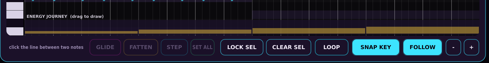

The energy moves the arp's level, brightness and space. It is also sent as MIDI controllers on the arp's channel (CC74 for brightness, CC11 for expression), so your own synth can follow it. It is written into MIX and single-lane MIDI files too.

> **Note:** The shape switch is on the MELODY controls and the ENERGY strip is under the ARP roll. Set the shape with MELODY open, then open ARP to draw.

---

## 19. Tempo, SYNC and playback

ArpEZator can follow your DAW or run by itself. The SYNC button decides.

**SYNC: DAW** (the default). The DAW's play button, tempo and position drive ArpEZator. The PLAY button is hidden, the tempo box shows "NNN DAW" and cannot be edited, and TAP is off. With a DAW present, the space bar belongs to the DAW.

**SYNC: OWN.** ArpEZator runs by itself with its own tempo (type it in the tempo box, from 20 to 400 BPM, or use TAP), its own PLAY / STOP and the space bar (it plays from the PLAY cursor). The DAW's transport is ignored. Switching SYNC stops every sounding note.

**No DAW** (the Standalone app). The tempo box takes 40 to 240 BPM.

**Drags always use the DAW's tempo when there is one**, whatever the SYNC mode. Without a DAW they use the idea's tempo.

**Short DAW loops.** If your DAW keeps looping a pattern that is shorter than the idea, only the start of the idea plays. ArpEZator tells you once ("Your DAW keeps looping a n-bar pattern, so only the start of the idea plays...") and suggests making the DAW pattern as long as the idea or switching SYNC to OWN.

---

## 20. ArpEZator in FL Studio

This chapter collects the FL Studio steps in one place. The ArpEZator side is exact; FL Studio's own menus can differ a little between versions.

### 20.1 Load it

1. After installing, rescan: **Options > Manage plugins**, then **Find installed plugins**.
2. In the Channel rack, click **+** and choose **ArpEZator**. It is an instrument (a generator), not an effect.

### 20.2 Play it with FL's transport

ArpEZator starts in **SYNC: DAW**, so FL's play button starts it and FL's tempo is used.

In FL's **pattern mode**, FL loops the pattern. An empty pattern is short, so you would only hear the first bar or so of the idea. Make the pattern as long as the idea, for example by drawing one note in ArpEZator's channel piano roll that lasts as long as the idea (the lane area shows the length, for example "BARS 1-4 OF 8"). Or play in **song mode**, or switch ArpEZator to **SYNC: OWN** while you write.

> **Tip:** With the play mode set to **ON NOTES** (header), ArpEZator plays only while a note is held. Draw one long note where you want the idea to play, and mute the channel to stop it.

### 20.3 Keep the notes: drag the MIDI

1. Choose **MIX** (one file, one track per lane) or **STEMS** (one file per lane).
2. Drag **DRAG MIDI** into the playlist or onto a piano roll. Or drag one lane's **DRAG** button.
3. To take only a loop, make a loop section, set **SECTION**, then drag.

FL Studio keeps only notes and velocity when you drop a MIDI file onto a piano roll. Pitch bends and controllers (glides, FATTEN, ENERGY) arrive when you import the file with **File > Import > MIDI file**. FL's own slide notes cannot be written in a MIDI file; for the exact slide sound, use **DRAG AUDIO**.

### 20.4 Drive another synth live

ArpEZator sends MIDI while it plays, so another synth can play the idea as you edit it.

1. In ArpEZator, switch **SOUND** off on the sound card if you only want to hear the other synth.
2. In MORE, leave **MIDI OUT** on. Keep **MIDI OUT: ALL CH 1** on for one synth, or switch it off to split the lanes: ARP on channel 1, MELODY 2, CHORDS 3, BASS 4.
3. Open ArpEZator's plugin wrapper settings in FL (the gear icon at the top of the plugin window) and set its MIDI **Output port** to a number, for example 1.
4. Load your synth. In its wrapper settings, set the MIDI **Input port** to the same number.
5. If your synth listens on one MIDI channel only, set it to the channel from step 2.
6. Press play in FL. The synth plays what ArpEZator generates.

**What goes out:**

- The notes of every PLAYING lane, with velocity (scaled by the lane VOL faders when VOL SCALES VELOCITY is on). Muted lanes send nothing. TRANSPOSE is applied.
- MELODY and BASS glides as pitch bend (when GLIDES AS PITCH BEND is on, in the BEND range you set; the bend range message RPN 0 is sent too).
- FATTEN as CC11 swells (on ARP, MELODY and BASS).
- On the ARP channel, with EVOLVE in GROW, WAVE or JOURNEY: CC74 and CC11 following the ENERGY curve.
- Never the KICK, never the preview sound, and never the notes you play in.

> **Warning:** With ALL CH 1 on, the pitch bend of a MELODY or BASS glide also bends the other lanes on the same synth. Split the channels (ALL CH 1 off) when you use glides.

In the demo, no new notes start during the same 2 seconds every 20 seconds as the audio drop-out (note-offs still go out, so nothing hangs).

---

## 21. Drag-out: MIDI and audio

Drag-out puts the idea into your DAW. You can drag MIDI (notes you can edit and re-sound) or audio (a WAV of the preview sound). Drag-out is part of the full version.

| Control | What it does |
|---|---|
| **DRAG MIDI** | Drags MIDI. MIX: one file with a track per lane. STEMS: one file per lane. |
| **DRAG AUDIO** | Drags a 24-bit WAV of the preview sound. It is rendered first: the button shows "RENDERING n%", then "AUDIO READY: DRAG". A click starts the render early; then drag. If you keep holding the mouse until the render ends, the drag starts by itself. |
| **MIX** / **STEMS** | One file with everything, or one file per lane (all the same length). STEMS leave out muted and empty lanes. Audio STEMS add the kick as its own file when KICK is on. |
| **WHOLE** / **SECTION** | The whole idea, or only the loop section (starting at 0). SECTION needs a loop section. |
| Lane **DRAG** buttons | One lane as MIDI. Hold Alt to drag it as audio. A plain click saves a copy of the file and tells you where. |
| Loop section **MIDI** / **WAV** grips | Just the looped part. |
| **ONE-TRACK DRAG** (MORE) | One track instead of one per lane. |

**About the MIDI files**

- They carry the tempo (your DAW's tempo when there is one) and a 4/4 time signature, and always use MIDI channel 1.
- TRANSPOSE is applied to the notes.
- A MIX file and a single-lane file include MELODY and BASS glides as pitch bend (when GLIDES AS PITCH BEND is on), FATTEN as CC11, and the ARP's ENERGY curve. STEMS and ONE-TRACK files hold notes only.
- A MIX file and the lane DRAG files include muted lanes. STEMS leave them out.
- Names look like "ArpEZator Am 124bpm all.mid". The key in the name is the idea's own key, before TRANSPOSE. Nothing is overwritten: a taken name gets a number.

**About the audio files.** 24-bit WAV, normalised to about -6 dBFS (stems share one gain, so their balance stays). The MIX WAV includes the kick when KICK is on; a single-lane WAV does not.

Copies are saved in your Documents folder (Reference E).

---

## 22. SAVE, LOAD and STARTERS

Save your ideas to use them in any project, and start from ready-made ideas.

**SAVE** (or Cmd/Ctrl + S) opens a card with a name box and **SAVE** / **CANCEL**. The name starts as something like "sunrise idea 540". Return saves; Esc cancels. The idea (lanes, chords, sound) is saved as an .arpz file in your Documents folder. It never overwrites: a taken name gets "(2)" and a message says it was saved as a new copy. Only letters, digits, spaces, # and - are kept in the file name.

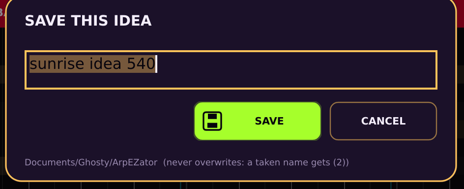{: .medium}

**LOAD** opens "LOAD AN IDEA (click = hear it, LOAD = keep it, CANCEL = back)": your saved ideas first, then the starters, with a search box.

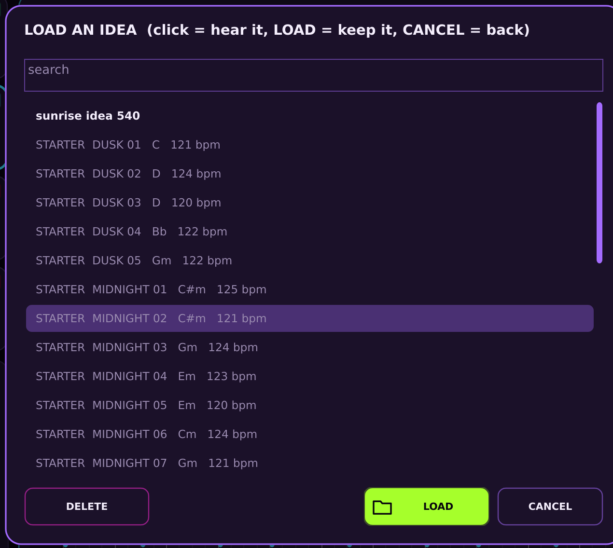{: .medium}

- Click an idea to hear it at once.
- **LOAD** keeps it. A double-click loads and closes.
- **CANCEL** (or Esc in the search box) puts everything back as it was. Clicking outside the card closes it and keeps the idea you were hearing.
- **DELETE** moves one of your own ideas to the trash, after a second click on **SURE? DELETE**. Starters cannot be deleted.

You can also drop an .arpz file anywhere on the window to load it.

**STARTERS** are 29 ready-made ideas: 12 SUNRISE, 5 DUSK and 12 MIDNIGHT. They appear in the LOAD list ("STARTER MIDNIGHT 01 C#m 125 bpm") and in the STARTERS menu in MORE. Load one, then VARY it, lock what you like, and drag it out.

SAVE, LOAD and STARTERS all work in the demo.

---

## 23. The four looks and the professor

ArpEZator has four looks: **BLACK** (the default), **PURPLE**, **LIGHT** and **GHOST** (liquid glass on a light base). The look button in the header shows the **next** look: it reads PURPLE while you are on BLACK, and after GHOST it goes back to BLACK. The look is saved with your project.

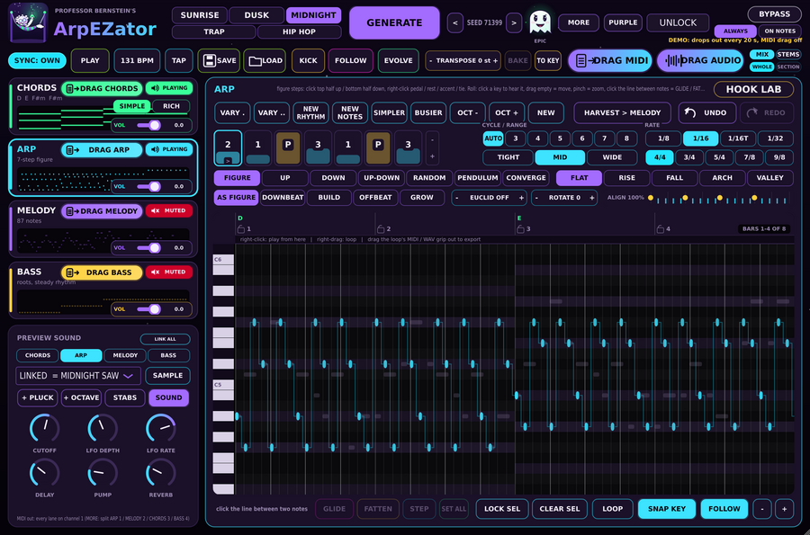{: .half}

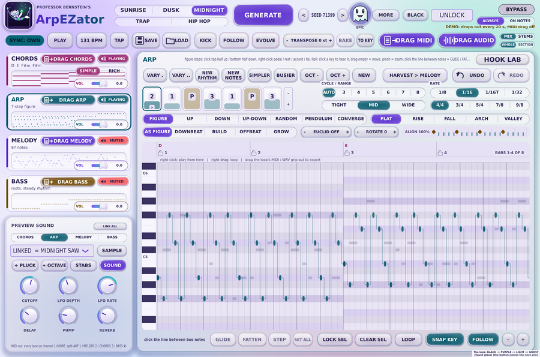{: .half}

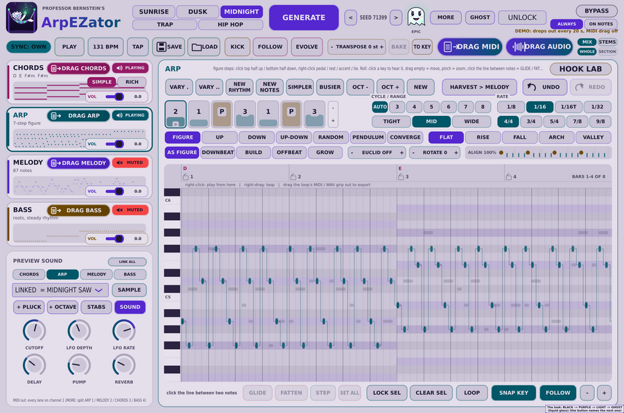{: .half}

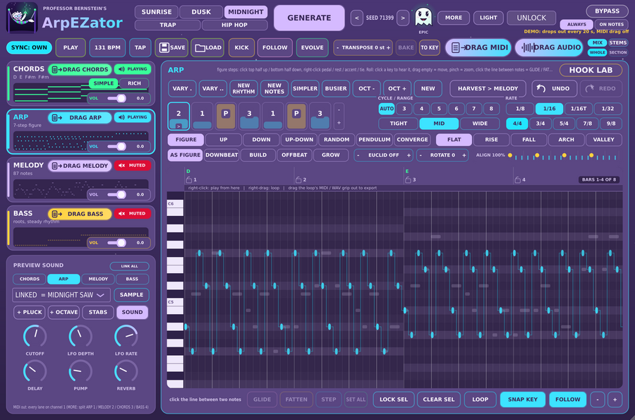{: .half}

The colours also follow the mood: SUNRISE warm gold and sky blue, DUSK orange, pink and violet, MIDNIGHT neon violet, cyan and green, TRAP icy blue, crimson and silver-lilac, HIP HOP dusty amber, teal and plum. Colours crossfade when you change the mood or the look.

**The professor** relaxes in his hammock in the top left corner and changes with the mood: a sunrise glow in SUNRISE, a sunset in DUSK, a starry night in MIDNIGHT. In TRAP he holds a stacked double foam cup with a straw; in HIP HOP, a bottle in a plain paper bag. The props carry no text or logos. The little ghost next to the seed is a different character: its face follows the chords.

{: .half}

{: .half}

---

## 24. Demo and full version

The demo lets you try everything except export.

**In the demo:**

- The sound drops out for 2 seconds every 20 seconds (with short fades). The 20-second clock starts when the plugin loads.
- The live MIDI out starts no new notes in the same 2 seconds. A recorded MIDI track has the same gaps.
- Nothing leaves as MIDI or audio: the DRAG MIDI and DRAG AUDIO buttons (MIX and STEMS), the lane DRAG buttons, Alt-drag, the click-to-save copies, the loop section grips, HOOK LAB tiles and the YOUR SAMPLE WAV grip are all off. When you try, the UNLOCK button blinks and a message says "Drag-out is part of the full version (UNLOCK)". Nothing is written.
- A reopened project starts with the default idea and sound instead of the saved one.
- The header shows the gold line "DEMO: drops out every 20 s, MIDI drag off".

**Everything else works:** generating, editing, the tools, locks, HOOK LAB, LISTEN, YOUR SAMPLE, the preview sound, and SAVE, LOAD and STARTERS for .arpz ideas.

> **Warning:** If you save a DAW project while in the demo, the default idea is what gets stored in it. To keep a demo idea, use **SAVE** (an .arpz file), and LOAD it after unlocking.

**To unlock:**

1. Click **UNLOCK** in the header. A dialog opens.
2. Paste the license key from your purchase receipt email and press **Unlock**. (No key yet? **Buy** opens the store.)
3. The button reads CHECKING... and then LICENSED.

The first unlock needs an internet connection. One key works on up to 5 computers. Once unlocked, a click on LICENSED shows "This copy is unlocked" with a hint of your key. Hover over UNLOCK for the demo rules.

---

## 25. Recipes

Short step-by-step recipes for common jobs.

### 25.1 A trap 808 with slides

1. Click **TRAP**. In MORE, set FLAVOUR to **DARK** or **DRILL** and DARKNESS to 70 or more.
2. Press **GENERATE**. The BASS card names the 808 pattern.
3. Open **BASS**. Click the line between two notes and press **GLIDE**. Drag the pink dot (or the amount slider) to set where the slide starts.
4. For the slide in MIDI: in MORE, keep **GLIDES AS PITCH BEND** on, turn **MIDI OUT: ALL CH 1** off, and set the same bend range (**+-12** by default) on your synth.
5. For the exact slide sound, use **DRAG AUDIO**.

### 25.2 A chord loop you shape yourself

1. Press **GENERATE** and open **CHORDS**.
2. Choose **SIMPLE** or **RICH**, a **VOICING** and a rhythm.
3. Click a chord chip to try its next version.
4. Edit notes in the roll with **SNAP KEY** on to stay in key.
5. Lock the notes you like. A later VOICING change keeps them.
6. Use **OCT +** in OCTAVE to lift the chords without touching the other lanes.

### 25.3 Turn an arp into a melody

1. Open **ARP**. Click bar numbers (Shift for more), or Shift-drag over notes.
2. Press **HARVEST > MELODY**.
3. Open **MELODY** and tidy up. Lock the notes you want to keep, then try **VARY .**.

### 25.4 Find a hook

1. Press **HOOK LAB**. It fills 16 tiles; press **GENERATE 16 HOOKS** for more.
2. Click tiles to hear them. Star the keepers (S).
3. Use **FIND THE MAGIC** on a good one, or **COMBINE** three tiles.
4. **USE THIS** (Enter) puts it in the MELODY lane.
5. **MAKE IT A SONG** grows it to 16 or 32 bars.

### 25.5 Parts for a song you already have

1. In MORE, press **LISTEN TO A FILE**, or drop the song on the window.
2. Wait for the message. A new idea appears in that tempo, key and chords.
3. Use **TO KEY** or **TRANSPOSE** if you want it in another key.

### 25.6 A sample as the lead

1. Press **SAMPLE** on the sound card and drop a vocal or a one-shot on the panel.
2. Choose a mode (ONE-SHOT, LOOP, NOTE LENGTH or SLICES) and check **ROOT**.
3. Under **PLAY SAMPLE ON**, light up **MELODY**.

### 25.7 A long take that keeps moving

1. Click **MIDNIGHT** and press **GENERATE**.
2. Open **MELODY** and set the **EVOLVE** shape to **JOURNEY**.
3. Open **ARP** and draw the ENERGY strip if you want your own curve.
4. In MORE, set EVOLVE LENGTH to **32 BARS**, then drag the MIDI out.

### 25.8 Arrange with your DAW

1. Set the header play mode to **ON NOTES**.
2. In your DAW, draw one long note wherever ArpEZator should play.
3. Mute or move those notes to arrange where the idea plays.

---

## 26. Troubleshooting

**No sound.**
Check that **SOUND** is on, the lane is **PLAYING** and its VOL is up. In SYNC: DAW, press play in your DAW; in SYNC: OWN, press PLAY. With **ON NOTES** set, hold a MIDI note. With **FOLLOW** on, hold a chord. Check **BYPASS**. Some lanes start muted (chapter 4).

**A lane is silent right after GENERATE.**
Some lanes start muted on purpose: SUNRISE ARP and BASS, DUSK BASS, MIDNIGHT MELODY and BASS, HIP HOP ARP. Click its MUTED button. If the MELODY card says "empty: HARVEST from the arp", the melody has no notes: press GENERATE, use HOOK LAB, or HARVEST from the arp.

**The sound or MIDI stops for 2 seconds.**
That is the demo drop-out. Unlock to remove it (chapter 24).

**Drag does nothing and UNLOCK blinks.**
Drag-out needs the full version.

**Only the first bars play in my DAW.**
Your DAW pattern or loop is shorter than the idea. Make it as long as the idea, or switch SYNC to OWN (chapter 20). Also check that a loop section is not on: press L.

**Only a short part plays and a message says "Looping bars...".**
A loop section is on. Press L (or click LOOP) to play everything.

**My other synth gets no MIDI.**
Check **MIDI OUT** in MORE and the routing in your DAW (chapter 20). Check the channels: ALL CH 1, or ARP 1, MELODY 2, CHORDS 3, BASS 4. Muted lanes send nothing, and with VOL SCALES VELOCITY on, a lane turned all the way down sends nothing.

**Glides bend all my parts on the other synth.**
With ALL CH 1 on, every lane shares one channel. Turn MIDI OUT: ALL CH 1 off.

**Pitch bends and slides are missing in FL Studio.**
A MIDI file dropped onto FL's piano roll keeps notes and velocity only. Import it with File > Import > MIDI file, or use DRAG AUDIO. STEMS and ONE-TRACK files have no bends.

**A muted lane is in my MIDI file.**
The MIX file and the lane DRAG files include muted lanes. Use STEMS.

**My chord edits disappeared.**
A rebuild (VOICING, SIMPLE / RICH, chord length, rhythm, a chord version and the others in chapter 11) replaces edited chord notes; GENERATE replaces everything. Lock first. UNDO brings them back.

**VARY changes nothing.**
Everything in the lane may be locked. Use UNLOCK ALL.

**LISTEN hears nothing.**
Send audio into ArpEZator's sidechain input in your DAW and let it listen for at least 4 seconds. Or use LISTEN TO A FILE.

**The tempo box will not change.**
In SYNC: DAW with a DAW present, the tempo comes from the DAW ("NNN DAW"). Switch to SYNC: OWN.

**A dragged file has a different tempo than my project.**
Drags use the DAW's tempo when there is one; without a DAW, the idea's tempo.

**Notes sound out of key.**
Keep SNAP KEY on while editing. Check KEY and SCALE in MORE, and the TRANSPOSE value.

**My project reopened with a different idea.**
In the demo a reopened project starts with the default idea. Unlock, then reopen the project.

**The plugin does not show up in FL Studio.**
Rescan (Options > Manage plugins > Find installed plugins). The VST3 folder is listed in Reference E.

**The Mac says the installer can't be opened.**
Right-click the installer and choose **Open**, then confirm. Or go to System Settings > Privacy & Security and click **Open Anyway**.

**The window is too big or too small.**
Drag its corner: it resizes from 60 % to 200 % and keeps its shape.

---

## 27. Questions and answers

**Is ArpEZator a MIDI effect?**
No. It is an instrument that also sends MIDI. Use it as a sound source, or as a MIDI generator for another synth.

**Do I need the preview sound?**
No. Turn SOUND off and use only the MIDI.

**Does it play the notes I play on my keyboard?**
No. Your notes only set the chord (FOLLOW MY KEYS) or start and stop playback (ON NOTES).

**What is the seed?**
The number behind each idea. Click it to type a number.

**Can the lanes be in different moods?**
ARP and MELODY can, with LANE MOOD in MORE. CHORDS and BASS follow the harmony.

**What is the difference between SIMPLE and RICH?**
SIMPLE gives plain triads in classic loops. RICH gives colourful chords with sevenths, ninths, sus chords and slash basses. CHORD COLOUR works only in RICH.

**Why do some lanes start muted?**
So each mood's first idea is clear. The notes are there; click MUTED to hear them.

**Can I edit the chords note by note?**
Yes (chapter 11).

**Does the KICK go into the MIDI?**
No. It is in audio STEMS and the MIX WAV only.

**How long can an idea be?**
The chord loop is 2, 4, 8 or 16 bars. EVOLVE takes are 16 or 32 bars. MAKE IT A SONG grows a hook to 16 or 32 bars.

**Can I use my own samples?**
Yes: YOUR SAMPLE, up to 60 seconds.

**Are there TRAP or HIP HOP starters?**
No. The 29 starters are SUNRISE, DUSK and MIDNIGHT ideas. In TRAP and HIP HOP, press GENERATE.

**Where are my saved ideas?**
In Documents/Ghosty/ArpEZator. LOAD lists them.

---

## 28. Glossary

- **808:** a deep, booming bass sound (named after a classic drum machine), the low end of trap music.
- **Accent:** a note played a little louder so it stands out.
- **ADSR (ATTACK, DECAY, SUSTAIN, RELEASE):** the shape of a note's volume over time: how fast it starts, how it falls, the level while held, and how long it rings after.
- **ALIGN:** the display that shows whether the arp figure restarts together with the chord changes.
- **Arpeggio (arp):** the notes of a chord played one after another instead of together.
- **BAKE:** write the TRANSPOSE into the notes.
- **Bar:** one measure of music; in 4/4 a bar has four beats.
- **Borrowed chord:** a chord taken from the parallel major or minor key, for colour.
- **BPM:** beats per minute, the tempo.
- **Call and response (RESPONSE):** a phrase answered by a second phrase, like a question and an answer.
- **CC (MIDI controller):** a MIDI message that moves a knob on a synth. CC11 is expression (volume swell), CC74 is often brightness (filter).
- **Chord:** three or more notes played together.
- **Chord loop (progression):** a sequence of chords that repeats, for example C, G, Am, F.
- **Chord tone:** a note that belongs to the current chord.
- **Cutoff:** the point above which a low-pass filter darkens the sound.
- **Dorian, phrygian, mixolydian:** scales (modes) with their own colour. Dorian is a softer minor, phrygian a dark, tense minor, mixolydian a bluesy major.
- **Double time / half-time:** feeling the beat twice as fast, or half as fast, as the tempo.
- **EUCLID (euclidean rhythm):** a rhythm that spreads a number of hits as evenly as possible over a cycle of steps.
- **EVOLVE:** a long take with small changes over time.
- **FATTEN:** a line type that makes the next note louder and fatter.
- **Figure:** the short repeating pattern of the arp (3 to 8 steps).
- **FLAVOUR:** a sub-style of TRAP or HIP HOP.
- **Formant:** the natural resonance that makes a voice sound like a voice; KEEP FORMANTS keeps it when pitching.
- **GLIDE (slide, portamento):** sliding smoothly from one note into the next.
- **Groove / swing:** pushing the offbeat notes a little later for a bouncy, human feel. 50 % swing is straight.
- **Harmonic minor:** a minor scale with a raised seventh note: dramatic and exotic.
- **HARVEST:** copy arp notes into the melody; in HOOK LAB, collect the best short fragments.
- **Hook:** the catchy part of a song you remember.
- **Key:** the home note and scale of a piece, for example A minor.
- **Legato:** notes that connect without a gap.
- **LFO:** a slow, repeating movement that changes a sound over time, here the filter.
- **Lock:** protect notes or bars from the tools.
- **Loop section:** a part of the idea that plays over and over.
- **Low-pass filter:** removes the high frequencies; turning it down makes a sound darker.
- **MIDI:** notes and controls as data, not sound. Any synth can play MIDI.
- **MIDI channel:** one of 16 lanes in a MIDI connection, so one cable can carry several parts.
- **Motif:** a short musical idea that comes back.
- **Octave:** the distance from one note to the next note with the same name, 12 semitones.
- **Pedal note:** a note that stays the same while the harmony moves.
- **Pentatonic:** a five-note scale with no clashing notes; easy and singable.
- **Pitch bend:** a MIDI message that bends the pitch smoothly; used for glides.
- **Polymeter:** a pattern whose length does not fit the bar, so it drifts against the bars and lines up again later.
- **Pump:** a rhythmic ducking of the volume on each beat, typical of dance music.
- **PUSH FURTHER:** each GENERATE moves away from your last ideas.
- **Register:** how high or low a part sits.
- **Root:** the note a chord is named after.
- **Scale:** the set of notes a piece uses.
- **Seed:** the number behind an idea.
- **Semitone (st):** the smallest step on a keyboard, from one key to the next.
- **Seventh, ninth (7th, 9th):** extra notes stacked on a triad for a richer, jazzier chord.
- **Sidechain input:** an extra audio input; LISTEN uses it to hear your song.
- **Slash chord (slash bass):** a chord with another note in the bass, written like C/E.
- **SNAP KEY:** keeps added and dragged notes on the notes of the key and chord.
- **Stab:** a short, punchy chord.
- **STARTERS:** ready-made ideas.
- **Stems:** separate files, one per part.
- **STUTTER:** bouncing repeats in the melody.
- **Sub:** a very low, clean bass.
- **Sus chord:** a chord whose third is replaced by the second or fourth: open, unresolved.
- **Tension:** notes that pull towards a resolution, such as passing notes, suspensions, sevenths and ninths.
- **Transient:** the sharp start of a sound, such as a drum hit. SLICES cuts at transients.
- **TRANSPOSE:** move all notes up or down by semitones.
- **Triad:** a three-note chord.
- **Velocity:** how hard a note is played, which usually sets its loudness.
- **Voicing:** how a chord's notes are arranged: which note is lowest, how spread out they are.

---

## Reference A. Every control, area by area

This chapter lists every control in one place, as a quick lookup. The chapters before explain how to use them.

### A.1 Header

| Control | Values and default | What it does |
|---|---|---|
| SUNRISE, DUSK, MIDNIGHT | | The melodic moods. |
| TRAP, HIP HOP | | The urban moods. |
| GENERATE | | A new idea in the current mood (reads GENERATING... while it works). |
| < SEED > | up to 60 ideas | Back and forward through your ideas; click the seed to type one. |
| Mood ghost | display | Its face and word follow the chords. |
| MORE | | Opens or closes the MORE panel. |
| Look button | BLACK | Names the next look: BLACK, PURPLE, LIGHT, GHOST. |
| UNLOCK / LICENSED | | License entry. Reads CHECKING... while checking. |
| BYPASS | off | Silence and no MIDI. Reads BYPASSED. |
| ALWAYS / ON NOTES | ALWAYS | Play with the transport, or only while a MIDI note is held. |

### A.2 Transport row

| Control | Values and default | What it does |
|---|---|---|
| SYNC: DAW / SYNC: OWN | SYNC: DAW | Follow the DAW, or run by itself. |
| PLAY / STOP | | Own playback. Hidden in SYNC: DAW with a DAW. |
| Tempo box | OWN 20 to 400 BPM; no DAW 40 to 240 | Click to type. Shows "NNN DAW" when the DAW sets it. |
| TAP | | Tap the tempo. |
| SAVE / LOAD | | Ideas (.arpz). |
| KICK | off | A kick on every beat, with a volume fader (-inf to +6 dB). Never in the MIDI. |
| FOLLOW | off | FOLLOW MY KEYS. |
| EVOLVE | off | A long, slowly changing take. |
| TRANSPOSE | 0, -24 to +24 st | Live semitone offset. Wheel, double-click = 0, right-click = type. |
| BAKE | | Write TRANSPOSE into the notes. Greyed at 0. |
| TO KEY | | Move to a key by the smallest step (-5 to +6); choose which lanes follow TRANSPOSE. |
| DRAG MIDI / DRAG AUDIO | | Drag-out. |
| MIX / STEMS | MIX | One file or one per lane. |
| WHOLE / SECTION | WHOLE | Whole idea or loop section. |

### A.3 Lane cards

| Control | Values and default | What it does |
|---|---|---|
| PLAYING / MUTED | depends on the mood | Mute the lane (sound, MIDI out, audio, STEMS). |
| DRAG CHORDS / ARP / MELODY / BASS | | Drag one lane; Alt = audio; click = save a copy. |
| VOL | -inf to +6 dB, 0 dB | Lane level (and MIDI velocity). Double-click = 0 dB. |
| SIMPLE / RICH | | CHORDS only: plain or colourful chords. |

### A.4 Lane controls

| Lane | Control | Choices |
|---|---|---|
| CHORDS | Chord length | 1 BAR, 2 BARS |
| CHORDS | Rhythm | SUSTAIN, OFFBEAT, SYNCOPATED |
| CHORDS | VOICING | SMOOTH, POWER, WIDE, WEB |
| CHORDS | OCTAVE | OCT -, OCT +, -2 to +2 |
| ARP | CYCLE | AUTO, 3 to 8 |
| ARP | RANGE | TIGHT, MID, WIDE |
| ARP | RATE | 1/8, 1/16, 1/16T, 1/32 |
| ARP | Meter | 4/4, 3/4, 5/4, 7/8, 9/8 |
| ARP | Direction | FIGURE, UP, DOWN, UP-DOWN, RANDOM, PENDULUM, CONVERGE |
| ARP | Contour | FLAT, RISE, FALL, ARCH, VALLEY |
| ARP | Accent | AS FIGURE, DOWNBEAT, BUILD, OFFBEAT, GROW |
| ARP | EUCLID / ROTATE | OFF or hits per cycle / 0 to steps minus 1 |
| MELODY | FORM | AAAB, ABAB, ABAC, AAAA |
| MELODY | STAGGER | IN PHASE, +2 BEATS, +1 BAR |
| MELODY | RANGE | TIGHT, MID, WIDE |
| MELODY | STUTTER | 0 to 1 |
| MELODY | Style | AUTO, HYPNOTIC, ANTHEMIC, MINIMAL, EMOTIONAL, PLAYFUL (+ TRAP or HIP HOP styles) |
| MELODY | Ear candy | NO CANDY, SUBTLE, HOOK, EUPHORIC, UNHINGED |
| MELODY | TENSION | AUTO, 0 to 100 % |
| MELODY | RESPONSE / SIMILAR | button / 0 to 100 %, 60 % |
| MELODY | LOCK MOTIF | on / off |
| MELODY | EVOLVE | OFF, SUBTLE, GROW, WAVE, JOURNEY |
| BASS | Rate | 1/8, 1/16, OFFBEAT |

### A.5 Tool buttons

| Lane | Buttons, left to right |
|---|---|
| ARP | VARY . · VARY .. · NEW RHYTHM · NEW NOTES · SIMPLER · BUSIER · OCT - · OCT + · NEW · HARVEST > MELODY · UNDO · REDO |
| MELODY, BASS | VARY . · VARY .. · NEW RHYTHM · NEW NOTES · SIMPLER · BUSIER · OCT - · OCT + · NEW · UNDO · REDO |
| CHORDS (RICH) | VARY . · VARY .. · SIMPLER · RICHER · NEW CHORDS · UNDO · REDO |
| CHORDS (SIMPLE) | VARY . · VARY .. · CALMER · PUNCHIER · NEW CHORDS · UNDO · REDO |

### A.6 Under the roll

| Button | Default | What it does |
|---|---|---|
| GLIDE, FATTEN, STEP, SET ALL | | The selected line (not on CHORDS). |
| Amount slider | | GLIDE: where the slide starts. FATTEN: how much louder. |
| LOCK SEL / UNLOCK SEL | | Lock or unlock the selection. |
| CLEAR SEL | | Clear the selection. |
| LOOP / LOOP ON | off | The loop section. |
| SNAP KEY | on | Keep notes on the key and chord. |
| FOLLOW | on | Follow the playhead. |
| - / + | | Zoom. |

### A.7 PREVIEW SOUND

| Control | Default |
|---|---|
| LINK ALL | on in SUNRISE, DUSK, MIDNIGHT |
| Lane tabs | follow the open lane |
| Sound menu | per mood (chapter 13) |
| + PLUCK, + OCTAVE | off |
| STABS | on in SUNRISE |
| SOUND | on |
| CUTOFF | 60 % |
| LFO DEPTH | 30 % |
| LFO RATE | 2 bars |
| DELAY | 35 % |
| PUMP | 25 % |
| REVERB | 30 % |

### A.8 YOUR SAMPLE

| Control | Range and default |
|---|---|
| Mode | ONE-SHOT, LOOP, NOTE LENGTH, SLICES |
| ROOT | detected on load |
| FINE | -100 to +100 cents, 0 |
| ATTACK | 0.0005 to 2 s, 0.003 |
| DECAY | 0.01 to 4 s, 0.5 |
| SUSTAIN | 0 to 1, 1 |
| RELEASE | 0.005 to 4 s, 0.25 |
| FILTER | 0 to 1, 1 |
| TONE | -1 to +1, 0 |
| VOLUME | -24 to +12 dB, 0 |
| XFADE | 0.002 to 0.25 s, 0.03 |
| END FADE | 1 to 500 ms, 20 ms |
| TRIM / STRETCH, HOLD IN LOOP | NOTE LENGTH mode |
| SLICE TO NOTES, IN ORDER / BY PITCH, PITCHED, PATTERN FROM SLICES | SLICES mode |

### A.9 HOOK LAB

| Control | Choices and default |
|---|---|
| BARS | 4 BARS, 8 BARS; 4 BARS |
| STYLE | AUTO (+ the mood's styles) |
| CANDY | NO CANDY |
| TENSION | AUTO |
| Register | LOW, MID, HIGH; MID |
| IDM meter | 4/4, 3/4, 5/4, 7/8, 9/8; 4/4 |
| EUCLID / ROTATE | OFF / 0 |
| FEEL | NORMAL, HALF-TIME, DROP; NORMAL |
| AUTO-PLAY, PIANO TEST | off |
| MAKE IT A SONG | 16 or 32 bars |

### A.10 MORE

| Control | Range and default |
|---|---|
| MASTER | 0 to 1, 0.5 |
| GROOVE | 0 to 1, 0 |
| CHORD COLOUR | 0 to 1, 0.4 |
| ARP GATE | 0.1 to 1, 0.45 |
| STUTTER | 0 to 1, per mood |
| CHORD LOOP | 2, 4, 8, 16 bars |
| ARP RE-SYNC | AUTO, 1, 2, 4, 8, OFF; AUTO |
| EVOLVE LENGTH | 16, 32 bars; 16 |
| MELODY PHRASE | AUTO, 4, 8, 16; AUTO |
| MELODY GRID | 1/8, 1/16; 1/16 |
| REGISTER | LOW, MID, HIGH; MID |
| LANE MOOD | SAME, SUNRISE, DUSK, MIDNIGHT, TRAP, HIP HOP; SAME |
| DRIVE, TONE, ECHO, SPACE | off |
| HOLD PEDAL | on |
| PUSH FURTHER | off (always on in TRAP / HIP HOP) |
| MIDI OUT | on |
| ONE-TRACK DRAG | off |
| FOLLOW MY KEYS | off |
| MIDI OUT: ALL CH 1 | on |
| VOL SCALES VELOCITY | on |
| GLIDES AS PITCH BEND | on |
| BEND | +-2, +-12, +-24; +-12 |
| VOLUME | 80 % |
| REVERB | 30 % |
| FLAVOUR | AUTO |
| DARKNESS | 0 to 100; 70 (TRAP), 40 (HIP HOP) |

---

## Reference B. Keyboard and mouse

Keyboard shortcuts work while the mouse is over ArpEZator. They never take over a text box you are typing in. The roll keys need the roll to have focus: click in it first.

| Keys / mouse | What it does |
|---|---|
| Space | Play or stop from the PLAY cursor (SYNC: OWN, or no DAW). With SYNC: DAW and a DAW, Space belongs to the DAW. |
| Home | PLAY cursor to the start (or the loop section's start). |
| L | Loop section on or off (makes one if there is none). |
| Esc | In the roll: clear the loop section. In HOOK LAB: close the lab. |
| Cmd/Ctrl + Z | Undo. With Shift: redo. |
| Ctrl + Y | Redo. |
| Cmd/Ctrl + S | Open the SAVE card. |
| Up / Down (roll) | Selected notes a semitone up or down. With Shift: an octave. |
| Delete / Backspace (roll) | Delete the selected notes (locked notes stay). |
| Click a note | Select and hear it. Shift-click adds or removes. |
| Double-click a note | Delete it. |
| Right-click a note / empty spot | Note menu / roll menu. |
| Shift-drag or Cmd-drag on an empty spot | Selection box. |
| Drag an empty spot, Alt-drag, middle-drag | Move the view. |
| Wheel / Shift + wheel / Cmd or Ctrl + wheel | Scroll pitch / scroll time / zoom. |
| Pinch (trackpad) | Zoom. |
| Right-drag in the timeline strip | Make a loop section. |
| Right-click in the timeline strip | Move the PLAY cursor there. |
| Double-click a knob or slider | Back to its default. |
| Right-click a knob or slider | Type a value. |
| Shift while dragging a slider | Fine control. |
| Alt + drag a lane DRAG button | Drag audio. |
| HOOK LAB: arrows, Space, 1 to 9 and 0, S, M, P, A, Enter, Esc | Chapter 15.3. |

---

## Reference C. Tooltips

This is the text ArpEZator shows when you rest the mouse on a control for a moment. Controls that are not listed here have no tooltip.

### C.1 Header and transport

| Control | Tooltip |
|---|---|
| TRAP / HIP HOP | TRAP: half-time minor motifs, flute, 808 slides and rolls. HIP HOP: swung loops, dusty keys, round sub |
| GENERATE | A new idea in this mood: chords + arp + melody |
| SEED | SEED: click to type a seed (same mood + seed = same idea) |
| Look button | The look: BLACK -> PURPLE -> LIGHT -> GHOST (liquid glass) (the button names the next one) |
| UNLOCK (demo) | Demo mode: the sound drops out for 2 s every 20 s, projects reopen at the default sound, and export is off. Enter your license key to unlock. |
| BYPASS | BYPASS: mute the whole plugin (instruments) / pass the sound through unprocessed (Ghost Box). Click again to turn it back on. |
| ALWAYS / ON NOTES | PLAY: ALWAYS = plays with the transport (as before). ON NOTES = plays only while a MIDI note is held (any key), so muting the channel in your DAW (FL's mute light) stops it and the next note starts it again in time. With FOLLOW KEYS on, the same held keys also set the chord. BYPASS wins |
| SYNC | SYNC TO DAW: follow the DAW's play button, tempo and position (default). OWN: this plugin runs by itself with its own tempo and its own PLAY / SPACE, and ignores the DAW's transport. |
| PLAY | Play on its own (when the host is stopped). With the host playing it follows the host. |
| Tempo box (DAW) | Tempo from the DAW (SYNC: DAW). Switch to SYNC: OWN for the plugin's own tempo |
| Tempo box (OWN) | The plugin's own tempo (SYNC: OWN): click to type it, or TAP |
| Tempo box (no DAW) | Tempo (no DAW): click to type it, or TAP |
| SAVE | Save this idea (lanes, chords, sound) to Documents/Ghosty/ArpEZator |
| LOAD | Your saved ideas + the STARTERS |
| KICK | A little kick, just for tempo + fun (never in the MIDI) |
| KICK volume | KICK volume |
| FOLLOW | FOLLOW MY KEYS: hold a chord on your MIDI keyboard and the arp / melody re-voice onto it |
| TRANSPOSE | TRANSPOSE every lane (and the MIDI out, the drag-outs, the Hook Lab) up / down in semitones. Live: GENERATE, the moods and the Hook Lab still write in the original key and the offset is added on the way out. Click - / +, wheel, double-click = 0, right-click = type it. TO KEY picks the smallest move to your song's key; BAKE writes it into the notes |
| BAKE | BAKE: write the TRANSPOSE into the notes and chords (one UNDO step) and set it back to 0, to keep editing at the new pitch |
| TO KEY | TO KEY: pick your song's key (the major / minor of the idea stays); the plugin moves by the smallest step. Also: which lanes follow the TRANSPOSE |
| DRAG MIDI | Drag the MIDI into your DAW: MIX = one .mid with every lane, STEMS = one .mid per lane |
| DRAG AUDIO | Drag the preview sound as WAV (24-bit): MIX = the whole thing, STEMS = one WAV per lane (+ kick). Rendered in the background first. |
| MIX / STEMS | MIX: one file with everything. STEMS: one file per lane, all the same length |
| WHOLE / SECTION | DRAG: WHOLE = the whole idea, SECTION = just the looped section (starting at 0); MIDI, AUDIO and STEMS |

### C.2 Lanes, tools and roll

| Control | Tooltip |
|---|---|
| Lane DRAG button | Drag this lane into your DAW as a .mid (at the host tempo) |
| PLAYING / MUTED | PLAYING / MUTED: muted lanes are left out of the sound and the MIDI out (your edits stay) |
| VOL | Volume of this lane (preview sound; also the MIDI velocity, see MORE). Double-click = 0 dB |
| SIMPLE / RICH | SIMPLE: classic big-room / progressive triads (Am F C G). RICH: colourful jazzy chords (7ths, 9ths, sus, slash basses). |
| VARY . | Vary a little (one change, everywhere it repeats) |
| VARY .. | Vary more (a few changes + one rhythm change) |
| NEW RHYTHM | New rhythm, same notes |
| NEW NOTES | New notes, same rhythm |
| SIMPLER | Fewer notes |
| BUSIER | More notes |
| SIMPLER (CHORDS, RICH) | Plainer chords (less colour) |
| RICHER (CHORDS, RICH) | Richer chords (more colour) |
| CALMER (CHORDS, SIMPLE) | SIMPLE chords: a calmer chord rhythm (stabs -> sustain) |
| PUNCHIER (CHORDS, SIMPLE) | SIMPLE chords: a busier chord rhythm (sustain -> stabs) |
| OCT - / OCT + | Octave down / Octave up |
| NEW | A brand-new take for this lane: every press gives a different one (locked bars / notes stay) |
| NEW CHORDS | NEW CHORDS: a new chord progression (the other lanes keep their rhythm) |
| UNDO | Undo the last change (Cmd/Ctrl+Z) |
| REDO | Redo (Cmd/Ctrl+Shift+Z or Ctrl+Y) |
| HARVEST > MELODY | Copy the selected arp bars / notes into the MELODY lane |
| Chords OCT - | CHORDS OCTAVE DOWN: every chord an octave lower (the ARP, MELODY and BASS stay as they are) |
| Chords OCT + | CHORDS OCTAVE UP: every chord an octave higher (the ARP, MELODY and BASS stay as they are) |
| Chords octave number | CHORDS OCTAVE: how many octaves the chord lane is moved (0 = where the voicing puts it) |
| CYCLE | Figure length: odd lengths drift against the 16-step bar (polymeter) and re-sync at phrase starts |
| ARP RANGE | How far the chord-tone ladder spreads: 1, 2 or 3 octaves |
| Direction | ARP DIRECTION: the order the figure's notes play in (the same notes) |
| Contour | ARP CONTOUR: the arp's shape across the whole chord loop |
| Accent | ARP ACCENT: which steps lean in, and how the emphasis develops |
| Meter | ARP METER: accents in 3/4, 5/4, 7/8 or 9/8 groups (7/8 = 2+2+3) that phase against the 4/4 bars; EUCLID uses the same cycle |
| EUCLID | ARP EUCLID: keep only this many evenly spread steps of the cycle (the figure's order stays). OFF = every step |
| ROTATE | ROTATE the euclidean rhythm by steps |
| ALIGN | Where the arp figure starts again (ticks) against the chord changes (bars). Gold = they meet: the phrase lines up with the progression |
| STAGGER | STAGGER: start the melody phrase late against the chord loop, so the loop keeps pulling forward |
| Style | COMPOSITION STYLE (independent of the mood): how the melody behaves |
| Ear candy | EAR CANDY: rare special moments (grace notes, octave answers, run-ups, ratchets...), a small budget per 4 / 8 bars |
| EVOLVE shape | EVOLVE shape: SUBTLE (one small change), GROW (more and more), WAVE (breathes), JOURNEY (travels away and comes home). The strongest motif stays |
| TENSION | MELODIC TENSION: left = stable chord tones, right = passing tones, suspensions, 9ths / 7ths, resolved chromatic notes. Far left (double-click) = AUTO |
| RESPONSE | GENERATE RESPONSE: the second half of the phrase answers the first (call and response, fitted to the chords) |
| SIMILAR | SIMILARITY of the RESPONSE: right = the answer copies the call's rhythm and shape, left = a fresh answer |
| LOCK MOTIF | LOCK MOTIF: the selected melody notes (or the strongest motif) come back in every phrase, through EVOLVE and regenerating |
| A line between notes | click: select this line, then GLIDE / FATTEN / STEP below (right-click = menu) |
| Line handle (GLIDE) | drag: where the GLIDE starts (left / right) |
| Line handle (FATTEN) | drag: how much FATTER (up / down) |
| Amount slider | GLIDE: where the slide starts (pink). FATTEN: how much louder / fatter the next note is (gold) |
| SNAP KEY | SNAP KEY: notes you add or drag land only on notes of the key / the chord |
| LOOP | LOOP SECTION (L): play only the loop in the timeline strip, over and over. Right-drag in the strip (two-finger drag on a trackpad) to make one, drag its ends to resize, the middle to move; double-click / ESC clears it; its MIDI / WAV grips drag it out |
| + / - (zoom) | Zoom in (or pinch / Cmd+wheel over the roll) / Zoom out |
| HOOK LAB | HOOK LAB: 16 hooks over these chords as tiles; click to hear, star the keepers, FIND THE MAGIC, COMBINE, MAKE IT A SONG |

The CHORDS wording (RICHER, CALMER, PUNCHIER, NEW CHORDS) shows only on the CHORDS lane. Every time you open another lane, its tools show their own tooltips again.

### C.3 Sound and YOUR SAMPLE

| Control | Tooltip |
|---|---|
| Lane tabs | SOUND FOR: the lane the sound menu edits (it follows the lane you are editing until you pick one). LINK ALL on = one sound for everything |
| LINK ALL | LINK ALL: one sound for every lane (as before). Off: CHORDS, ARP, MELODY and BASS each get their own sound (or YOUR SAMPLE) |
| SAMPLE | YOUR SAMPLE: load / drop a sample (WAV, AIFF, FLAC, MP3) and play it from any lane; trim, loop, reverse, root, ADSR |
| SOUND | The preview sound. Turn it off when ArpEZator drives another synth through MIDI out. |
| STABS | Chords as wide supersaw STABS (else a soft pad) |
| LOAD... | Load a sample (WAV, AIFF, FLAC, OGG, MP3; up to 60 s). Or drop one on this panel / on PREVIEW SOUND |
| Mode | ONE-SHOT: every note plays the region from START to END (a vocal phrase rings out). LOOP: holds inside the loop points (crossfaded). NOTE LENGTH: the note's length decides how much plays (TRIM or STRETCH to fit). SLICES: the sample is chopped at its hits, one slice per note |
| REVERSE | Play the region backwards |
| KEEP FORMANTS | KEEP FORMANTS: pitch it without the chipmunk / giant effect (a voice stays a voice) |
| AUTO LOOP | Find a seamless loop inside START..END |
| ROOT | ROOT: the note the sample plays at its own pitch (detected on load) |
| PLAY SAMPLE ON | PLAY SAMPLE ON this lane: lit = the lane plays YOUR SAMPLE, off = the lane's own sound |
| ATTACK, DECAY, SUSTAIN, RELEASE | ATTACK (s), DECAY (s), SUSTAIN, RELEASE (s) |
| FILTER | FILTER: low-pass cutoff |
| TONE | TONE: darker <-> brighter |
| VOLUME | VOLUME (dB) |
| XFADE | LOOP CROSSFADE (s) |
| TRIM / STRETCH | NOTE LENGTH: TRIM plays at the key's pitch and stops where the note ends; STRETCH time-stretches START..END to fill each note exactly (the pitch still follows the key) |
| HOLD IN LOOP | HOLD IN LOOP: a note longer than START..END keeps playing inside the loop points (else it stops at END) |
| END FADE | END FADE: how fast a note fades when it ends (NOTE LENGTH and SLICES) |
| SLICE TO NOTES | SLICE TO NOTES: chop START..END at its hits (transients); each note then plays its own slice. Click again to re-slice (right-click: finer) |
| IN ORDER / BY PITCH | IN ORDER: the 1st note of the lane plays slice 1, the 2nd slice 2, ... BY PITCH: the note's distance from ROOT picks the slice (C = 1, C# = 2, ...) |
| PITCHED | PITCHED: slices follow the notes' pitch (off = every slice at its own pitch, like a chopped break) |
| PATTERN FROM SLICES | PATTERN FROM SLICES: write the selected lane's notes on the slices' own rhythm (one undo step) |

### C.4 HOOK LAB

| Control | Tooltip |
|---|---|
| GENERATE 16 HOOKS | 16 new hooks over the current chords with the lab's STYLE / CANDY / TENSION / REGISTER (starred tiles stay) |
| FIND THE MAGIC | Variations of the selected hook that keep what makes it work (motif rhythm, interval signature, peak, contour) and change the rest: each tile says how much is new |
| MAKE IT A SONG | Develop the selected hook into a 16 / 32 bar melody (A A' B A''), in the hook's register. The other lanes are looped to the new length (your edits kept) |
| COMBINE | COMBINE: click three tiles: RHYTHM from the first, OPENING from the second, ENDING from the third |
| USE THIS | Put the selected hook in the MELODY lane (undo brings the old one back). Enter |
| HARVEST MOTIFS | MOTIF HARVESTER: the best fragments of the arp + melody, ranked by what you keep. Click one to lock it as the motif |
| PIANO TEST | PIANO TEST: hear the tiles as plain piano over the chords (flat velocity, no glides, no FX, no arp / bass). A real hook still works like this; each tile shows whether it passes |
| AUTO-PLAY | AUTO-PLAY: after one pass of a tile, the next one plays |
| LOW / MID / HIGH | REGISTER: where the hooks sit. LOW = a counter-line under the arp, MID = the lead (G4..F#5), HIGH = a top line. Nothing goes above E6 |
| < / > | The grid before / The next grid |
| IDM meter | METER: the hook repeats every 3/4, 5/4, 7/8 or 9/8 cycle against the 4/4 bars (it phases over the chords), accents on the meter's groups (7/8 = 2+2+3) |
| EUCLID | EUCLID: the hook's rhythm = this many hits spread as evenly as possible over the cycle (16ths of the METER). OFF = the engine's own rhythm |
| ROTATE | ROTATE the euclidean rhythm by 16ths |
| FEEL | FEEL: HALF-TIME = the hook at half speed; DROP = on a 3-3-2 kick grid, sparser, wider leaps, a register lower |
| TENSION | MELODIC TENSION of the lab's hooks: stable chord tones <-> passing tones, suspensions, extensions, resolved chromatic notes (far left = AUTO) |
| A tile | Click = hear it from bar 1, star = keep, right-click = more, drag out = MIDI. piano ok / weak: does it still work as a dry piano line (the PIANO TEST) |

### C.5 MORE

| Control | Tooltip |
|---|---|
| PUSH FURTHER | PUSH FURTHER: each GENERATE moves away from your last 3 ideas (another melody shape, rhythm, scale / bass pattern). Always on in TRAP and HIP HOP |
| BEND | Pitch-bend range the glides are written for (set the same range on your synth; RPN 0 is sent too) |
| MIDI OUT: ALL CH 1 | Live MIDI out: every lane on channel 1 (on), or ARP 1 / MELODY 2 / CHORDS 3 / BASS 4 (off). Dragged .mid files are always channel 1. |
| GLIDES AS PITCH BEND | MELODY / BASS glides also write pitch bend (plus overlapping legato notes for portamento). FL Studio: dragging a .mid onto the piano roll keeps notes + velocity only; bends and CC11 arrive when you import the .mid as a MIDI file (File > Import > MIDI file). FL slide notes can't be written in MIDI: for the exact sound use DRAG AUDIO. |
| VOL SCALES VELOCITY | The lane VOL faders also scale the MIDI velocity (so the balance carries over to Ghosty Pro) |
| LANE MOOD (ARP, MELODY) | LANE MOOD: this lane composes in its own mood (SAME = the idea's mood); the other lanes keep theirs |
| LANE MOOD (CHORDS, BASS) | LANE MOOD: the chords and the bass follow the harmony (ARP and MELODY can pick their own mood) |
| NEW TAKE (ARP, MELODY) | NEW TAKE: a new variation of this lane only (UNDO to go back) |
| DRIVE | DRIVE: warm saturation on this lane only (double-click = off) |
| TONE | TONE: left = darker, right = thinner (centre = off) (double-click = off) |
| ECHO | ECHO: send this lane into the dotted 1/8 delay (double-click = off) |
| SPACE | SPACE: send this lane into the reverb (double-click = off) |
| DARKNESS | DARKNESS (TRAP / HIP HOP): up = phrygian / harmonic minor, b2 + b5 notes, lower and sparser melodies, longer 808s, slower slides, darker chords + sound; 0 = a brighter minor |
| FLAVOUR | FLAVOUR (TRAP / HIP HOP): AUTO picks one per idea; a flavour sets tempo, scales, progressions, the 808 / bass patterns and the melody rhythms |

---

## Reference D. Parameters your DAW can automate

These are the parameters ArpEZator shows to your DAW, with the names your DAW displays. Everything else (the idea itself, the mood, the seed, the notes, the MORE dials, the lane effects and the YOUR SAMPLE settings) is saved with your project but cannot be automated.

| Parameter | Type and range | Default |
|---|---|---|
| Sound | on / off | on |
| Volume | 0 to 100 % | 80 % |
| Sound Preset | the 18 sounds, then YOUR SAMPLE | NEON PLUCK |
| + Pluck Layer | on / off | off |
| + Octave Layer | on / off | off |
| Supersaw Chord Stabs | on / off | off |
| Cutoff | 0 to 100 % | 60 % |
| LFO Depth | 0 to 100 % | 30 % |
| LFO Rate | 1/4, 1/2, 1 bar, 2 bars, 4 bars | 2 bars |
| Delay | 0 to 100 % | 35 % |
| Reverb | 0 to 100 % | 30 % |
| Pump | 0 to 100 % | 25 % |
| Kick | on / off | off |
| MIDI Out | on / off | on |
| Follow My Keys | on / off | off |
| Chords Volume | -60 dB (-inf) to +6 dB | 0 dB |
| Arp Volume | -60 dB (-inf) to +6 dB | 0 dB |
| Melody Volume | -60 dB (-inf) to +6 dB | 0 dB |
| Bass Volume | -60 dB (-inf) to +6 dB | 0 dB |
| Kick Volume | -60 dB (-inf) to +6 dB | 0 dB |
| Volume Scales MIDI Velocity | on / off | on |
| MIDI Out All On Channel 1 | on / off | on |
| Glides As Pitch Bend | on / off | on |
| Pitch Bend Range | +-2, +-12, +-24 | +-12 |
| Play | Always, On Notes | Always |
| Bypass | on / off | off |
| Transpose | -24 to +24 semitones | 0 |
| Chords Sound | LINKED, the 18 sounds, YOUR SAMPLE | LINKED |
| Arp Sound | LINKED, the 18 sounds, YOUR SAMPLE | LINKED |
| Melody Sound | LINKED, the 18 sounds, YOUR SAMPLE | LINKED |
| Bass Sound | LINKED, the 18 sounds, YOUR SAMPLE | LINKED |

The volume faders have a curved response, finer near 0 dB. The mood changes the sound parameters when you switch moods (chapter 13).

---

## Reference E. Where files are saved

| What | Mac | Windows |
|---|---|---|
| Saved ideas (.arpz) | ~/Documents/Ghosty/ArpEZator | Documents\Ghosty\ArpEZator |
| MIDI copies and HOOK LAB MIDI | ~/Documents/Ghosty/ArpEZator/MIDI | Documents\Ghosty\ArpEZator\MIDI |
| Rendered audio and sample WAVs | ~/Documents/Ghosty/ArpEZator/Audio | Documents\Ghosty\ArpEZator\Audio |
| License | ~/Library/GhostBlock | %APPDATA%\GhostBlock |
| VST3 plugin | /Library/Audio/Plug-Ins/VST3 | C:\Program Files\Common Files\VST3 |
| AU and CLAP plugins (Mac) | /Library/Audio/Plug-Ins/Components and /Library/Audio/Plug-Ins/CLAP | not available |
| Standalone app | /Applications/GhostBlock | the folder chosen in the installer |

The ArpEZator folder also holds two small helper files: the HOOK LAB taste memory and the recent samples list.
