# Ghosty Spectrum: User Manual

Ghosty Spectrum is a sound maker you play with the mouse. You paint ringing notes, draw loops, paint on the sound itself, turn drawn lines into gliding voices and reshape a voice. Then you put it all on a timeline, or drag it straight into your DAW.

Version 3.1.0. Formats: VST3 (Windows and Mac), AU (Mac) and a Standalone app. The Mac installer also includes a CLAP version when one was built. The Windows installer has no CLAP version.

## Contents

- Part 1, Start here: Welcome; Your first sound in 5 minutes; Finding your way around
- Part 2, The pages: PAINT PADS; PAINT LOOP; SPECTRAL LAB; PROCESS; ARCS; ARRANGE; VOICE; GHOST VOICE
- Part 3, Recipes and help: Recipes; Ghosty Spectrum in FL Studio; Demo and full version; Troubleshooting; FAQ; Glossary
- Part 4, Reference: the full control tables of every page, the 35 processes, keyboard shortcuts, automatable parameters, factory content, files and limits, tooltip texts

# Start here

## Welcome to Ghosty Spectrum

Ghosty Spectrum is an instrument you play with the mouse. You don't need to know any music theory. Up is higher, across is time, and what you draw is what you hear.

It has seven pages. Each one makes sound in its own way:

- **PAINT PADS**: click to paint notes that ring on and on. Notes that sit close together beat against each other, then settle into harmony. Four ready-made chords get you started.
- **PAINT LOOP**: a piano roll you draw on. Pick a synth, a drum or one of your own samples, then draw a line. The line becomes notes that play in time with your song.
- **SPECTRAL LAB**: paint on the sound itself. A sound, or even a picture, becomes a canvas of light. You can paint it, smear it, shift it, make variations of it, cut it into rhythmic bands and morph two sounds into each other.
- **PROCESS**: change the Lab's sound with a chain of effects. You can reverse it, stretch it, freeze it, chop it into grains and much more (35 processes).
- **ARCS**: every line you draw becomes a voice that glides along it. You draw the melody and you shape the sound.
- **VOICE**: change a voice. Move its pitch, borrow the vowels of another voice, draw a new melody for it, give it new vowels or tune it to a key.
- **GHOST VOICE**: sing a line, blend your voice with another voice (or a designed one), and a new singer sings your performance.
- **ARRANGE**: a timeline. Everything you make on the other pages can land here as a clip. Then you build a piece and drag out the mix, the stems or the MIDI.

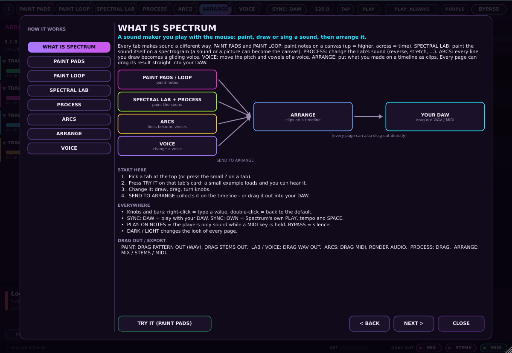

**What you can do with it**

- Make a pad that never stops ringing, in your song's key, in two clicks.
- Draw a bass and drum loop and drag it into your DAW as one WAV file or as stems.
- Turn a photo into a texture, or a vocal into a spectral ghost.
- Make eight variations of one hit, one for every key press.
- Draw a riser, a glide or a whole melody as lines, and export it as MIDI for your own synths.
- Make a synth "speak" by giving it the vowels of a spoken line.
- Collect it all on one timeline and render a finished section.

> **Tip:** Every page has a **TRY IT** example. Press the small **?** on a page's tab, then **TRY IT**. A small example made by the plugin loads, and you can hear it at once. Your own work is kept (see each page for the details).

**How to read this manual.** Part 1 gets you making sound and shows you around. Part 2 has one chapter per page. Each chapter starts with what the page is for and a picture with numbered labels. Part 3 has recipes, FL Studio steps, the demo rules and answers to common problems. Part 4 is the complete reference: every control, every range and every default. Use the **Find it fast** index at the very end to jump to any control.

On-screen names are printed in **BOLD CAPITALS**, exactly as they appear on the screen.

## Your first sound in 5 minutes

This tutorial uses PAINT PADS, PAINT LOOP and ARRANGE. You need nothing but the plugin. In your DAW, load **Ghosty Spectrum** on an instrument track (FL Studio steps are in the chapter "Ghosty Spectrum in FL Studio"). Or open the Standalone app.

### Step 1: Paint a chord

Spectrum opens on **PAINT PADS**. On the left, under **STARTING POINTS**, click **Bell chord**. Six bell notes appear on the canvas and start to ring at once. You don't need to press play.

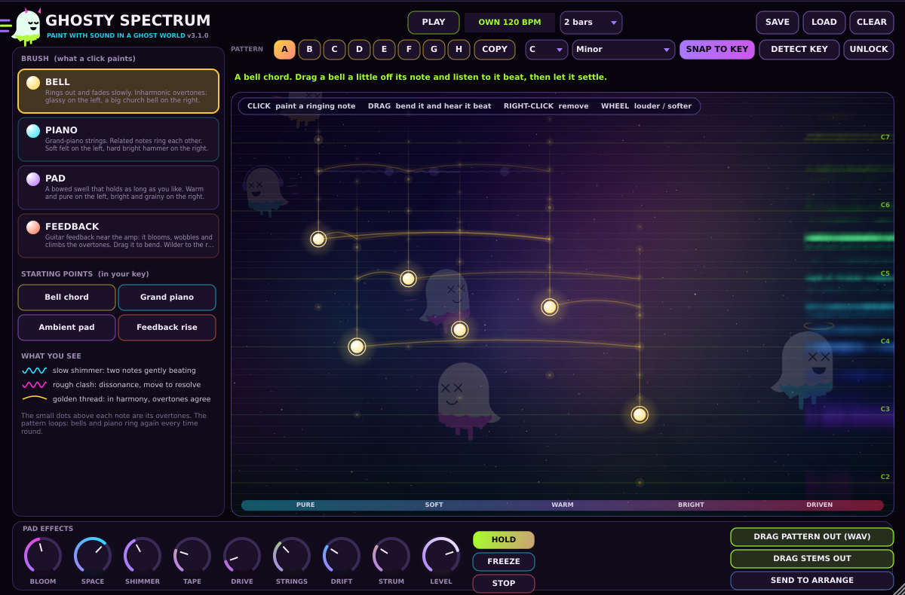

### Step 2: Make two notes beat

Click a bell note and drag it a little up or down while it rings. A label shows its note and how far it is off the note in cents (a cent is a hundredth of a semitone), for example "F4 -29c BELL". Listen: the note now beats against its neighbours. Let go, and it snaps back onto the key.

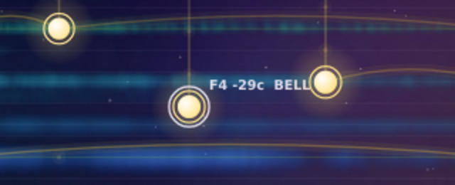

> **Try this:** Hold **ALT** while you let go. The note stays where you left it, between two notes, and keeps beating.

### Step 3: Add a pad and some space

Click the **PAD** tile in the **BRUSH** list on the left, then click anywhere on the canvas. A soft pad note swells in. Now drag the **SPACE** and **SHIMMER** knobs at the bottom upward. The sound gets a big reverb with a sparkle on top.

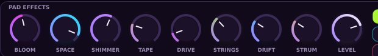

### Step 4: Draw a loop

Click the **PAINT LOOP** tab at the top. The first time you open a page, a hint tells you what to do first. Click **GOT IT**.

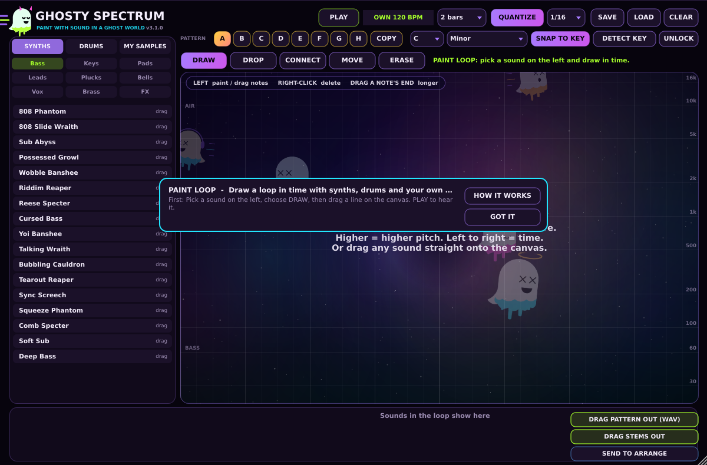

1. On the left, **SYNTHS** is open with the **Bass** group. Click a bass, for example **Sub Abyss**. You hear it once.
2. **DRAW** is the chosen tool. Drag a short line low on the canvas. It becomes a bass note. Draw three or four.
3. Click **DRUMS**, then **Kick**, then **Punch Kick**. Click low on the canvas, near the bass, once per beat. QUANTIZE (on by default) puts each hit on the grid.
4. Click **Hat** and a hat sound, and click between the kicks.
5. Press **PLAY** at the top of the page. The live sound glows behind your notes.

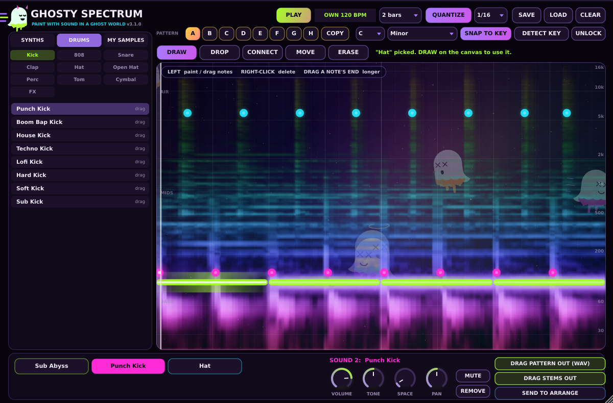

### Step 5: Send it to ARRANGE

Press **PLAY** again to stop. Click **SEND TO ARRANGE** at the bottom right. The status line says the sound is on the ARRANGE timeline.

### Step 6: Play the timeline

Click the **ARRANGE** tab (click **GOT IT** on its hint). Your loop is there as a clip called **Loop A**, with the pad notes of pattern A mixed in. Press **PLAY** (or SPACE). Drag the clip to move it. Drag its right edge to trim it.

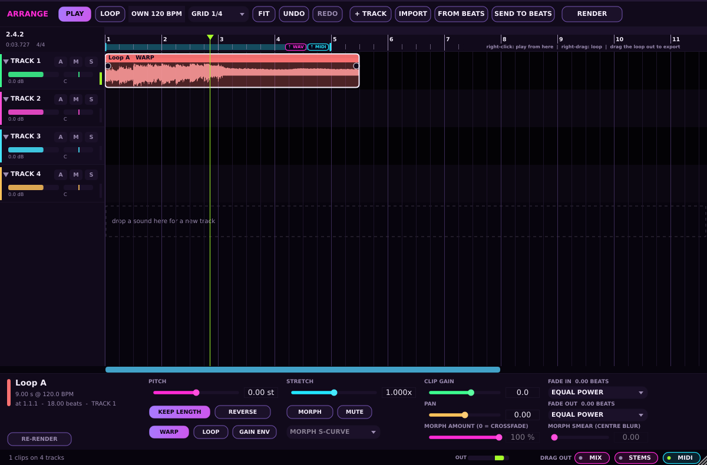

### Step 7: Take it to your DAW

In the full version, drag the **MIX** chip (bottom right of ARRANGE) into your DAW's playlist. On the PAINT pages you can also drag **DRAG PATTERN OUT (WAV)** straight into the DAW. In the demo, exporting is switched off. Everything else works, so you can keep practising.

> **Note:** No sound? Look at the bar at the top. **BYPASS** silences everything. **PLAY: ON NOTES** only plays while a MIDI key is held. See "Troubleshooting".

## Finding your way around

The window has two parts. The **top bar** is always there. Under it is the **page** of the tab you picked.

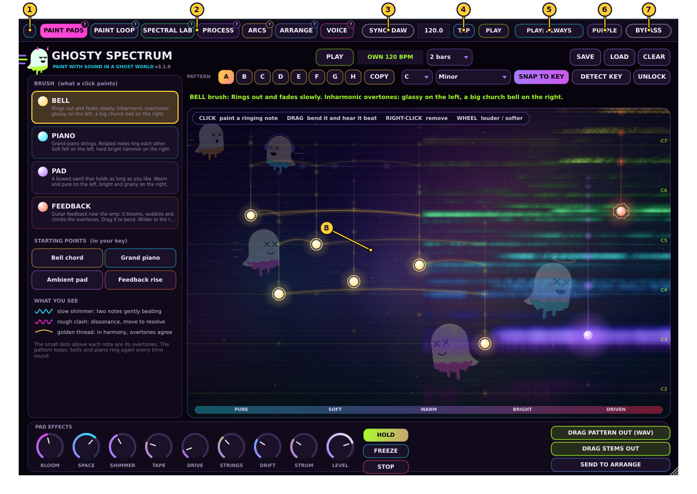

| No. | Part | What it is for |
|---|---|---|
| 1 | **?** | Opens HOW IT WORKS, the built-in guide. |
| 2 | Tabs | The seven pages. Each tab has a small **?** that opens that page's guide card. |
| 3 | **SYNC: DAW / SYNC: OWN** | Follow your DAW's play button and tempo, or run Spectrum's own clock. |
| 4 | BPM box, **TAP**, **PLAY** | Spectrum's own tempo and play button (or your DAW's tempo). |
| 5 | **PLAY: ALWAYS / PLAY: ON NOTES** | Play all the time, or only while a MIDI key is held. |
| 6 | Look button | Changes the colours of every page. |
| 7 | **BYPASS** | Silences Spectrum. |
| 8 | The page | The page of the tab you picked. |

### The top bar up close

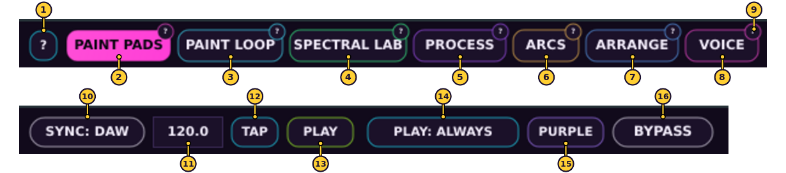

| No. | Control | What it does |
|---|---|---|
| 1 | **?** | Opens HOW IT WORKS: a WHAT IS SPECTRUM card and one card per page. |
| 2 to 9 | **PAINT PADS, PAINT LOOP, SPECTRAL LAB, PROCESS, ARCS, ARRANGE, VOICE, GHOST VOICE** | The pages. Hover a tab to read what the page is for. |
| 9 | Small **?** on a tab | Opens that page's HOW IT WORKS card. |
| 10 | **SYNC: DAW** / **SYNC: OWN** | **DAW** (the default) follows your DAW's play button, tempo and song position. **OWN** runs Spectrum's own clock with its own tempo and **PLAY**. Your DAW's transport is then ignored. |
| 11 | BPM box | Spectrum's own tempo, 20 to 999 BPM. Double-click, type a number, press Enter. |
| 12 | **TAP** | Click it in time with the beat, at least twice. The tempo is worked out from your last taps (up to 8). A pause of more than 2 seconds starts a new count. |
| 13 | **PLAY** | Starts Spectrum's own clock from bar 1. It reads **STOP** while the clock runs. SPACE does the same. |
| 14 | **PLAY: ALWAYS** / **PLAY: ON NOTES** | See "Play always, or only on notes" below. |
| 15 | Look button | Shows the name of the NEXT look: BLACK, then PURPLE, then LIGHT. |
| 16 | **BYPASS** | Fades Spectrum out in about 6 ms, stops every voice and player, and ignores MIDI until you switch it off. Your DAW's own bypass button switches it too. |

**When do the BPM box, TAP and PLAY show?** They show in **SYNC: OWN**, in the Standalone app, and in a DAW that sends no song position. Otherwise the same place shows your DAW's tempo, for example "128.0 BPM  DAW" (it reads "DAW TEMPO" until your DAW has sent a tempo).

### SYNC: following your DAW or Spectrum's own clock

- **SYNC: DAW** (default): PAINT LOOP, the Lab's loop, ARCS and ARRANGE follow your DAW. Press play in your DAW and they play in time.
- **SYNC: OWN**: Spectrum runs its own clock. Set the tempo with the BPM box or **TAP**, and press **PLAY** (or SPACE while the plugin window has focus). Use it to try ideas while your DAW is stopped.
- Changing SYNC fades the players out and in over a few milliseconds, so it doesn't click.
- SYNC is saved with your project (not in presets).

> **Note:** The Standalone app always runs on Spectrum's own clock, because there is no DAW. The SYNC button still shows DAW or OWN, but switching it changes nothing you can hear there.

### Play always, or only on notes

- **PLAY: ALWAYS** (default): the players play whenever the song plays. The players are the PAINT LOOP pattern, a pad with **HOLD** on, the Lab's loop, ARCS and ARRANGE.
- **PLAY: ON NOTES**: the players only sound while a MIDI note is held (any key). Draw one long note in your DAW over the bars where Spectrum should sound. The button shows **>** while the gate is open and **||** while it is closed.
- A held key still does its usual job as well (it plays the Lab in KEYS mode, transposes the pad, plays ARCS with MIDI IN).
- The gate also applies to VOICE's preview and to ARRANGE's own PLAY.
- **BYPASS** always wins. This setting is saved with your project and can be automated from your DAW (parameter "Play").

### HOW IT WORKS and the first-run hints

Press **?** at the far left, or the small **?** on a tab. Each card has a short description, four steps for a first result, the gestures, what you can drag out, and a **TRY IT** button. Move between cards with **< BACK** and **NEXT >**, or with the arrow keys. **CLOSE**, **Esc** or a click outside the panel closes it. On the WHAT IS SPECTRUM card the button reads **TRY IT (PAINT PADS)**.

When you switch to a tab, a hint bubble shows the first thing to do ("First: ..."). **GOT IT** hides it for that page in this project. **HOW IT WORKS** opens the page's card. A click on the page also hides it.

### Knobs, bars and tooltips

- **Knobs:** drag up or down to turn. **Right-click** a knob to type a value. **Double-click** to go back to the default. A value shows while you drag.
- **Bars** (for example the SPLIT steps, the morph lane, the ARRANGE inspector): click sets the value under the mouse, drag scrubs, **Shift** gives fine steps, the mouse wheel moves one step.
- **Tooltips:** hover over any control to read what it does.

### The three looks

Click the look button near the right of the top bar. It goes BLACK, PURPLE, LIGHT, then back to BLACK. The button always names the NEXT look, so a new project (in BLACK) shows **PURPLE**. The look changes every page and is saved with your project. The PAINT PADS canvas stays a dark night sky in every look. This manual shows the BLACK look.

### The window and the Standalone app

- Formats: VST3 (Windows and Mac), AU (Mac) and the Standalone app. The Mac installer also has a CLAP version when one was built.
- The window is 1200 x 830 pixels at 100 %. Drag its corner to resize it from 75 % to 200 %. Everything scales together.
- Spectrum is an instrument with a stereo output. It takes MIDI notes on every channel and sends no MIDI out.
- It has one stereo input, named "Sidechain". Only **DETECT KEY** listens to it.
- **Standalone app:** the **Options** button at the top left offers **Audio/MIDI Settings...**, **Save current state...**, **Load a saved state...** and **Reset to default state**. Pick your sound card in Audio/MIDI Settings. Tick your MIDI keyboard there too: the app doesn't switch MIDI inputs on by itself. The app's input is off, so DETECT KEY listens to Spectrum's own sound there.

# The pages

## PAINT PADS

**What this page is for.** PAINT PADS is a canvas of ringing notes. Every dot you paint is a note that keeps sounding. Up and down is pitch, left and right is tone. Use it for pads, bells, drones and slowly shifting chords in your song's key.

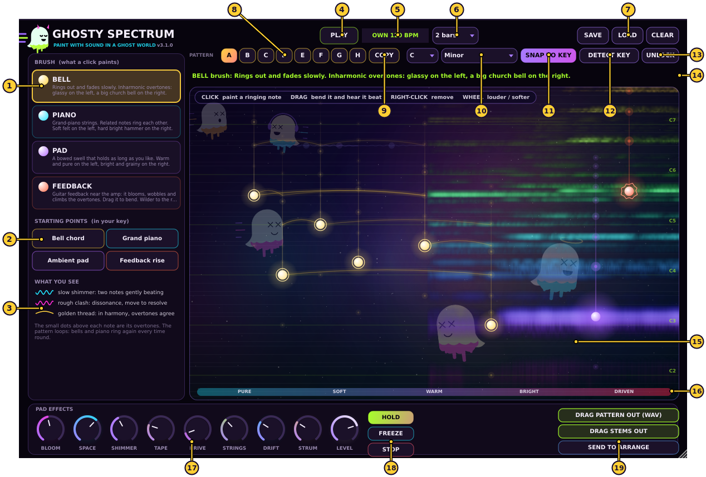

| No. | Control | What it does |
|---|---|---|
| 1 | **BRUSH** tiles: **BELL, PIANO, PAD, FEEDBACK** | What the next click paints. |
| 2 | **STARTING POINTS**: **Bell chord, Grand piano, Ambient pad, Feedback rise** | One click paints a ready-made picture in your key. |
| 3 | **WHAT YOU SEE** | Explains the coloured lines between the dots. |
| 4 | **PLAY** | Plays the pattern while your DAW is stopped. |
| 5 | Tempo | The tempo the pattern, the drag-outs and the stems use. |
| 6 | Length box | **1 bar**, **2 bars** or **4 bars**: how long the pattern loops. |
| 7 | **SAVE**, **LOAD**, **CLEAR** | Save or load the whole canvas, or clear this pattern. |
| 8 | **PATTERN A** to **H** | Eight separate pictures. Right-click one to copy or clear it. |
| 9 | **COPY** | Copies this pattern into the next empty one. |
| 10 | Key and scale boxes | The key and scale used by SNAP TO KEY and the STARTING POINTS. |
| 11 | **SNAP TO KEY** | Notes land on the notes of the key. |
| 12 | **DETECT KEY** | Listens and sets the key and scale for you. |
| 13 | **UNLOCK** | Enter your license key here. After unlocking it reads **LICENSED**. |
| 14 | Status line | Tells you what just happened. |
| 15 | The canvas | Click to paint, drag to bend, right-click to remove, wheel for louder or softer. |
| 16 | Tone strip | **PURE, SOFT, WARM, BRIGHT, DRIVEN**: the tone zones from left to right. |
| 17 | **PAD EFFECTS** knobs | **BLOOM, SPACE, SHIMMER, TAPE, DRIVE, STRINGS, DRIFT, STRUM, LEVEL**. |
| 18 | **HOLD**, **FREEZE**, **STOP** | Always sound or follow your keys; hang the reverb in the air; stop the ringing. |
| 19 | **DRAG PATTERN OUT (WAV)**, **DRAG STEMS OUT**, **SEND TO ARRANGE** | Take the pattern to your DAW or to ARRANGE. |

### How the canvas works

- **Up and down is pitch.** The canvas runs from F#1 at the bottom to A7 at the top. Every C is labelled on the right edge. Middle C is C4.
- **Left and right is tone.** Dots further right get more overtones and more drive. The strip along the bottom names the zones.
- **Dots talk to each other.** Two dots whose overtones (the quieter, higher tones that ring above every note) almost line up "beat" against each other. Drag one until they agree, and the beating settles into harmony.
- The lines between dots show this. A cyan wavy line is a slow shimmer (two notes gently beating). A pink wavy line is a rough clash. A golden arc means the two notes are in harmony. The faster two notes beat, the faster their line wiggles and the more it turns from cyan to pink to red.
- The small dots above each note are its overtones.

**Gestures on the canvas**

| Gesture | What it does |
|---|---|
| Click on empty space | Adds a dot with the current brush. With SNAP TO KEY on, it lands on the nearest note of the key. |
| Drag a dot | Moves it in pitch and tone while it sounds. It moves freely while you drag, so you hear every shade of beating. When you let go, it snaps into key (if SNAP TO KEY is on). |
| **ALT** while letting go | Keeps the dot where it is, off the key. |
| Hover a dot | Shows its note, how far off it is in cents (when it is off by 1 cent or more) and its brush, for example "A3 +14c BELL". |
| Mouse wheel over a dot | Louder or softer. Louder dots are drawn bigger. |
| Right-click a dot | Removes it. Keep the right button down and drag to remove several. On a Mac, Ctrl-click works too. |

A pattern holds up to 32 dots.

### The four brushes

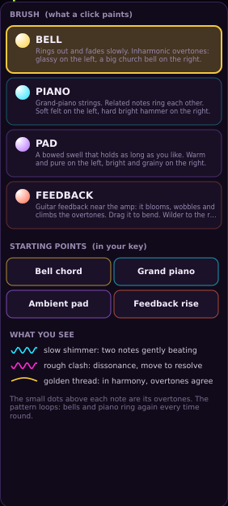

Each dot keeps the brush it was painted with.

- **BELL** (the default): struck once, then it rings out slowly. Glassy on the left, a big church bell on the right.
- **PIANO**: struck like a piano string, with slightly sharp overtones. Soft felt on the left, hard bright hammer on the right.
- **PAD**: swells in and holds as long as you like. Warm and pure on the left, bright and grainy on the right.
- **FEEDBACK**: like guitar feedback near the amp. It swells in, wobbles and climbs up the overtones. It gets wilder to the right.

When you add a new dot, BELL and PIANO dots that share overtones with it ring again softly, like piano strings ringing along.

### The STARTING POINTS

One click replaces the dots of the current pattern with a ready-made picture in the current key and scale, and picks the matching brush. There is no undo, so press **COPY** first if you want to keep your own picture.

> **Try this:** Click **Feedback rise** and wait a few seconds. The feedback notes bloom and climb. Then drag one of them sideways to bend it.

### The pad effects

The nine knobs at the bottom shape the whole pad (not the PAINT LOOP sounds). All of them run from 0 to 100 % and can be automated from your DAW.

- **BLOOM**: how slowly notes swell in and fade away.
- **SPACE**: the size and amount of the big reverb.
- **SHIMMER**: an octave-up sparkle that rises out of the reverb.
- **TAPE**: a warbly tape echo on a dotted eighth note.
- **DRIVE**: gentle saturation (warm distortion).
- **STRINGS**: like holding down a piano's sustain pedal: open strings tuned to your key ring along with the pad.
- **DRIFT**: a slow, dreamy pitch wander.
- **STRUM**: BELL and PIANO dots ring one after another, from low to high, instead of all at once.
- **LEVEL**: the pad's volume.

**HOLD** (on by default) makes the pad sound all the time. Turn it off and the pad only sounds while you hold MIDI keys. **FREEZE** hangs the current reverb in the air. **STOP** fades the pad out (the button then reads **START**).

### How the pad plays

- With **HOLD** on, the pad sounds as soon as you paint. You don't need to press play.
- The pattern length (1, 2 or 4 bars) is the loop length. While your DAW plays, or **PLAY** is on, BELL and PIANO dots ring again at the start of every loop (strummed by STRUM). With nothing playing they ring once and fade. PAD and FEEDBACK dots simply keep holding.
- The loop is counted from the start of your song, at your DAW's tempo (or Spectrum's own tempo in SYNC: OWN).
- The pad stops when you stop your DAW (or Spectrum's own clock), when you open SPECTRAL LAB, or when BYPASS is turned on. It starts again when playback starts, when you click the canvas, when you play a MIDI key or when you press START.

### Playing the pad from MIDI keys

- **HOLD off:** the pad sounds while at least one key is held, and fades when you let go.
- **Transpose:** the lowest held key transposes the whole pad. The root of your key at middle C (C4 when the key is C, D4 when it is D) plays the pad as painted. One key higher is a semitone up. This works with HOLD on too, and the pad stays transposed after you let go.
- **Re-ring:** every key you press rings the BELL and PIANO dots again, louder when you play harder.
- When SPECTRAL LAB is open with **KEYS** on, your keys play the Lab instead.
- MIDI keys don't play the PAINT LOOP sounds.

### Patterns, saving and DETECT KEY

- **Patterns A to H** are shared with PAINT LOOP. Each pattern holds both its pad dots and its loop notes, and both play together. You can switch patterns at any time, even while playing. A pattern with content shows a dot (for example **B.**).
- **SAVE** stores the whole canvas (all 8 patterns, all sounds, the key, the scale and the pad effects) as a file in **Documents/Ghosty/Spectrum**, named after the date and time (for example "Spectrum 10-27 1432"). **LOAD** opens a menu of those files. A canvas opens on the page it was saved on (PAINT PADS or PAINT LOOP), and the tab switches with it.
- **DETECT KEY** listens for 5 seconds and sets the key and a major or minor scale. It listens to the sidechain input when audio arrives there, otherwise to Spectrum's own sound.
- These two pages have no undo. Use **COPY** before big changes, and **SAVE** to keep the whole canvas.

> **Note:** All control details, ranges and defaults are in "Reference: PAINT PADS and PAINT LOOP".

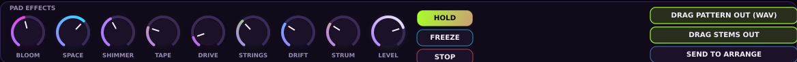

## PAINT LOOP

**What this page is for.** PAINT LOOP is a piano roll you draw on. Pick a synth, a drum or your own sample in the bank on the left, then draw. Lines become notes that play in time with your song. Use it for bass lines, beats, plucks and short melodic loops.

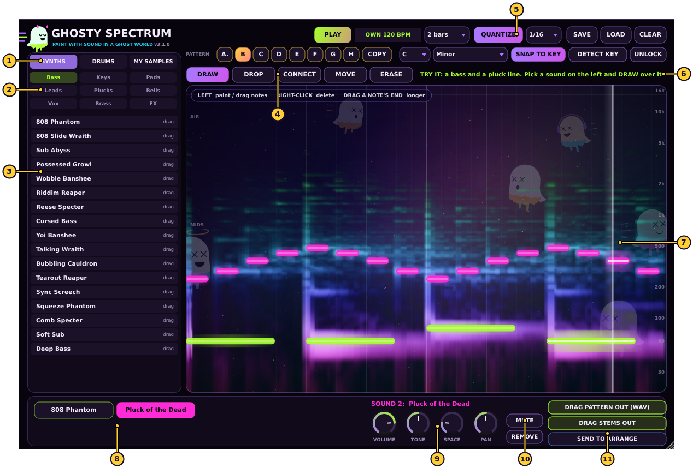

| No. | Control | What it does |
|---|---|---|
| 1 | **SYNTHS**, **DRUMS**, **MY SAMPLES** | The three parts of the sound bank. |
| 2 | Group buttons | Show one group of sounds (for example **Bass**, **Keys**, **Kick**). |
| 3 | Sound list | Click a sound to hear it and use it. Drag it onto the canvas to place one note. |
| 4 | Tools: **DRAW, DROP, CONNECT, MOVE, ERASE** | How a click or drag on the canvas works. |
| 5 | **QUANTIZE** and grid box | Snap notes to a grid of **1/4**, **1/8** or **1/16** notes. |
| 6 | Status line | Tells you what just happened. |
| 7 | The canvas | Up is pitch, across is time. The live sound glows behind your notes. |
| 8 | Layer buttons | Each sound you use is a layer. Click one to select it. |
| 9 | **VOLUME, TONE, SPACE, PAN** | The selected layer's level, tone, reverb and stereo place. |
| 10 | **MUTE**, **REMOVE** | Mute the layer, or remove it. |
| 11 | Drag-out and send buttons | As on PAINT PADS. |

The top rows (PLAY, tempo, length, SAVE, LOAD, CLEAR, patterns, COPY, key, scale, SNAP TO KEY, DETECT KEY) work as on PAINT PADS. Here, **CLEAR** removes this pattern's notes but keeps the sounds.

### The canvas

Up is pitch and across is time. The canvas runs from about 20 Hz at the bottom to 20 kHz at the top. The left edge reads **BASS**, **MIDS** and **AIR**. Bright vertical lines mark bars and fainter ones mark beats. While the loop plays, a playhead runs across, and the live sound glows as colour behind your notes.

### Draw your first loop

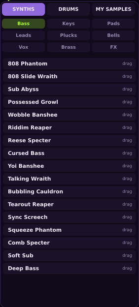

1. Click a sound in the bank, for example a bass under **SYNTHS > Bass**. You hear it once, and it becomes a layer.
2. With **DRAW**, drag a line on the canvas. It becomes notes, one per grid step. On a synth, steps in a row on the same pitch join into one long note.
3. Click a drum (for example **DRUMS > Kick**) and click on the beats. Each click is one hit.
4. Press **PLAY**, or play your DAW.

### The tools

- **DRAW** (default): drag a line and it becomes notes, one per grid step. A click makes one note. Grab a note to move it, or grab its right end to make it longer.
- **DROP**: click to drop single notes.
- **CONNECT**: click a note, then a later note of the same sound. The later note now slides (glides) from the earlier one. A sound with a slide plays one note at a time.
- **MOVE**: drag a note to move it. Drag its right end to change its length.
- **ERASE**: click or drag over notes to erase them.
- In every tool, a right-click erases the note under the mouse, and a right-drag keeps erasing. On a Mac, Ctrl-click works too.

### Drums and synths

- **Synths and samples** play at the pitch you draw. With SNAP TO KEY on they land on the notes of the key, otherwise on the nearest semitone. They are drawn as bars.
- **Drums** always land on whole semitones and ignore SNAP TO KEY. Each drum has a home height where it plays at its normal pitch. Higher plays it faster and higher, lower plays it slower and lower. Drums play to their end and are drawn as round dots.
- All notes play at the same velocity. There is no velocity editing.

### Layers

Each sound you use becomes a layer, up to 8. The layers belong to the whole canvas: all 8 patterns share them, and each pattern has its own notes. Click a layer button to select it and hear it once. Its knobs appear on the right: **VOLUME**, **TONE** (darker to the left, thinner to the right, no filter in the middle), **SPACE** (reverb) and **PAN**.

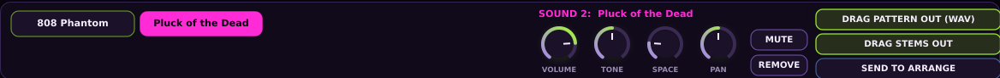

> **Note:** **REMOVE** takes the sound out of the loop together with its notes in every pattern (A to H). All other notes keep their own sounds in every pattern.

### Your own sounds

Drop audio files (WAV, AIF, AIFF, MP3, FLAC or OGG; M4A and CAF on a Mac) onto PAINT PADS or PAINT LOOP. Spectrum opens PAINT LOOP and puts them in **MY SAMPLES**. Up to 60 seconds of each file is read, and silence at the start and end is trimmed. A sample plays at its own pitch on middle C (C4) and follows your notes up and down from there. Samples you use are saved with the project and with SAVE (up to 30 seconds each). The MY SAMPLES list itself is for this session only.

### How the loop plays

- **SYNC: DAW**: the loop plays whenever your DAW plays and follows its tempo and position. The pattern repeats every 1, 2 or 4 bars counted from the start of the song.
- **PLAY** plays the loop while your DAW is stopped. Pressing it again carries on from where it stopped.
- **SYNC: OWN**: the loop follows Spectrum's own clock (and SPACE). The page's PLAY still works.
- **PLAY: ON NOTES**: the loop only sounds while a MIDI note is held.
- MIDI keys don't play the loop's sounds. On these two pages they play the pad.

### Drag out and send

- **DRAG PATTERN OUT (WAV)**: drag it into your DAW or a folder. You get one pass of the current pattern as you hear it (the loop sounds and the pad dots), plus a tail. Muted layers are left out.
- **DRAG STEMS OUT**: one WAV per layer that has notes, plus "00 Pad.wav" when the pattern has pad dots.
- **SEND TO ARRANGE**: puts what you hear on the ARRANGE timeline as a clip named **Loop A** to **Loop H** (or **Pad A** to **Pad H** when sent from PAINT PADS).

Renders always include the pad dots of the pattern as painted, even when the pad is stopped or HOLD is off. Dragging out needs the full version. SEND TO ARRANGE also works in the demo.

> **Note:** If you make a pattern shorter, notes past the new end are hidden and silent: they don't play and are left out of the renders. They are kept, so making the pattern longer again brings them back. CLEAR removes them all.

### TRY IT

- **PAINT PADS TRY IT** moves to the first empty pattern (or uses the current one if none is empty), paints the Bell chord, picks BELL, turns HOLD on and starts the pad.
- **PAINT LOOP TRY IT** moves to an empty pattern in the same way, adds two new layers (the first Bass sound and the first Plucks sound, "808 Phantom" and "Pluck of the Dead"), sets 2 bars, writes a bass line and a pluck figure and starts PLAY. Each press adds the two layers again, so press it only once.

> **Note:** All control details are in "Reference: PAINT PADS and PAINT LOOP".

## SPECTRAL LAB

**What this page is for.** The SPECTRAL LAB lets you paint on the sound itself. It shows sound as a spectrogram: a picture where up is pitch, across is time and brighter is louder. Import a sound or a picture and it becomes the canvas. Then paint on it, edit it, play it from your keys or in time with the song, and send it on.

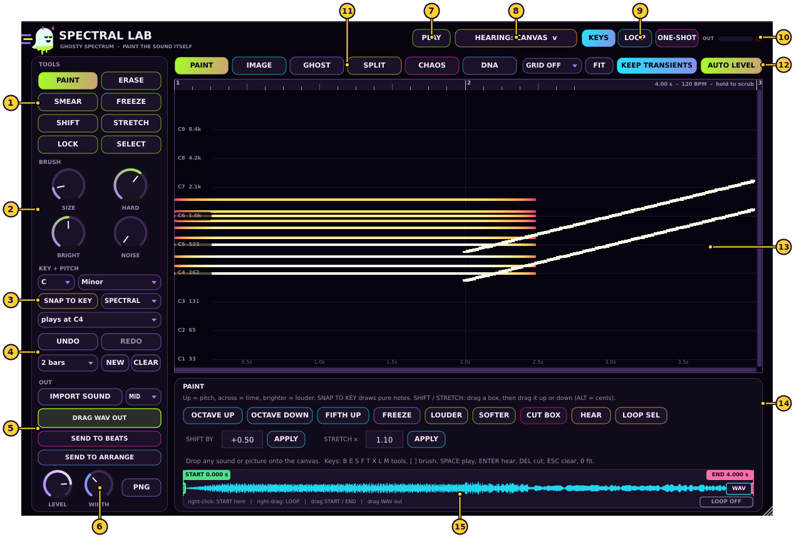

| No. | Control | What it does |
|---|---|---|
| 1 | **TOOLS** | **PAINT, ERASE, SMEAR, FREEZE, SHIFT, STRETCH, LOCK, SELECT**. |
| 2 | **BRUSH** knobs | **SIZE, HARD, BRIGHT, NOISE**: the brush for PAINT, ERASE and SMEAR. |
| 3 | **KEY + PITCH** | Key, scale, **SNAP TO KEY**, the **KEYS PITCH** box and the root note ("plays at C4"). |
| 4 | **UNDO**, **REDO**, length box, **NEW**, **CLEAR** | Undo, and start or empty a canvas. |
| 5 | **OUT** | **IMPORT SOUND** and its input box, **DRAG WAV OUT**, **SEND TO BEATS**, **SEND TO ARRANGE**. |
| 6 | **LEVEL**, **WIDTH**, **PNG** | The Lab's volume and stereo width; save the canvas as a picture. |
| 7 | **PLAY** | Plays the Lab sound as a loop (reads STOP while playing). |
| 8 | **HEARING** | What you hear: the canvas, the ghosts, the split bands or the morph. |
| 9 | **KEYS** / **LOOP**, **ONE-SHOT** | Play the sound from MIDI keys, or loop it with the song. |
| 10 | **OUT** meter | The Lab's output level, with a clip light. |
| 11 | Page buttons | **PAINT, IMAGE, GHOST, SPLIT, CHAOS, DNA**: the page strip under the canvas. |
| 12 | View buttons | The grid box, **FIT**, **KEEP TRANSIENTS**, **AUTO LEVEL**. |
| 13 | The canvas | The spectrogram you paint on. The ruler on top scrubs when you hold it. |
| 14 | The page strip | The controls of the page you picked. |
| 15 | Waveform strip | (PAINT page) START and END, a loop, and a WAV grip to drag out a part. |

### What you see on the canvas

- Up is pitch. The labels on the left show the note and its frequency in Hz (C1 33 Hz up to C9 8.4 kHz).
- Across is time. Bars and beats are on the ruler, seconds along the bottom.
- Brightness is loudness. A thin bright line is a pure tone. A wide, soft smear is noise or breath.
- Every sound is made of partials: the separate tones (the main note and its overtones) that you see as lines stacked above each other.

### A first result in a minute

1. Press **IMPORT SOUND** (left) and pick a file, or drag a sound or a picture onto the canvas. Or just paint with **PAINT**.
2. Press **PLAY** at the top, or hold the ruler to scrub through the sound.
3. Pick a tool (**SMEAR**, **SHIFT**, **STRETCH** ...) and paint over the sound.
4. Press **PLAY** again and listen.

> **Try this:** With the TRY IT example loaded, pick **SELECT**, drag a box around the chord, then press **OCTAVE UP** in the PAINT strip. Press **PLAY**. UNDO takes it back.

### The tools

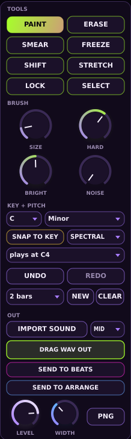

- **PAINT** (key B): drag to paint light, which becomes sound. Right-drag erases. With **SNAP TO KEY** on, the brush becomes a thin line on the exact pitch of the nearest note of the key, and the note name shows next to it.
- **ERASE** (E): erase what is under the brush.
- **SMEAR** (S): blur a sound in time.
- **FREEZE** (F): drag a box. The first moment of the box holds across the whole box.
- **SHIFT** (T): drag a box, then drag inside it up or down to move it in pitch, in semitones (hold ALT for cents).
- **STRETCH** (X): drag a box, then drag inside it up to spread its overtones apart, or down to squeeze them. The lowest partial stays put.
- **LOCK** (L): drag boxes that CHAOS must keep.
- **SELECT** (M): drag a box. **HEAR** plays it, **LOOP SEL** loops it, **CUT BOX** erases it.

### Playing the Lab

- **KEYS** (the default): your MIDI keys play the sound. The key shown in the root box ("plays at C4") plays it at its own pitch. Other keys play it higher or lower. Up to 12 notes at once.
- **KEYS PITCH**: **SPECTRAL** re-renders the sound at each pitch and keeps its length (the first press of a new key may sound tape-style for a moment while it renders). **TAPE** works like a sampler: higher is faster.
- **ONE-SHOT**: keys play the whole sound, even after you let go.
- **LOOP**: the sound loops in time with the song (your DAW, or Spectrum's own clock in SYNC: OWN). In LOOP mode, MIDI keys play the PAINT PADS pad instead.
- **PLAY** loops the Lab sound right here, at the tempo. SPACE does the same (in a DAW with SYNC: DAW).

> **Note:** The Lab only makes sound while its tab is open. KEYS, LOOP and PLAY all go quiet when you switch to another page. Opening the Lab also stops a running PAINT PADS pad.

### HEARING: what you hear

The **HEARING** button names what you hear. Normally it follows the page: PAINT, IMAGE and CHAOS play the **CANVAS**, GHOST plays the **GHOST**s, SPLIT plays the **SPLIT** bands and DNA plays the **MORPH**. Click it to pin one choice ("Always Canvas" and so on); the label then adds "(PINNED)". Some actions still switch it to their own page: GENERATE and NEW SEED on GHOST, HEAR MORPH, and edits on the SPLIT page. When there is nothing to hear yet on the chosen page (no ghosts made, no A and B loaded), you hear the canvas.

### The six pages under the canvas

**PAINT** has quick moves for the box (or the whole canvas when there is no box): **OCTAVE UP**, **OCTAVE DOWN**, **FIFTH UP**, **FREEZE**, **LOUDER**, **SOFTER**, **CUT BOX**, **HEAR** and **LOOP SEL**, plus typed **SHIFT BY** and **STRETCH x** amounts. Under them is the waveform strip.

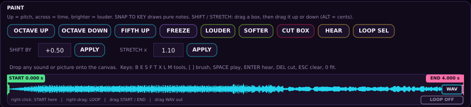

**IMAGE** (IMAGE TO SOUND) turns a picture into sound. Bright pixels sing, dark ones are silent, and the top of the picture is the highest pitch.

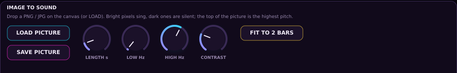

**GHOST** (SPECTRAL GHOST) makes a set of variations of the canvas sound, one per hit. Each ghost travels further: it rings like metal, rises, breaks into fragments, turns to dust, then returns.

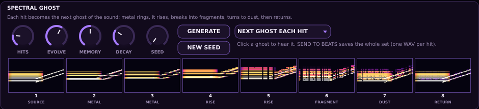

**SPLIT** (SPECTRAL SPLIT) cuts the sound into 2 to 6 frequency bands. Each band plays through its own step sequencer, so the lows can pulse while the highs keep running. Drag the coloured lines on the canvas to move the band edges.

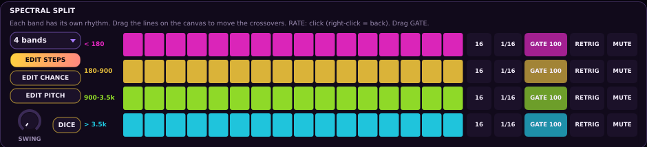

**CHAOS** (CHAOS PAINT) paints a new picture from a few knobs, in your key and at your tempo. LOCK boxes keep the parts you like.

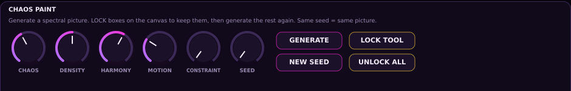

**DNA** (SPECTRAL DNA) morphs sound A into sound B: partials glide to their partners, the tone colour blends and the timing lines up. Play softer or harder to morph with **PER NOTE**, or draw a morph lane with **PER BAR**.

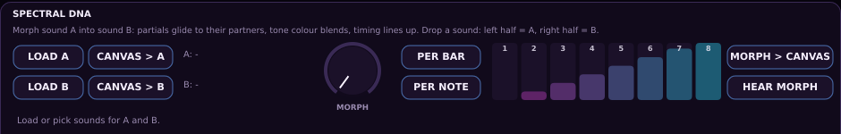

### Getting the sound out

- **DRAG WAV OUT**: drag what you hear into your DAW as a high-quality WAV (full version).
- **SEND TO BEATS**: saves what you hear into the Shared Sounds folder for Ghosty Beats (full version).
- **SEND TO ARRANGE**: puts what you hear on the ARRANGE timeline. Painted lines that sit on an exact pitch come along as MIDI notes (when hearing the canvas).
- **PNG**: saves a picture of the canvas.
- The waveform strip's **WAV** grip drags out only the highlighted part (full version).

> **Note:** All control details are in "Reference: SPECTRAL LAB".

## PROCESS

**What this page is for.** PROCESS changes the SPECTRAL LAB's sound with a chain of effects that are written into the sound (they are "destructive", but you can always undo). Select a part of the waveform, add processes, listen, and keep the result. Use it to reverse, stretch, freeze, chop, granulate or colour a sound.

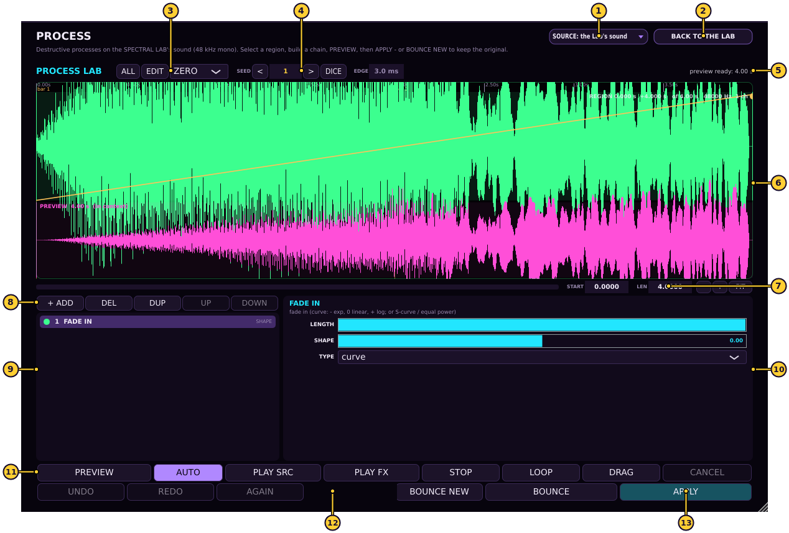

| No. | Control | What it does |
|---|---|---|
| 1 | **SOURCE** menu | The Lab's sound, and the sounds BOUNCE NEW kept. |
| 2 | **BACK TO THE LAB** | Goes back to SPECTRAL LAB, which now plays the processed sound. |
| 3 | **ALL**, **EDIT**, snap box | Select everything, the edit menu, and how selection edges snap. |
| 4 | **SEED**, **DICE**, **EDGE** | The random seed, a random seed, and the edge crossfade. |
| 5 | Status line | What the panel is doing ("working... 40 %", "preview ready"). |
| 6 | The waveform | Drag to select a region. After a preview, the result shows in a lane underneath. |
| 7 | **START**, **LEN**, zoom | The region in seconds; zoom out, zoom in, **FIT**. |
| 8 | **+ ADD, DEL, DUP, UP, DOWN** | Build the chain. |
| 9 | The chain | The processes, in order. Click a row's dot to switch it on or off. |
| 10 | Parameter panel | The controls of the selected process. |
| 11 | **PREVIEW, AUTO, PLAY SRC, PLAY FX, STOP, LOOP, DRAG, CANCEL** | Listen, compare and drag out. |
| 12 | **UNDO, REDO, AGAIN, BOUNCE NEW, BOUNCE** | Undo, repeat and bounce. |
| 13 | **APPLY** | Keeps the result in the sound. |

### The basic flow

1. **Make or import a sound in SPECTRAL LAB first.** PROCESS works on the Lab's sound. (TRY IT on the PROCESS card makes a Lab sound for you.)
2. **Select.** The whole sound is selected when it loads. Drag across the waveform to select a part. A single click only sets a cursor, and PREVIEW and APPLY stay greyed out until there is a region. Press **ALL** (or A, or double-click) to select everything again.
3. **+ ADD** a process from the menu and set its controls. Add more to build a chain.
4. **Listen.** **AUTO** (on by default) makes a preview by itself after each change. Or press **PREVIEW** (P). Compare with **PLAY SRC** (the original) and **PLAY FX** (the result).
5. **Keep it.** **APPLY** (Enter) puts the result into the sound; the Lab plays it at once. **BOUNCE** (Ctrl/Cmd+B) does the same and clears the chain. **BOUNCE NEW** makes only the processed part the Lab's new sound and keeps the old sound in the **SOURCE** menu (for this session).

> **Tip:** Every change is one UNDO step, here and in the Lab. You can try anything.

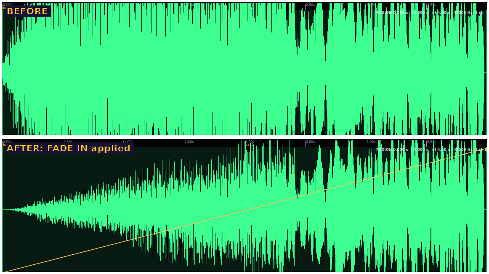

### The 35 processes

The **+ ADD** menu has 7 groups:

- **WAVECYCLES** (8): work on the single wave cycles of a sound. Shuffle, repeat, drop, reverse, interleave, average, transpose or distort them. Great for glitchy, buzzy textures.
- **GRANULAR** (2): **BRASSAGE** rebuilds the sound from short grains (tiny slices of sound, 40 ms long by default). **ITERATE** repeats the region with random pitch steps.
- **SPECTRAL** (9): work on the frequencies. Blur, trace, freeze, stretch, pitch shift, gate, shift bins, cross-synthesise with another sound, or stretch to extremes.
- **SHAPE** (6): envelope, extend (loop), normalise, reverse, fade in, fade out.
- **BASICS** (4): gain, invert, DC remove, stereo.
- **PITCH** (2): varispeed (tape-style) and stretch to a number of bars.
- **COLOUR** (4): drive, bitcrush, filter sweep, frequency shift.

The parameter panel shows a one-line description of the selected process. The full list, with every control, range and default, is in "Reference: PROCESS".

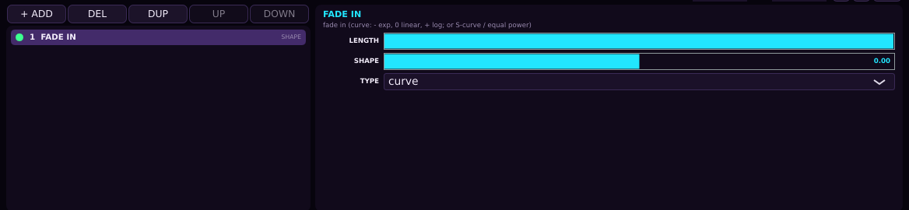

> **Try this:** Select the second half of a sound. **+ ADD > SHAPE > REVERSE**, then **+ ADD > SPECTRAL > STRETCH**. Press **PLAY FX**. Then **APPLY**.

### Good to know

- Seeded processes (the ones that use chance) give the same result for the same chain and **SEED**. Press **DICE** for another take.
- The keys work after you click the waveform or the chain list. In SYNC: OWN and in the Standalone app, SPACE runs Spectrum's clock, so use PLAY SRC and PLAY FX there.
- **DRAG** drags the preview (or the region) into your DAW as a WAV (full version).

> **Note:** All control details and the 35 processes are in "Reference: PROCESS".

## ARCS

**What this page is for.** In ARCS every line you draw is a voice. Up is pitch and across is time. When the playhead crosses a line, its voice glides along exactly what you drew. Use it for glides, risers, bass dives, arps and melodies you can see, and export them as MIDI for your own synths.

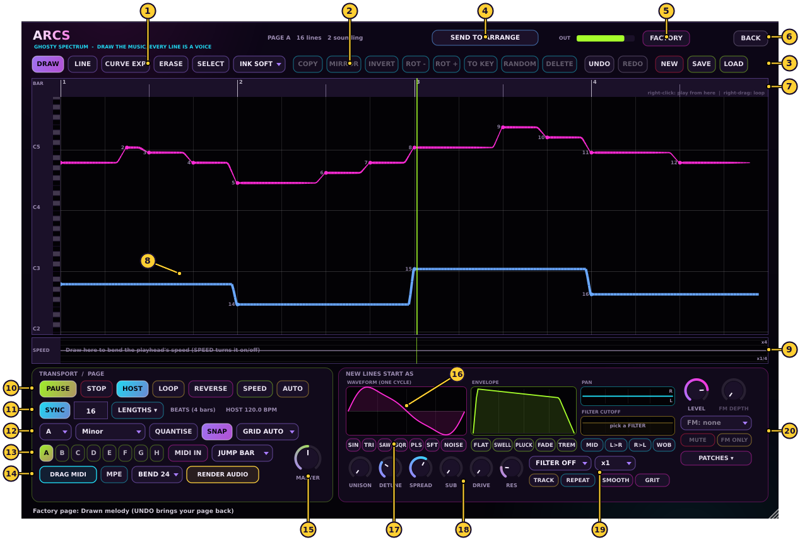

| No. | Control | What it does |
|---|---|---|
| 1 | Tools: **DRAW, LINE, CURVE, ERASE, SELECT**, ink box | How you draw and edit lines. |
| 2 | **COPY, MIRROR, INVERT, ROT -, ROT +, TO KEY, RANDOM, DELETE** | Edit the selected lines. |
| 3 | **UNDO, REDO, NEW, SAVE, LOAD** | Undo, and manage the page. |
| 4 | **SEND TO ARRANGE** | Renders one pass of the page onto the ARRANGE timeline. |
| 5 | **FACTORY** | Loads a ready-made page. |
| 6 | **BACK** | Goes back to the PAINT page you used last. |
| 7 | Ruler | Right-click: play from here. Right-drag: make a loop. |
| 8 | The canvas | Each line is a voice. Its number shows at its start. |
| 9 | **SPEED** lane | Draw here to make the playhead run faster or slower. |
| 10 | **PLAY, STOP, HOST, LOOP, REVERSE, SPEED, AUTO** | The transport. |
| 11 | **SYNC**, length, **LENGTHS**, tempo | How long the page is, in beats or seconds. |
| 12 | Key, scale, **QUANTISE**, **SNAP**, grid | Keep lines in key and on the grid. |
| 13 | **A** to **H**, **MIDI IN**, jump box | The 8 pages; play the page from MIDI. |
| 14 | **DRAG MIDI, MPE, BEND, RENDER AUDIO** | Drag the page out as MIDI or audio. |
| 15 | **MASTER** | The page's output level. |
| 16 | Waveform, envelope, pan and filter editors | Draw the sound of the selected lines (or of new lines). |
| 17 | Wave and shape buttons | Ready shapes: **SIN, TRI, SAW, SQR, PLS, SFT, NOISE**; **FLAT, SWELL, PLUCK, FADE, TREM**; **MID, L>R, R>L, WOB**. |
| 18 | **UNISON, DETUNE, SPREAD, SUB, DRIVE, RES** | The line's sound knobs. |
| 19 | Filter box, rate box, **TRACK, REPEAT, SMOOTH, GRIT** | Filter, the line's own speed, and cycle tools. |
| 20 | **LEVEL, FM DEPTH**, FM box, **MUTE, FM ONLY, PATCHES** | Level, line-to-line FM and sound presets. |

### A first result in a minute

1. Press **FACTORY** (top right) and pick a page, or choose **DRAW** and drag a line from left to right.
2. Press **PLAY**. With **HOST** on (the default), the page also plays whenever your DAW plays.
3. Draw more lines. **LINE** makes a straight glide, **CURVE** a shaped one for risers.
4. Press **Esc** (the card at the bottom right now reads **NEW LINES START AS**), change the waveform or the envelope there, then draw again.

### Drawing lines

- **DRAW** (key D): freehand. Your first clear move sets the direction; a line always plays left to right.
- **LINE** (L): click at the start, drag to the end. Hold **Shift** for a flat line.
- **CURVE** (C): a shaped line. Click the button again to switch between **CURVE EXP** (slow, then fast), **CURVE S** and **CURVE LOG** (fast, then slow).
- **ERASE** (E): rubs out parts of lines with a round brush. Cutting a line in the middle makes two lines. With every tool except SELECT, a right-drag erases too.
- **SELECT** (S): click a line to select it, drag a box to select several. Drag to move them, Alt-drag to copy them. The handles on the box stretch time, stretch pitch and rotate the group. In SELECT, the right button selects like the left one.
- The ink box (**INK RAW**, **INK SOFT**, **INK SMOOTH**) sets how much DRAW smooths a shaky hand.

> **Tip:** After you draw a line, it is selected, so the sound card at the bottom right edits that line. Press **Esc** to clear the selection and set the sound for the next lines you draw (the card then reads **NEW LINES START AS**).

### Keeping lines in key

- **QUANTISE** plays every line on the nearest note of the key and scale, but keeps your drawing as it is.
- **TO KEY** changes the drawing itself: every point of the selected lines moves onto the nearest note of the key.
- **SNAP** (on by default) snaps starts, ends and moves to the grid. With SNAP on, LINE and CURVE ends also snap to whole semitones.

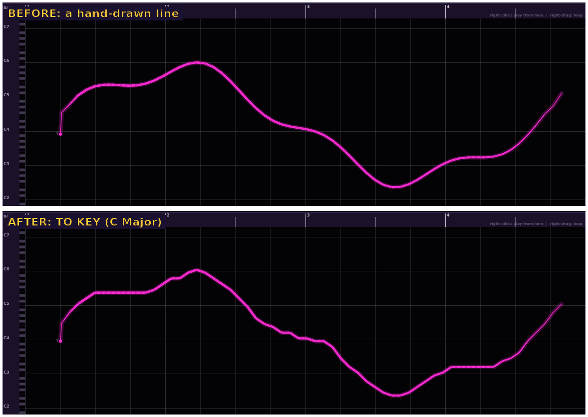

### The sound of a line

The card at the bottom right edits the sound of the selected lines. Its title says what you are editing: **LINE n**, **n LINES (edits go to all of them)** or **NEW LINES START AS**.

- **WAVEFORM (ONE CYCLE)**: draw the shape of the line's wave, or start from **SIN, TRI, SAW, SQR, PLS** or **SFT**. **NOISE** uses noise instead.
- **ENVELOPE**: the loudness along the line, from its start to its end.
- **PAN**: left and right along the line.
- **FILTER CUTOFF**: the filter along the line (pick a filter in the filter box first).
- Knobs: **UNISON** (stacked voices), **DETUNE**, **SPREAD**, **SUB** (a sine an octave down), **DRIVE**, **RES**, **LEVEL** and **FM DEPTH**.
- **PATCHES**: 16 ready-made line sounds. A patch changes the selected lines; with nothing selected it sets what new lines start as. Press Ctrl/Cmd+A to select every line first if you want the whole page to change.

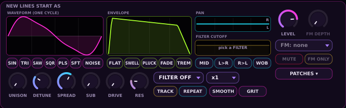

### Playing and the transport

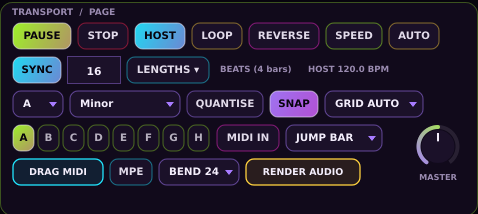

- **PLAY** plays the page on its own (it reads **PAUSE** while playing). **STOP** goes back to the start.
- **HOST** (on by default) follows Spectrum's transport: your DAW in SYNC: DAW, Spectrum's own clock in SYNC: OWN.
- **LOOP** loops the region you right-drag on the ruler. A right-click on the ruler plays from there.
- **MIDI IN**: hold a MIDI note to play the page, transposed (middle C plays it as drawn). Notes C-1 to G-1 switch to pages A to H.
- Each instance holds 8 pages, **A** to **H**, all saved with your project.

### Getting it out

- **DRAG MIDI**: drag the page into your DAW as MIDI: one note per line, glides as pitch bend. Set your synth's bend range to match **BEND** (default 24 semitones).
- **RENDER AUDIO**, then drag **DRAG AUDIO** into your DAW.
- With LOOP on, the loop bar has **WAV** and **MIDI** grips to drag out just the loop.
- **SEND TO ARRANGE** (top) works in the demo too. Exporting needs the full version.

> **Note:** All control details are in "Reference: ARCS".

## ARRANGE

**What this page is for.** ARRANGE is a timeline of tracks and clips. Everything you make in Spectrum lands here with **SEND TO ARRANGE**. You can also import audio files. Move, trim, pitch, stretch, fade and morph the clips into a piece, then drag out the mix, the stems or the MIDI.

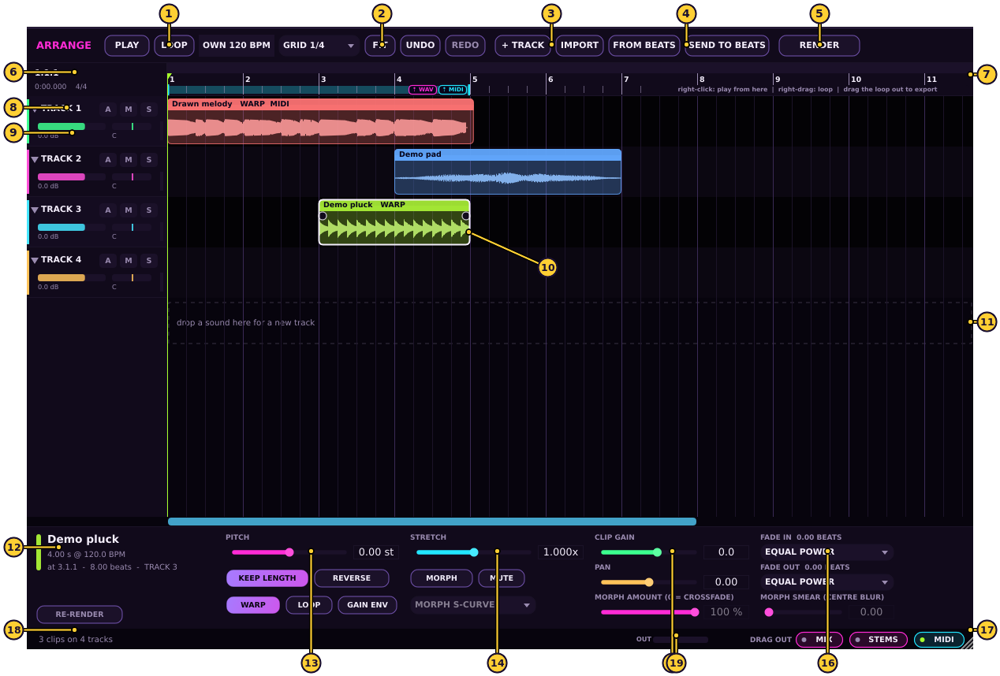

| No. | Control | What it does |
|---|---|---|
| 1 | **PLAY**, **LOOP**, tempo | Play the timeline; loop a region; the tempo it follows. |
| 2 | Grid box, **FIT**, **UNDO**, **REDO** | The snap grid, zoom to everything, undo. |
| 3 | **+ TRACK**, **IMPORT** | Add a track; import audio files. |
| 4 | **FROM BEATS**, **SEND TO BEATS** | Share sounds with Ghosty Beats through the Shared Sounds folder. |
| 5 | **RENDER** | Renders the mix (or the loop) to a WAV file. |
| 6 | Position | Bar.beat.sixteenth, minutes:seconds and 4/4. |
| 7 | Ruler | Click to place the playhead, right-drag to loop, double-click the top strip for a marker. |
| 8 | Track header | Name, **A** (automation), **M** (mute), **S** (solo). |
| 9 | Gain and pan bars | The track's level and stereo place. |
| 10 | A clip | Drag to move, drag an edge to trim, right-click for its menu. |
| 11 | New-track row | Drop a sound here for a new track. |
| 12 | Clip name, **RE-RENDER** | The selected clip and where it came from. RE-RENDER is greyed out when no page can render the clip again (for example a bounce). |
| 13 | **PITCH**, **KEEP LENGTH**, **REVERSE**, **WARP**, **LOOP**, **GAIN ENV** | Pitch and playback of the clip. |
| 14 | **STRETCH**, **MORPH**, **MUTE**, morph shape | Time stretch and spectral morph. |
| 15 | **CLIP GAIN**, **PAN**, **MORPH AMOUNT** | Level, pan and how far the morph goes. |
| 16 | **FADE IN**, **FADE OUT**, **MORPH SMEAR** | Fade shapes and morph blur. |
| 17 | **MIX**, **STEMS**, **MIDI** chips | Drag the mix, the stems or the notes into your DAW. |
| 18 | Status line | Clip count and messages. |
| 19 | **OUT** meter | The output level. |

### A first result in a minute

1. On another page press **SEND TO ARRANGE** (or press TRY IT on the ARRANGE card, which adds two clips).
2. Press **PLAY** (or SPACE).
3. Drag clips to move them. Drag their edges to trim them.
4. Right-drag on the ruler to loop a part. This turns **LOOP** on.

### Working with clips

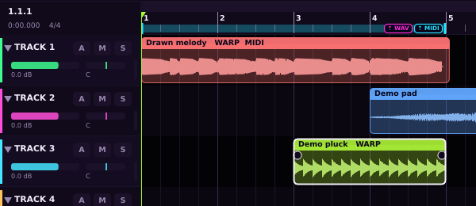

- **Select** a clip with a click. Shift-click adds more. Drag a box on empty space to select several.
- **Move** a clip by dragging it (also to another track). **Alt-drag** leaves a copy. Hold **Shift** to move off the grid.
- **Trim** by dragging an edge. **Fades**: drag the round handles near the top corners.
- **Right-click** a clip for its menu: split, duplicate, delete, copy, cut, bounce, reverse, mute, morph, loop, warp, gain envelope, reset length, send to Ghosty Beats, re-render and colour.
- The **inspector** under the timeline edits the selected clip: **PITCH**, **STRETCH**, **CLIP GAIN**, **PAN**, the fades and the morph.

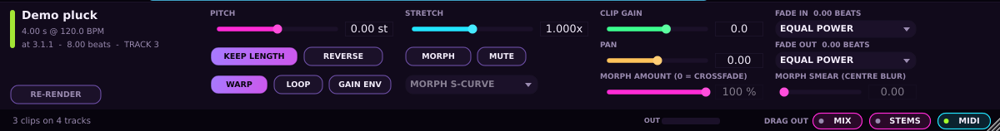

> **Try this:** Put two clips on one track so they overlap a little. Select the left one and switch on **MORPH**. Press PLAY: over the overlap, the first sound melts into the second.

### Tempo and WARP

Clip positions are in bars and beats, so clips stay on the beat when the tempo changes. Only clips with **WARP** on stretch their sound to the new tempo. WARP works on sounds that carry a tempo, such as PAINT and ARCS sends and the TRY IT pluck. Other clips keep their speed, so their sound may end early or get cut at the clip's end. **Reset length to the whole sound** (clip menu) fits the clip again.

### How ARRANGE plays

- **SYNC: DAW** with your DAW stopped: **PLAY** plays ARRANGE on its own. A click on the ruler sets the playhead, a right-click moves the playhead there (it does not start playback), and **LOOP** loops the region.
- **SYNC: DAW** with your DAW playing: ARRANGE follows the DAW's position.
- **SYNC: OWN**, and always in the Standalone app: **PLAY** starts Spectrum's own clock from bar 1, and ARRANGE follows it. The playhead position and the ARRANGE loop don't apply then.
- **PLAY: ON NOTES**: ARRANGE only sounds while a MIDI key is held.

### Getting it out

- **MIX** chip: drag the mix (or the loop, with LOOP on) into your DAW. A green dot means it is ready; if it isn't, the first drag starts the render, so drag again when the dot is green.
- **STEMS** chip: one WAV per track that plays.
- **MIDI** chip: the notes of clips that carry notes (for example ARCS sends).
- **RENDER**: saves the mix as a WAV in Documents/Ghosty/Spectrum/Arrange Bounces.
- Everything here is undoable, and the whole arrangement is saved inside your DAW project.

> **Note:** All control details are in "Reference: ARRANGE".

## VOICE

**What this page is for.** VOICE takes a sound apart into its pitch and its formants, lets you change them, and puts it back together. Formants are the resonances of the throat and mouth that make the vowels (A, E, I, O, U) and the "size" of a voice. Load a voice, or any sound, into slot **A**, pick one of five modes, and listen.

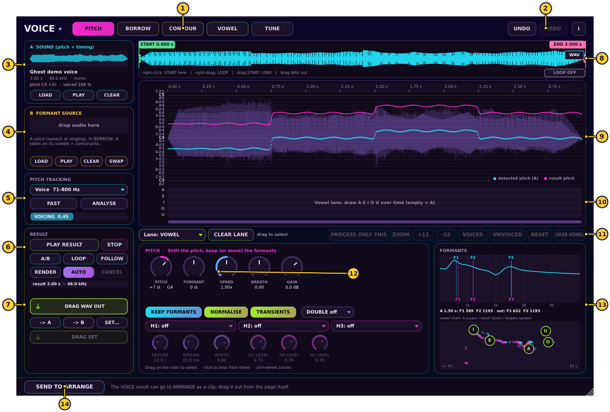

| No. | Control | What it does |
|---|---|---|
| 1 | Modes: **PITCH, BORROW, CONTOUR, VOWEL, TUNE** | What the page does to slot A (keys 1 to 5). |
| 2 | **UNDO, REDO, i** | Undo, and the about panel. |
| 3 | Slot **A** | The sound you change: **LOAD, PLAY, CLEAR**. |
| 4 | Slot **B** | The formant source, used only by BORROW: **LOAD, PLAY, CLEAR, SWAP**. |
| 5 | **PITCH TRACKING** | The pitch range, **FAST**, **ANALYSE** and **VOICING**. |
| 6 | **RESULT** | **PLAY RESULT, STOP, A/B, LOOP, FOLLOW, RENDER, AUTO, CANCEL**. |
| 7 | Export | **DRAG WAV OUT, -> A, -> B, SET..., DRAG SET**. |
| 8 | Source waveform | START, END, a loop and a WAV grip. |
| 9 | Pitch view | A's detected pitch (cyan) and the result's pitch (pink). |
| 10 | Lane strip | Draw vowels, pitch, formant or breath over time. |
| 11 | Selection bar | **CLEAR LANE**, **PROCESS ONLY THIS**, **ZOOM**, the pitch repairs, **GRAB VOWEL**, and **X** (clear the selection). |
| 12 | Mode controls | The shared knobs and switches, plus the controls of the current mode. |
| 13 | **FORMANTS** | A's formants at the cursor, and a vowel chart. |
| 14 | **SEND TO ARRANGE** | Puts the result on the ARRANGE timeline. |

### A first result in a minute

1. Drop a sound on slot **A** (or press **LOAD**). TRY IT on the VOICE card loads a short sung line.
2. Press **PLAY RESULT**.
3. Turn **PITCH** or **FORMANT**, or draw on the pitch view.
4. Drag **DRAG WAV OUT** (left) into your DAW when you like it (full version).

With **AUTO** on (the default), the result renders again by itself after each change. An **OUT OF DATE** badge shows while it is not up to date.

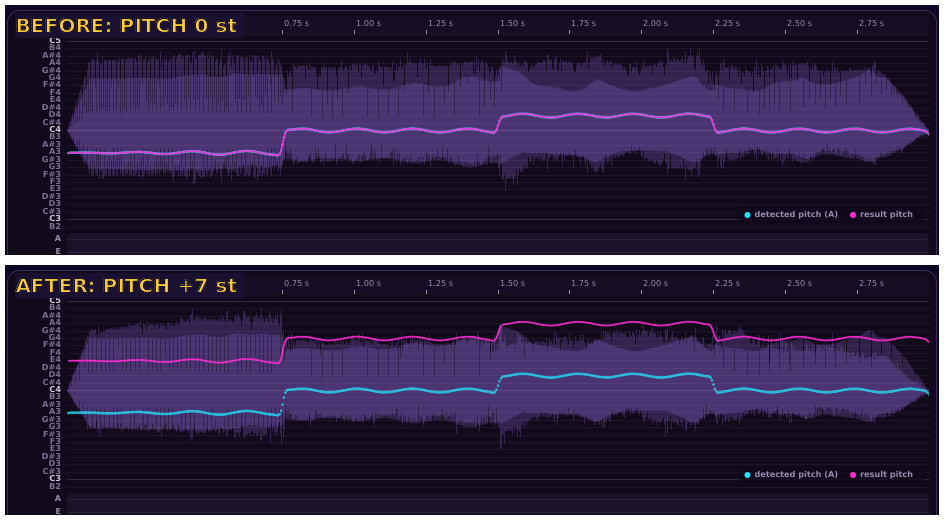

### The left column

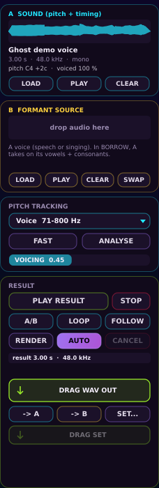

Slot **A** holds the sound you change, slot **B** the voice BORROW takes its formants from. **PITCH TRACKING** sets how the pitch is found. **RESULT** plays, renders and exports the result.

### The five modes

- **PITCH** (key 1): move the pitch and keep the formants, so there is no chipmunk effect. Turn **KEEP FORMANTS** off to let the formants move with the pitch.
- **BORROW** (key 2): slot A takes on the formants of slot B, so it speaks or sings with B's vowels and consonants. Make a synth speak.
- **CONTOUR** (key 3): draw a new pitch curve on the pitch view, and the sound sings it. **TRACE** copies A's own pitch so you can edit it.
- **VOWEL** (key 4): put the vowels A, E, I, O, U along the vowel lane, and morph between them.
- **TUNE** (key 5): pull A's pitch onto the notes of a key. **RETUNE** sets how fast; 0 is instant and robotic.

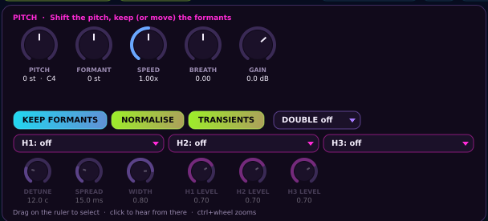

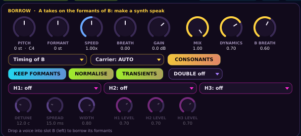

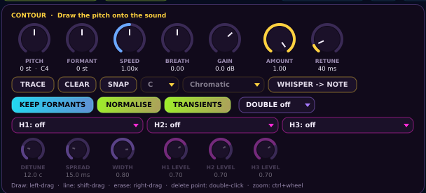

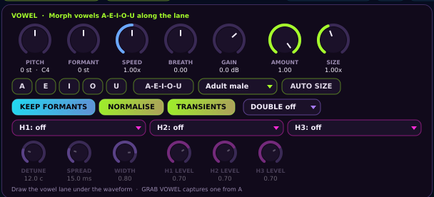

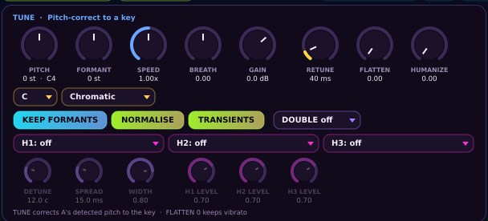

### Thicker voices: DOUBLE and HARMONY

- **DOUBLE** stacks detuned, slightly delayed copies (x2 to x8) for a wide, thick sound.
- **H1**, **H2** and **H3** add up to three harmony voices in the key.

> **Warning:** The harmony steps count notes of the chosen scale. The default scale is **Chromatic**, where "3rd up" is only two semitones. Set the root and a 7-note scale (Major, Minor, Dorian, Mixolydian) first. The root and scale boxes are only shown in **TUNE** and **CONTOUR** mode: switch to TUNE (key 5), set them, then switch back.

### When the pitch looks wrong

The cyan dots are the pitch VOICE detected in A. If they jump an octave or miss a part:

- Pick a better range in **PITCH TRACKING** (for example **Sub / 808** for bass, **High voice** for high singing).
- Select the part on the pitch view's ruler and use the repair buttons: **+12**, **-12**, **VOICED** or **UNVOICED**.
- Switch **FAST** off for the slower, more careful tracking.

### Good to know

- Only the part between **START** and **END** in the source waveform is processed.
- **PROCESS ONLY THIS** changes only the selection and leaves the rest of A untouched (not in BORROW).
- **A/B** (or Tab) switches between the result and the original at the same spot, at matched loudness.
- **-> A** puts the result into slot A, so you can process it again.
- In the Standalone app, and with SYNC: OWN, SPACE runs Spectrum's clock. Use **PLAY RESULT** there.

> **Note:** All control details are in "Reference: VOICE".

# Recipes and help

## GHOST VOICE

**What this page is for.** You sing a line. GHOST VOICE takes the "fingerprint" of another voice - what that voice's throat and mouth do for every vowel - blends it with yours, and sings your line with the blended voice. Your pitch, timing, words and vibrato stay exactly as you sang them; only the voice changes. The result is a singer nobody has heard before. It is classic signal processing (no models, no graphics card), so it renders in a few seconds on a background thread.

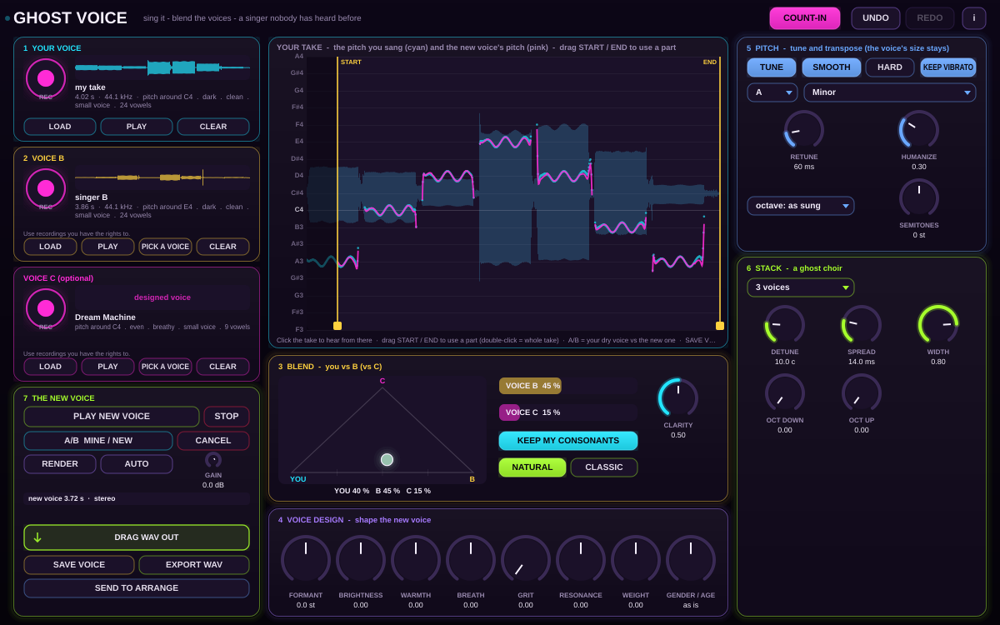

| No. | Section | What it does |
|---|---|---|
| 1 | **YOUR VOICE** | The performance. **REC** records from the input (the mic in the standalone app, the track in a DAW), with four **COUNT-IN** clicks at Spectrum's tempo; **LOAD** or a drop takes a WAV. Up to 3 minutes. |
| 2 | **VOICE B** | The voice blended in: record it, drop a file, or **PICK A VOICE** (designed voices and your saved ones). It can be a singer, a pad, a choir or an instrument. Use recordings you have the rights to. |
| - | **VOICE C** | Optional third voice. With C the blend pad becomes a triangle. |
| 3 | **BLEND** | The dot: how much of you, B and C. The **VOICE B / VOICE C** sliders set exact percentages. **KEEP MY CONSONANTS**: your s, t, k, f and breaths stay yours; **CLARITY** is how much of the fine detail above 5 kHz stays yours. **NATURAL / CLASSIC** picks the sound (see below). |
| 4 | **VOICE DESIGN** | FORMANT (size), BRIGHTNESS, WARMTH, BREATH, GRIT, RESONANCE, WEIGHT and GENDER / AGE (size and pitch together). |
| 5 | **PITCH** | **TUNE** to a key (SMOOTH keeps vibrato and glides; HARD snaps flat), RETUNE and HUMANIZE, KEEP VIBRATO; octave and SEMITONES transpose. The voice's size never follows the transpose. |
| 6 | **STACK** | 1 to 4 doubled voices with DETUNE, SPREAD and WIDTH (a ghost choir), plus OCT DOWN / OCT UP layers. |
| 7 | **THE NEW VOICE** | PLAY NEW VOICE, STOP, A/B (your dry voice vs the new one at the same spot, loudness-matched), RENDER / AUTO, GAIN, the progress bar, DRAG WAV OUT, SAVE VOICE, EXPORT WAV, SEND TO ARRANGE. |

### A first result in a minute
1. Press **REC** on YOUR VOICE and sing a line (four clicks, then it records). Or drop a WAV. **TRY IT** on the HOW IT WORKS card loads a short sung line and the voice Glass Angel.
2. On VOICE B press **PICK A VOICE** and choose one, or record someone (with their permission), or drop a file.
3. Drag the blend dot to the middle. **PLAY NEW VOICE**. Press **A/B** to hear your dry voice against the new one.
4. **SAVE VOICE** to keep the blend as a preset; **DRAG WAV OUT** into your DAW.

### The take picture
The big picture is your take: the waveform, the pitch you sang (cyan dots) and the new voice's pitch (pink line). They sit on top of each other, which is the point: the pitch is exactly yours. Click anywhere to hear from there. Drag **START** and **END** to use only a part of the take; double-click the picture to use the whole take again.

### How the blend works, in plain words
Every voice has a fingerprint: for each vowel, where its resonances sit and how bright, breathy or heavy it is. GHOST VOICE learns B's fingerprint from B's recording (it sorts B's sung moments by vowel and keeps one picture per vowel). Then, for every moment of your take, it finds how B would sing the vowel you are singing, slides your resonances and B's towards each other by the blend percentage, and rebuilds the sound with your pitch and your timing. That sliding is what makes a 50 / 50 blend sound like one new singer and not like two people at once. Consonants and breaths are left as yours unless you switch KEEP MY CONSONANTS off.

### NATURAL or CLASSIC
- **NATURAL** (a new page starts here): your own recording is reshaped into the new voice. Nothing is re-built from scratch, so your breath, attacks and the detail of your recording stay, and every blend comes out at the same loudness. Pitch moves, TUNE, STACK, BREATH and GRIT all work on it. At 0 % you hear your own take back.
- **CLASSIC**: the first GHOST VOICE sound. The new voice is re-built from scratch; it sounds more processed.
- Sessions saved before NATURAL existed open on CLASSIC, so they sound exactly as they did. Switch to NATURAL any time.

### Designed voices
The factory voices are built, not recorded: nobody's voice is in them. Glass Angel (airy, bright, delicate), Midnight (dark, warm, intimate), Electric Soul (powerful, textured), Dream Machine (soft, breathy, atmospheric), Velvet, and the strange ones: Tiny, Giant, Alien, Choir Of One, Static Ghost.

### Good to know
- A voice B with no clear vowels (a pad, a noise) is used by its overall colour instead; the page says so.
- **SAVE VOICE** writes a small `.ghostvoice` file (the fingerprint plus the settings) to Documents/Ghosty/Ghosty Spectrum/Voices. It appears under MY VOICES in PICK A VOICE, and a `.ghostvoice` file can be dropped on VOICE B or C.
- The render runs on a background thread with a progress bar; the audio never waits for it. **AUTO** renders again after every change; **CANCEL** stops a long one.
- Demo mode: everything plays, but DRAG WAV OUT and EXPORT WAV are part of the full version.
- Keys: Space plays / stops, Tab = A/B, R = record on YOUR VOICE, Esc stops a recording, Ctrl/Cmd+Z undoes.

## Recipes

Short step-by-step recipes. Each one names the page to open first.

### A pad that never stops (PAINT PADS)

1. Set the key and scale first (or press **DETECT KEY** while your song plays into the sidechain input).
2. Keep **SNAP TO KEY** on. Click **Ambient pad** under STARTING POINTS.
3. Raise **BLOOM** and **SPACE**, and add some **SHIMMER**. Keep **HOLD** on so it always sounds.
4. Press **FREEZE** at the end of a section to hang the sound in the air. **STOP** fades it out.

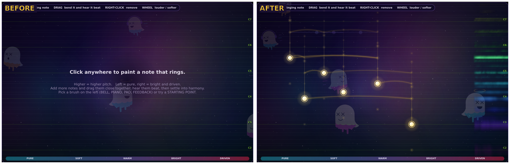

### Draw a bass and drums loop (PAINT LOOP)

1. Length box: **2 bars**. Click a bass under **SYNTHS > Bass**, choose **DRAW** and drag a few short lines.
2. Set the grid box to **1/8** (QUANTIZE is on by default).
3. Click a kick under **DRUMS**, choose **DROP** and click on the beats. Each sound is its own layer: set its **VOLUME** and **PAN**.
4. Press **PLAY**, or play your DAW. **DRAG STEMS OUT** gives one WAV per layer that has notes (full version).

### Turn a picture into a texture (SPECTRAL LAB, IMAGE)

1. Open the **IMAGE** page. Press **LOAD PICTURE**, or drop a PNG or JPG on the canvas.
2. Set **LOW Hz**, **HIGH Hz** and **CONTRAST**. Press **FIT TO 2 BARS** to match your tempo.
3. Press **PLAY**. Switch to the **PAINT** page and **SMEAR** or **SHIFT** parts of it.
4. Press **SEND TO ARRANGE**.

> **Note:** Edits you make on the PAINT page are lost if you then turn an IMAGE knob, because the picture is mapped again (UNDO brings them back). Set the IMAGE knobs first, then paint.

### Make a one-note sound playable (SPECTRAL LAB)

1. Press **IMPORT SOUND**. Check the root box ("plays at ..."): the Lab sets it from the sound's pitch.
2. Make sure **KEYS** is on at the top. Play your MIDI keyboard: the root key plays the sound at its own pitch.
3. Choose **KEYS PITCH: SPECTRAL** to keep the length on every key, or **TAPE** for a sampler feel. Turn on **ONE-SHOT** for drums.

### Variations on every hit (SPECTRAL LAB, GHOST)

1. Put a short sound on the Lab canvas. Open the **GHOST** page (ghosts are made at once).
2. Set **HITS** to 8, raise **EVOLVE**, press **GENERATE**.
3. Play keys: every key press plays the next ghost. Set the hit box to **ALWAYS GHOST 3** to stay on one.
4. **SEND TO BEATS** saves the whole set, one WAV per ghost (full version).

### Band rhythms (SPECTRAL LAB, SPLIT)

1. Put a pad or a drone on the Lab canvas. Open the **SPLIT** page.
2. Choose **4 bands**. With **EDIT STEPS**, switch steps off in the low band for a pulse, and leave the top band running.
3. Use **EDIT CHANCE** for random hits and **EDIT PITCH** to move steps up or down. Raise **SWING**. **DICE** rolls the chance steps again.
4. Press **PLAY**.

### Morph two sounds by playing harder (SPECTRAL LAB, DNA)

1. Open the **DNA** page. Press **LOAD A** and **LOAD B** (or **CANVAS > A**, **CANVAS > B**).
2. Turn on **PER NOTE**, and make sure **KEYS** is on. Soft keys give A, hard keys give B.
3. Or turn on **PER BAR** and draw the 8-bar lane for a morph that moves along the song.
4. **MORPH > CANVAS** puts the current morph on the canvas so you can paint on it.

### Generate ideas (SPECTRAL LAB, CHAOS)

1. Open the **CHAOS** page. Set the key and scale on the left.
2. Set **HARMONY** to the middle (notes of the key), **DENSITY** to taste, and **CHAOS** low for tidy or high for wild.
3. Press **GENERATE**. Like a part of it? Press **LOCK TOOL**, draw a box around that part, then **GENERATE** again: the locked box stays. **NEW SEED** gives a new picture.

### Reverse and stretch a tail (PROCESS)

1. Make or import a sound in SPECTRAL LAB, then open **PROCESS**.
2. Drag across the tail of the waveform to select it.
3. **+ ADD > SHAPE > REVERSE**, then **+ ADD > SPECTRAL > STRETCH**. AUTO previews it.
4. Compare with **PLAY SRC** and **PLAY FX**.
5. Press **APPLY** to keep the whole sound with the changed tail (UNDO brings the old one back). **BOUNCE NEW** instead makes only the processed tail the Lab's new sound.

### A synth line you draw (ARCS)

1. Press **FACTORY** for a starting page, or choose **DRAW** and sketch a line. Press **PLAY**.
2. Turn on **QUANTISE** and set the key and scale.
3. Press Ctrl/Cmd+A to select every line, then pick a sound from **PATCHES**.
4. For a glide to a note use **LINE**. For a riser use **CURVE EXP**.
5. Drag **DRAG MIDI** into your DAW and play it on your own synth, or press **RENDER AUDIO**, then drag **DRAG AUDIO** (full version).

### Make a synth speak (VOICE, BORROW)

1. Load a synth pad into **A** and a spoken line into **B**.
2. Choose **BORROW**. Set the carrier to **VOCODE** for chords, or **RESYNTH** for a single line (AUTO picks for you).
3. Keep **CONSONANTS** on (the default) to hear the s, t and k come through. Press **PLAY RESULT**.

### Tune a sung line to a key (VOICE, TUNE)

1. Load the line into **A** (or press TRY IT). Pick the **Voice** range (or **Deep voice / bass** for low voices).
2. Choose **TUNE** (key 5). Set the root and scale boxes to your song.
3. **RETUNE** 40 ms sounds natural; 0 is instant and robotic. Raise **FLATTEN** to remove vibrato.
4. If one phrase is wrong, select it on the pitch view's ruler and use the repair buttons (**+12**, **-12**, **VOICED**, **UNVOICED**).

### Thicken a voice (VOICE, DOUBLE and HARMONY)

1. Press **TUNE** (key 5) and set the root and a 7-note scale (for example Minor), so the harmony stays in key.
2. Go back to **PITCH** (key 1). Set the **DOUBLE** box to **DOUBLE x4** and raise **WIDTH**.
3. Set **H1** to **3rd up** and **H2** to **5th up**; keep their levels around 0.7.
4. Press **PLAY RESULT**, then **A/B** (Tab) to compare with the original.

### Build a song section (ARRANGE)

1. Use **SEND TO ARRANGE** on three or four pages.
2. In ARRANGE, drag the clips into place. Double-click the thin strip at the top of the ruler to add markers. Right-drag the ruler to loop a part.
3. Use the clip **PITCH** and **STRETCH** to fit the key and tempo. Overlap two clips on one track and switch on **MORPH** on the left one for a spectral blend.
4. Press **RENDER**, or drag the **MIX** chip into your DAW (full version).

### Jam without your DAW running (SYNC: OWN)

1. Set **SYNC: OWN**, tap a tempo with **TAP** (or type it), and press **PLAY** (or SPACE).
2. PAINT LOOP, ARCS and ARRANGE now follow Spectrum's own clock.
3. Switch back to **SYNC: DAW** when you want to follow your project again.

In the Standalone app Spectrum always runs on its own clock, so you only need step 1.

### One long note drives a whole section (PLAY: ON NOTES)

1. Set **PLAY: ON NOTES**. In your DAW, draw one long note over the bars where Spectrum should sound.
2. Mute or unmute that channel to start and stop all the players in time with the song.

## Ghosty Spectrum in FL Studio

These steps use FL Studio. Other DAWs work the same way with their own menus.

1. **Install and scan.** Run the installer. In FL Studio, open **Options > Manage plugins** and start a scan (**Find installed plugins**; in newer versions **Find more plugins**). Ghosty Spectrum appears in the list (as VST3; on a Mac also as AU).
2. **Load it.** Click **+** in the Channel rack (or open the plugin browser) and choose **Ghosty Spectrum**. It loads as an instrument (a generator) and opens its window.
3. **Play it.** PAINT PADS rings as soon as you paint. Press FL's play button: PAINT LOOP, ARCS and ARRANGE play in time with your project (keep **SYNC: DAW**).
4. **MIDI notes.** Draw notes in the channel's Piano roll, or play your keyboard with the channel selected. Spectrum takes notes on every MIDI channel. It sends no MIDI out.
5. **PLAY: ON NOTES.** Draw one long note in the Piano roll over the bars where Spectrum should sound, and set **PLAY: ON NOTES** in the top bar. Muting the channel then stops the Lab loop, ARCS and ARRANGE; unmuting starts them again in time.
6. **Drag into the Playlist.** Drag a drag-out button straight onto FL's Playlist or onto a channel: **DRAG PATTERN OUT (WAV)**, **DRAG STEMS OUT**, **DRAG WAV OUT**, **DRAG MIDI**, the ARRANGE **MIX**, **STEMS** and **MIDI** chips. Some renders run in the background first: if a chip's dot is not green yet, drag again in a moment. Dragging out needs the full version.
7. **Automation.** Move a control in Spectrum, then use FL's **Tools > Last tweaked > Create automation clip**. Or browse the plugin's parameters in the wrapper menu. The list is in "Reference: Automatable parameters".
8. **DETECT KEY with your song.** Route a mixer track into Spectrum's input (its stereo input is named "Sidechain"). DETECT KEY then listens to it. With no signal there, it listens to Spectrum's own sound.
9. **Saving.** Everything (patterns, sounds, the Lab, ARCS pages, ARRANGE, VOICE slots, the PROCESS chain, the look, SYNC and PLAY) is saved inside your FL project.
10. **Tail.** Spectrum reports a 6-second tail to FL, so reverb tails are not cut when you render.

> **Warning:** In the demo, a project reopens at the default state, and saving it while still locked writes the default state over your work. Unlock before you save a project you want to keep.

## Demo and full version

Without a license key, Ghosty Spectrum runs in **demo mode**. You can paint, play and edit everything. The limits are:

- **Drop-out:** the sound goes silent for 2 seconds every 20 seconds (with short fades). This affects every page (the PROCESS page's own preview is not affected).
- **Reopened projects start at the default state.** A locked plugin ignores the saved state when a project opens. If you then save the project while still locked, the default state replaces your saved work. The look, SYNC, PLAY and the first-run hints also start fresh.
- **No export.** Audio and MIDI cannot leave the plugin:
  - PAINT: **DRAG PATTERN OUT (WAV)**, **DRAG STEMS OUT**.
  - SPECTRAL LAB: **DRAG WAV OUT**, the waveform strip's **WAV** grip, **SEND TO BEATS**.
  - PROCESS: **DRAG**.
  - ARCS: **DRAG MIDI** (and saving MIDI by click), **RENDER AUDIO** and **DRAG AUDIO**, the loop's **WAV** and **MIDI** grips.
  - ARRANGE: the **MIX**, **STEMS** and **MIDI** chips, the loop grips, **RENDER**, **SEND TO BEATS**.
  - VOICE: **DRAG WAV OUT**, the **WAV** grip, **DRAG SET**, **RENDER SET**.
- When you try one, a hint appears for about 4 seconds near the top right, where the **UNLOCK** button sits on the PAINT pages: "Export is part of the full version. Click UNLOCK and enter your license key ..." Nothing is written or dragged.
- **Saves leave out audio the plugin made while locked**: clips sent to ARRANGE from other pages, ARRANGE bounces, a PROCESS result used as the Lab's sound, and a canvas rendered into a DNA slot. Sounds you imported yourself are kept.

Still available in the demo: all painting and playing, **SEND TO ARRANGE** and ARRANGE playback, **PNG** and **SAVE PICTURE** in the Lab, SAVE and LOAD of PAINT canvases and ARCS pages.

### How to unlock

1. Click **UNLOCK** (top row of PAINT PADS and PAINT LOOP).
2. In the Unlock box, paste the license key from your purchase receipt email and click **Unlock**. (**Buy** opens the store if you don't have a key yet.)
3. The first unlock needs the internet. After that it works offline. The button then reads **LICENSED**.

- A key works on up to 5 computers. Unlocking again on the same computer doesn't use up another one. Past the limit you get a message asking you to email support.
- A product key unlocks its own plugin (a Ghosty Spectrum key also unlocks Ghosty Beats, which is sold with it). A bundle key unlocks every GhostBlock plugin; enter it once in each plugin.
- Spectrum checks the purchase again quietly every 14 days when it loads. It only locks again if the purchase was refunded, charged back or disputed, never because the internet is down.
- The license file is kept in **~/Library/GhostBlock** (Mac) or **%APPDATA%\GhostBlock** (Windows).

## Troubleshooting

**No sound at all.**
Check the top bar. **BYPASS** silences everything. **PLAY: ON NOTES** only sounds while a MIDI key is held. In **SYNC: OWN**, press Spectrum's own **PLAY**. On PAINT PADS, a stopped pad needs **START** (or a click on the canvas, a MIDI key or your DAW's play). Check that the plugin's mixer track is not muted.

**My MIDI keyboard does nothing.**
Make sure the MIDI goes to Spectrum's channel. In the Standalone app, tick your keyboard in **Options > Audio/MIDI Settings...**. In the Lab, press **KEYS** and stay on the Lab tab. On PAINT PADS, turn **HOLD** off if you want the pad to follow your keys. In ARCS, turn on **MIDI IN**.

**The sound drops out for 2 seconds.**
That is demo mode (every 20 seconds). Enter your license key.

**Drag-out does nothing and says "full version".**
Exporting is part of the full version. Click **UNLOCK** and enter your key.

**The plugin is not in FL Studio.**
Scan again in FL's plugin manager (**Options > Manage plugins**). Make sure you installed the VST3 (on a Mac, VST3 or AU).

**Mac: "cannot be opened because it is from an unidentified developer".**
On older macOS: right-click the installer, choose **Open**, then confirm. On macOS 15 and later: try to open it once, then go to **System Settings > Privacy & Security** and click **Open Anyway**.

**Nothing plays when I press play in my DAW.**
Set **SYNC** to **DAW**. Check **PLAY** is not on **ON NOTES** without a held note. In ARCS, check **MIDI IN** is off (while it is on, only held notes play the page). The Lab only plays while its tab is open.

**A short delay when I play a new key in the Lab.**
**KEYS PITCH: SPECTRAL** renders each new pitch in the background. The first press may sound tape-style for a moment. Choose **TAPE** for instant response.

**PREVIEW is greyed out in PROCESS.**
PREVIEW needs a sound, at least one process in the chain (use **+ ADD**) and a region. Make or import a sound in SPECTRAL LAB first (or press TRY IT on the PROCESS card). If you clicked the waveform, you only placed a cursor: drag across it, or press **ALL**.

**The hint bubbles come back.**
GOT IT hides a hint for that page in this project. In the demo, reopened projects start fresh, so the hints come back.

**The tempo of a drag-out is wrong.**
In SYNC: DAW, drag-outs use your project's tempo. In SYNC: OWN and in the Standalone app they use Spectrum's own tempo.

**My dropped file doesn't appear.**
Files dropped on the PAINT pages go to **MY SAMPLES** in PAINT LOOP. SPECTRAL LAB, ARRANGE and VOICE take a drop for themselves. Check the file type: the Lab takes WAV, AIF, AIFF, FLAC, OGG, MP3, M4A, CAF and AAC (and pictures); the PAINT pages take WAV, AIF, AIFF, MP3, FLAC, OGG, M4A and CAF; ARRANGE takes only WAV, AIF, AIFF, FLAC and OGG; VOICE takes WAV, AIF, AIFF, FLAC, OGG and MP3. M4A, AAC and CAF only open on a Mac; on Windows use WAV, AIFF, FLAC, OGG or MP3.

**VOICE gets the pitch wrong in one part.**
Select the part on the pitch view's ruler and use the repair buttons (**+12**, **-12**, **VOICED**, **UNVOICED**). Try another pitch range, or switch **FAST** off.

**A reopened project sounds different or empty.**
In the demo, a reopened project starts at the default state. Unlock, then reopen the project (don't save it while locked).

## FAQ

**How do I hear only part of a sound?**
SPECTRAL LAB: right-drag in the waveform strip, or draw a SELECT box and turn on LOOP SEL, then press PLAY (or press HEAR). ARCS and ARRANGE: right-drag on the ruler. PROCESS: drag on the waveform and press PLAY SRC. VOICE: right-drag on the source waveform for a loop.

**How do I undo?**
Ctrl/Cmd+Z, or the UNDO button on SPECTRAL LAB, PROCESS, ARCS, ARRANGE and VOICE. PAINT PADS and PAINT LOOP have no undo: use the patterns (COPY first) to keep versions.

**Does TRY IT delete my work?**
PAINT PADS and PAINT LOOP: the example goes into an empty pattern (into the current one only when no pattern is empty). SPECTRAL LAB and PROCESS: the example is a NEW Lab canvas, and UNDO in the Lab brings your canvas back (an imported sound comes back as its canvas picture, not as the original file). ARCS: it replaces the current page with a factory page, as one undo step. ARRANGE: two clips are added. VOICE: it replaces slot A, as one undo step.

**Where do my files go?**
Saved canvases, Lab bounces and pictures: Documents/Ghosty/Spectrum. SEND TO BEATS: Documents/Ghosty/Shared Sounds. Drag-out files: your system's temporary folder. See "Reference: Files, folders and limits".

**Can I use my own samples?**
Yes. Drop audio files on the PAINT pages (they appear in MY SAMPLES), IMPORT SOUND in the Lab, IMPORT in ARRANGE, or LOAD in VOICE.

**Does it send MIDI out?**
No. ARCS and ARRANGE can drag MIDI files out (full version), which you then play on another instrument.

**Can I use it as an effect on my tracks?**
No. It is an instrument. Its input is only used by DETECT KEY.

**Which parameters can I automate?**
See "Reference: Automatable parameters".

**Is there an output volume control?**
The plugin has a Volume parameter in your DAW's parameter list (its default is unity gain). On screen, use the pad LEVEL, the layer VOLUME, the Lab LEVEL, the ARCS MASTER and the ARRANGE track gain.

**How many computers can one key unlock?**
Five. Unlocking again on the same computer doesn't count twice.

## Glossary

- **Spectrogram:** a picture of sound. Up is pitch, across is time, and brightness is loudness. The SPECTRAL LAB canvas is a spectrogram you can paint on.
- **Partial:** one of the separate tones a sound is made of: the main note and the quieter overtones above it. On a spectrogram each partial is a line.
- **Overtone:** a higher, quieter tone that rings above a note and gives it its colour.
- **Formant:** a resonance of the throat and mouth. Formants make the vowels (A, E, I, O, U) and the "size" of a voice.
- **Grain:** a tiny slice of sound, from a few to a few hundred milliseconds long. Granular processes rebuild a sound from many grains.
- **Wavecycle:** one single swing of a waveform, from one rising zero crossing to the next.
- **Beating:** the slow wobble you hear when two tones are almost, but not quite, in tune.
- **Cent:** a hundredth of a semitone.
- **Pad dot:** one ringing note on the PAINT PADS canvas.
- **Brush:** the sound of new pad dots: BELL, PIANO, PAD or FEEDBACK.
- **Pattern A to H:** one of eight pictures shared by PAINT PADS and PAINT LOOP. Each pattern holds pad dots and loop notes.
- **Layer:** one sound in PAINT LOOP, with its own VOLUME, TONE, SPACE and PAN.
- **Box:** a rectangle you drag on the Lab canvas to select, shift, stretch, freeze, lock or cut.
- **Ghost:** a variation of the Lab sound, one per hit.
- **Band:** a slice of the frequency range. SPLIT gives each band its own rhythm.
- **Seed:** a number that makes random choices repeatable. The same seed gives the same result.
- **Morph:** a blend from one sound into another, done on the frequencies rather than by a simple crossfade.
- **Process / chain:** an effect that is written into the Lab's sound / a list of processes run in order.
- **Destructive:** an edit that changes the sound itself (you can still undo it).
- **Arc / line:** a line in ARCS. Each line is one voice.
- **Page (ARCS):** a set of lines. Eight pages, A to H, per plugin.
- **Quantise:** move notes onto a grid in time, or onto the notes of a key in pitch.
- **MPE:** MIDI with one channel per note, so each note can bend on its own.
- **Clip / track:** a piece of sound on the ARRANGE timeline / the row it sits on.
- **Warp:** stretching a clip's sound so it follows the song tempo.
- **Stems:** one audio file per layer or per track.
- **Slot A / B (VOICE):** A is the sound you change; B is the voice whose formants BORROW uses.
- **Vocode / resynth:** two ways BORROW rebuilds A: filter A's real audio, or rebuild it from its pitch.
- **Voice fingerprint (GHOST VOICE):** what a voice's throat and mouth do for every vowel: where its resonances sit, how bright, breathy and heavy it is. GHOST VOICE blends two or three of them.
- **Shared Sounds:** the Documents/Ghosty/Shared Sounds folder that Spectrum and Ghosty Beats both use.
- **Sidechain input:** Spectrum's audio input. Only DETECT KEY listens to it.
- **Demo mode:** using the plugin without a license key: drop-outs and no export.

# Reference

## Reference: PAINT PADS and PAINT LOOP

This chapter lists every control of the two PAINT pages with its options and default. The chapters "PAINT PADS" and "PAINT LOOP" explain how to use them.

### Top rows (both pages)

| Control | Options / range | Default | What it does |
|---|---|---|---|
| **PLAY** | on / off | off | Plays the pattern while your DAW is stopped. When the DAW plays, the pattern plays with it anyway. Pressing PLAY again after a stop carries on from where it stopped. |
| Tempo label | | | **HOST 128 BPM**: your project's tempo. **OWN 120 BPM**: Spectrum's own tempo (SYNC: OWN, the Standalone app, or a DAW that sends no position). It can show one decimal. Playback, drag-outs, stems and SEND TO ARRANGE use this tempo. |
| Tempo bar | 60 to 200 BPM | 120 | Shown instead of the label only in SYNC: DAW when the DAW sends a song position but has never sent a tempo. Click or drag to set, Shift for fine steps, wheel for 1 BPM, right-click to type, double-click for 120. It is the host parameter "Tempo (no host)". |
| Length box | **1 bar**, **2 bars**, **4 bars** | 2 bars | The length of this pattern. The canvas loops. Each pattern keeps its own length. |
| **QUANTIZE** | on / off | on | PAINT LOOP only. See "Tools and grid (PAINT LOOP)". |
| Grid box | **1/4**, **1/8**, **1/16** | 1/16 | PAINT LOOP only. |
| **SAVE** | | | Saves the whole canvas (all 8 patterns, all sounds, key, scale, the switches and the pad effects) as a .ghostspec file in Documents/Ghosty/Spectrum, named for you after the date and time, for example "Spectrum 10-27 1432". Your own samples are saved inside the file. A second SAVE in the same minute replaces the first file. |
| **LOAD** | | | A menu of the saved files, sorted by name. Picking one replaces everything SAVE stores, and also restores the current pattern and the brush. It opens on the tab it was saved on (PAINT PADS or PAINT LOOP). An empty folder shows "Nothing saved yet (use SAVE)". |
| **CLEAR** | | | PAINT PADS: removes every dot in this pattern. PAINT LOOP: removes every note in this pattern and keeps the sounds. There is no undo. |
| **A** to **H** | 8 patterns | A | Eight separate pictures. Switch at any time, even while playing: the old pattern's dots fade out and the new ones fade in. A pattern with content (other than the current one) shows a dot, for example **B.** |
| Right-click a pattern | **Copy current pattern here**, **Clear this pattern** | | Copy overwrites that pattern with the current one and switches to it. Clear empties it (its dots and notes; another pattern also goes back to 2 bars). |
| **COPY** | | | Copies this pattern into the next empty one (after H it wraps round to A) and switches there. When all 8 are in use: "All 8 patterns are in use. Clear one first (right-click it)." |
| Key box | **C, C#, D, D#, E, F, F#, G, G#, A, A#, B** | C | The key. Changing it doesn't move notes you placed; it moves the guide lines, retunes the open strings of STRINGS and sets which MIDI key plays the pad as painted. |
| Scale box | **Major, Minor, Harmonic minor, Dorian, Pentatonic minor, Pentatonic major, Chromatic** | Minor | Used by SNAP TO KEY, the STARTING POINTS and STRINGS. |
| **SNAP TO KEY** | on / off | on | Notes land on notes of the key. On PAINT PADS a new dot lands on a key note at once; a dragged dot moves freely and snaps when you let go (hold ALT to keep it free). With SNAP on, the key's rows show faint guide lines. |
| **DETECT KEY** | | | Listens, then sets the key and a **major** or **minor** scale, and turns SNAP TO KEY on. It reads LISTENING..., then LISTENING 0-100%. It takes in 5 seconds of audio, or gives up after 9 seconds. It uses the sidechain input when audio arrives there, otherwise Spectrum's own sound. See the messages below. |
| **UNLOCK** / **LICENSED** | | | Only shown while the plugin needs a license key. See "Demo and full version". |

DETECT KEY messages: on click, "Listening... play your track (route it into Spectrum's sidechain) or press PLAY." When done, for example "Heard A minor in the sidechain input. SNAP TO KEY now uses it." (or "...in Spectrum's own sound..."; "(a close call)" is added when two keys scored almost the same). With nothing heard: "Didn't hear anything. Send audio into Spectrum's sidechain input (or press PLAY), then DETECT KEY again."

Under the rows, the status line tells you what just happened (for example 'Saved "Spectrum 10-27 1432" (all patterns) in Documents/Ghosty/Spectrum.', "Copied to pattern B. Change it to make a variation.").

### Brushes (PAINT PADS)

| Brush | Mark on the dot | How it behaves |
|---|---|---|
| **BELL** (default) | a ring | Struck once, then it decays. Inharmonic overtones: glassy on the left, a big church bell on the right. It rings again each time the pattern loops while playing, and on every MIDI key. |
| **PIANO** | a vertical line | Struck like a piano string, with slightly sharp overtones. Soft felt on the left, hard bright hammer on the right. |
| **PAD** | none | Swells in and holds. Warm and pure on the left (with a soft sub an octave down), bright and grainy on the right. It is not struck again when the pattern loops. |
| **FEEDBACK** | a jagged ring | Swells in, then climbs up the overtones, with vibrato and drive that grow over time. On the far left it climbs to the 2nd harmonic in about 7 seconds; on the far right to the 5th harmonic in about 2.5 seconds. Drag it to bend it. |

When a new dot (any brush) is added, BELL and PIANO dots that share overtones with it ring again softly. Brush colours: BELL amber, PIANO cyan, PAD violet, FEEDBACK orange-red; dots get paler towards the left.

### STARTING POINTS (PAINT PADS)

| Starting point | What it paints | Brush selected |
|---|---|---|
| **Bell chord** | 6 BELL dots: a chord around middle C (1st, 3rd and 5th notes of the scale), the root an octave below, and the root and 5th an octave above | BELL |
| **Grand piano** | 6 PIANO dots from two octaves below middle C up to the octave above it | PIANO |
| **Ambient pad** | 5 PAD dots (root, 5th, 3rd and 7th over a low root) plus 1 BELL on top | PAD |
| **Feedback rise** | 2 PAD dots (low root and 5th) under 2 FEEDBACK dots (root and 5th) | FEEDBACK |

"3rd" and "5th" are notes of a 7-note scale. In the pentatonic scales the 2nd and 3rd scale notes are used instead, and in Chromatic the 2nd and 4th semitone steps above the root (D and E in C). A starting point replaces the current pattern's dots; there is no undo.

### Canvas (PAINT PADS)

| Gesture | What it does |
|---|---|
| Click on empty space | Adds a dot with the current brush at 80 % loudness. A pattern holds at most 32 dots ("32 notes is the most a pad can hold. Right-click one to remove it."). |
| Drag a dot | Moves it in pitch and tone while it sounds, without snapping. Snaps into key when you let go (SNAP TO KEY on); hold **ALT** while letting go to keep it free. |
| Hover or drag a dot | Shows its note, its offset in cents (from 1 cent) and its brush, for example "A3 +14c BELL". |
| Mouse wheel over a dot | Louder or softer, from 5 % to 100 %. |
| Right-click a dot | Removes it. Keep the right button down and drag to remove several. On a Mac, Ctrl-click or a two-finger click works too. |

The hint at the top of the canvas reads "CLICK paint a ringing note, DRAG bend it and hear it beat, RIGHT-CLICK remove, WHEEL louder / softer". A thin bar along the top of the canvas shows the loop position while something plays. Touching the canvas also restarts a pad you stopped with STOP.

### PAD EFFECTS (PAINT PADS)

All nine knobs run from 0 to 100 %. They act on the pad only. All of them, plus HOLD and FREEZE, can be automated (see "Reference: Automatable parameters").

| Knob | Default | What it does |
|---|---|---|
| **BLOOM** | 45 % | How slowly notes swell in and fade away. PAD dots swell in over 0.08 s (0 %) up to about 5 s (100 %) and fade over 0.35 s up to about 7.4 s. FEEDBACK swells over 0.15 to 2.65 s and fades over 0.4 to 4.4 s. BELL and PIANO always strike at once; when let go they fade over 0.5 to 3 s. |
| **SPACE** | 65 % | Size and amount of the big reverb. Higher is a bigger room, more of the pad sent into it and less of the dry sound. |
| **SHIMMER** | 40 % | An octave-up sparkle: the reverb is shifted up an octave and fed back in. A guard stops it from building up louder than the pad. |
| **TAPE** | 25 % | A warbly tape echo on a dotted 1/8 note at the current tempo. It bounces left and right, wobbles and gets darker with each repeat. More TAPE gives more and louder repeats. Below 1 % it is off. |
| **DRIVE** | 12 % | Gentle saturation on the whole pad. Below 1 % it is off. |
| **STRINGS** | 35 % | Sustain pedal down: up to 22 open strings, tuned to the notes of your key and scale from C2 upward, ring along with the pad. With a 7-note scale the strings reach about C5, with a pentatonic scale about C6. In Chromatic the strings use the notes of the Major scale. Below 1 % it is off. |
| **DRIFT** | 30 % | A slow pitch wander. Each dot drifts at its own slow speed, by up to about 9 cents either way at 100 %. |
| **STRUM** | 30 % | BELL and PIANO dots ring one after another from low to high (when the loop comes round or on a MIDI key). The gap is 0 s at 0 % and 0.11 s at 100 % (33 ms at the default). |
| **LEVEL** | 75 % | Pad volume. A limiter (about -5 dBFS) keeps many bright dots from slamming the output. |

| Button | Default | What it does |
|---|---|---|
| **HOLD** | on | On: the pad always sounds. Off: the pad only sounds while you hold MIDI keys. |
| **FREEZE** | off | Freezes the reverb so the sound hangs in the air. While the pad is stopped, FREEZE is ignored. |
| **STOP** / **START** | | STOP fades the pad out (even with HOLD on); the button then reads START. The pad starts again with START, a click on the canvas, a MIDI key, or when playback starts. |

The pad also stops when your DAW stops (or Spectrum's own clock stops), when you open SPECTRAL LAB, or when BYPASS is on.

### Sound bank (PAINT LOOP)

| Part | What it does |
|---|---|
| **SYNTHS** | 52 sounds in the groups **Bass, Keys, Pads, Leads, Plucks, Bells, Vox, Brass, FX**. |
| **DRUMS** | 61 sounds in the groups **Kick, 808, Snare, Clap, Hat, Open Hat, Perc, Tom, Cymbal, FX**. |
| **MY SAMPLES** | Your own sounds for this session. When it is empty: "Drop audio files anywhere on Spectrum and they show up here." |
| Click a group | Shows its sounds. Scroll the list with the mouse wheel. |
| Click a synth or sample | Plays it once at middle C, adds it as a new layer and selects it ('"[name]" picked. DRAW on the canvas to use it.'). If it is already a layer, that layer is selected. |
| Click a drum | Plays it once and picks it. It becomes a layer the first time you draw or drop with it. |
| Drag a sound onto the canvas | Adds it as a layer if needed and places one note where you let go (on the grid with QUANTIZE on, in key with SNAP TO KEY on for synths and samples). |

Dropped files (WAV, AIF, AIFF, MP3, FLAC, OGG; M4A and CAF on a Mac) go to MY SAMPLES: up to 60 s of each file is read, silence at both ends is trimmed, the level is normalised, and the sample is named after the file. It plays at its own pitch on C4. Samples used as layers are saved with the project and with SAVE (as 16-bit mono, up to 30 s each).

### Tools and grid (PAINT LOOP)

| Tool | What it does |
|---|---|
| **DRAW** (default) | Drag a line: one note per grid step the line crosses. On a synth or sample, steps in a row on the same pitch join into one longer note; on a drum every step is its own hit. A click makes one note. Grab a note to move it, or its right end to stretch it. |
| **DROP** | Click to drop single notes. Grab a note to move or stretch it. |
| **CONNECT** | Click a note, then a later note of the same sound: the later note slides from the earlier one, and the earlier note is set to end exactly where the later one starts. A curve shows the slide. A sound with a slide plays one note at a time. A click on empty space cancels. |
| **MOVE** | Drag a note to move it in time and pitch. Drag its right end to change its length. |
| **ERASE** | Click or drag over notes to erase them. |
| Right-click / right-drag | Erases in every tool. On a Mac, Ctrl-click or a two-finger click works too. |

| Control | Options | Default | What it does |
|---|---|---|---|
| **QUANTIZE** | on / off | on | Notes snap to the grid when you place, move and stretch them (placing and moving round down to the grid line before the mouse). With QUANTIZE on, a note can't be shorter than one grid step. With it off, notes go anywhere, down to 1/64 note. |
| Grid box | **1/4, 1/8, 1/16** | 1/16 | The grid for QUANTIZE and for DRAW. A drawn line makes one note per grid step even with QUANTIZE off. The box is greyed out while QUANTIZE is off. |

A clicked note is 1 grid step long on a drum, or 2 grid steps (at least half a beat) on a synth or sample. All notes play at 85 % velocity. If no sound is picked: "Pick a sound in the bank first (left), then draw." The canvas hint reads "LEFT paint / drag notes, RIGHT-CLICK delete, DRAG A NOTE'S END longer". Up to 1,024 notes per pattern are played.

### Layers (PAINT LOOP)

Up to 8 layers ("8 sounds is the max - remove one first (REMOVE)."). Layer buttons sit 4 per row; a muted layer shows "(muted)" before its name. The title over the knobs reads **SOUND n: [name]**. A layer's colour belongs to its place in the list (1 to 8).

| Control | Range | Default | What it does |
|---|---|---|---|
| **VOLUME** | -inf to 0 dB | 0.8 (-1.9 dB) | The layer's level. |
| **TONE** | 0 to 100 % | 50 % | No filter near the middle (48 to 52 %). Below it a low-pass closes from about 19 kHz to 120 Hz (darker); above it a high-pass opens from 25 Hz to 4 kHz (thinner). |
| **SPACE** | 0 to 100 % | 20 % (new drum layers start at 8 %) | How much of the layer goes to the shared loop reverb. Double-click resets it to 20 %. |
| **PAN** | 100 L to 100 R | C | Left/right placement. |
| **MUTE** | on / off | off | Mutes the layer; its notes stay. |
| **REMOVE** | | | Removes this sound and its notes in every pattern. The other notes keep their own sounds in every pattern. |

The layer knobs are not host parameters. The whole loop runs through a gentle soft clipper.

### Drag out and send (both pages)

| Control | What you get |
|---|---|
| **DRAG PATTERN OUT (WAV)** | One pass of the current pattern as you hear it (the loop sounds and the pad dots), at the current tempo, plus a tail: 5 s if the pattern has pad dots, otherwise 2 s. Stereo WAV, 48 kHz, 24-bit, named like "Ghosty Spectrum A 120bpm 143205.wav". Muted layers are left out. |
| **DRAG STEMS OUT** | A folder "Stems HHMMSS" with one WAV per unmuted layer that has notes ("01 [sound name].wav", ...) with a 2 s tail, plus "00 Pad.wav" (5 s tail) when the pattern has pad dots. |
| **SEND TO ARRANGE** | Renders what you hear (this pattern with the pad, one pass plus tail) and puts it on the ARRANGE timeline as a clip tagged with the current tempo, named **Pad A** to **Pad H** (from PAINT PADS) or **Loop A** to **Loop H** (from PAINT LOOP). The status line shows "Rendering for ARRANGE..." and then "On the ARRANGE timeline - open ARRANGE to place it." A very loud render is turned down to just below full scale. An empty pattern sends a silent clip. |

Renders use the plugin's Volume parameter (no knob on screen) and always play the pad as painted: HOLD, STOP, MIDI transposition and PLAY: ON NOTES don't apply to them.

### Keys and mouse (both pages)

| Key / gesture | Action |
|---|---|
| SPACE | Plays and stops Spectrum's own clock in SYNC: OWN and in the Standalone app. In SYNC: DAW it goes to your DAW. |
| ALT while letting go of a dot | Keeps the dot off the key. |
| Mouse wheel over a dot | Louder / softer. |
| Right-click | Removes a dot or a note. On a pattern button: the copy / clear menu. On a knob: type a value. |
| Double-click a knob | Back to its default. |

These pages have no undo.

## Reference: SPECTRAL LAB

The Lab works at 48 kHz inside. The canvas has 3 rows per semitone, from 27.5 Hz to about 22 kHz. While the Lab is open it fills the whole page area under the top bar.

### Top strip

| Control | What it does |
|---|---|
| **PLAY** (reads **STOP** while playing) | Plays or stops the Lab sound as a loop, only while the Lab tab is open. The loop length is what you hear, rounded to whole beats (at least 1 beat). With START / END moved in the waveform strip, PLAY loops between them (while the song is stopped). With **LOOP SEL** on and a box drawn, PLAY loops only the box (hearing the canvas, song stopped). |
| **HEARING** | Picks what you hear. Unless pinned, it follows the page: PAINT, IMAGE and CHAOS play **CANVAS**, GHOST plays **GHOST**, SPLIT plays **SPLIT**, DNA plays **MORPH**. Its menu (WHAT YOU HEAR): **Follow the page**, **Always Canvas**, **Always Ghost**, **Always Split**, **Always Morph**. A pinned choice adds "(PINNED)". The label also shows details: the playing ghost (for example 3/8), the number of bands, or the morph amount. GHOST GENERATE / NEW SEED, HEAR MORPH and SPLIT edits switch it to their page even when pinned. With MORPH chosen but no A and B, or GHOST before any ghosts exist, you hear the canvas. Host parameter **Lab Hear**. The pin is not saved. |
| **KEYS** / **LOOP** | **KEYS** (default): your MIDI keys play the sound. **LOOP**: the sound loops locked to the song position (your DAW in SYNC: DAW, Spectrum's own clock in SYNC: OWN); MIDI keys then play the PAINT PADS pad. Both only sound while the Lab tab is open. |
| **ONE-SHOT** | KEYS mode only: keys play the whole sound even after you let go. |
| **OUT** meter and clip light | The Lab's output level. A limiter keeps the Lab below about -0.4 dBFS. The red light glows for about 1.5 s when the limiter caught a peak above 0 dBFS. |

PLAY: ON NOTES (top bar) gates the Lab when it plays with the song (LOOP mode, or PLAY while the song runs). PLAY with the song stopped, MIDI keys, HEAR and scrubbing are not gated. BYPASS stops the Lab.

### Page and view buttons

| Control | Options / default | What it does |
|---|---|---|
| **PAINT, IMAGE, GHOST, SPLIT, CHAOS, DNA** | | Pick the page strip. The strip titles are PAINT, IMAGE TO SOUND, SPECTRAL GHOST, SPECTRAL SPLIT, CHAOS PAINT and SPECTRAL DNA. |
| Grid box | **GRID OFF** (default), **GRID 1/4, 1/8, 1/16, 1/32, 1/64** | Box edges snap in time to this grid at the tempo, and beat lines are drawn. Brush strokes don't snap. |
| **FIT** | | Shows the whole canvas (key 0). |
| **KEEP TRANSIENTS** | on | SHIFT, STRETCH and GHOST keep the snap of drums and plucks. Also used by SPECTRAL key renders and CANVAS > A / B. |
| **AUTO LEVEL** | on | Brings the canvas sound to about -16 dBFS RMS (gain limited to x0.25 to x6). The same gain is used for GHOST, SPLIT and MORPH and for their files. |

### The canvas

- **Ruler:** bars and beats; the right end shows the length, the tempo and "hold to scrub". Hold the ruler to hear the sound from that spot; drag along it to scrub. Double-click the ruler (or the bottom scrollbar) to fit the view.
- **Wheel:** zooms time around the mouse. Shift+wheel zooms pitch, Alt+wheel scrolls pitch, a sideways wheel or swipe scrolls time. The closest zoom shows 8 frames and 8 semitones.
- **Pitch labels:** note names and Hz from C1 to C9. Zoomed in, they show C and G of each octave, then every semitone.
- The playhead is a green line. Seconds are marked along the bottom.
- **Drop** sound files (WAV, AIF, AIFF, MP3, FLAC, OGG; M4A, CAF and AAC on a Mac) to import them, or pictures (PNG, JPG, JPEG, GIF, BMP) to make an IMAGE canvas. On the DNA page, drop left of the strip's middle for A, right for B. Only the first of several files is used.

### Tools

| Tool (key) | How to use it |
|---|---|
| **PAINT** (B) | Drag to paint light. Right-drag erases. With **SNAP TO KEY** on, the brush becomes a thin line at the exact pitch of the nearest key note (a pure tone), with the note name next to it. |
| **ERASE** (E) | Drag to erase under the brush. |
| **SMEAR** (S) | Drag across a sound to blur it in time. Right-drag erases. |
| **FREEZE** (F) | Drag a box: its first moment holds across the whole box. |
| **SHIFT** (T) | Drag a box, then drag inside it up or down to move it in whole semitones (hold ALT for cents). A readout shows the amount. Partials pushed past the top of the range are removed, and the status line says so. |
| **STRETCH** (X) | Drag a box, then drag inside it up to spread its overtones apart or down to squeeze them; the lowest partial stays. A drag of 60 rows (20 semitones) doubles the spread. The readout shows for example "stretch x1.25". |
| **LOCK** (L) | Drag boxes that CHAOS GENERATE must keep (shown with amber hatching and "LOCKED"). Right-click inside a lock to remove it. |
| **SELECT** (M) | Drag a box. **HEAR** plays it, **LOOP SEL** loops it, **CUT BOX** / Del erases it. The box shows its length. |

A click shorter than 3 pixels or **Esc** clears the box. Choosing any tool other than SELECT, SHIFT or STRETCH clears it too. A right-drag in the waveform strip makes a full-height box.

### Brush

| Knob | Range | Default | What it does |
|---|---|---|---|
| **SIZE** | 0.5 to 24 | 4 | Brush size, in rows of a third of a semitone. `[` makes it smaller (x0.8), `]` bigger (x1.25). |
| **HARD** | 0 to 0.95 | 0.6 | Soft edge (left) to hard edge (right). |
| **BRIGHT** | 0.01 to 1 | 0.5 | Loudness of the stroke. A wide brush is not louder than a thin one. |
| **NOISE** | 0 to 1 | 0 | Pure tone (left) to breath and noise (right). |

### Key and pitch

| Control | Options / default | What it does |
|---|---|---|
| Key box | C to B (C) | The key for SNAP TO KEY and CHAOS, shared with the PAINT pages. |
| Scale box | Major, Minor, Harmonic minor, Dorian, Pentatonic minor, Pentatonic major, Chromatic (Minor) | Shared with the PAINT pages. |
| **SNAP TO KEY** | off | Painted lines land exactly on the notes of the key (pure tones). |
| **KEYS PITCH** box | **SPECTRAL** (default) / **TAPE** | **SPECTRAL**: other keys re-render the sound at that pitch and keep its length (up to 24 semitones up or down, while hearing the canvas). The first press of a new key plays TAPE-style while it renders. Any canvas edit clears these renders. **TAPE**: faster is higher, like a sampler. GHOST, SPLIT and MORPH always play keys TAPE-style. |
| Root box | **plays at C1** to **plays at C7** (plays at C4) | The MIDI key that plays the sound at its own pitch. IMPORT SOUND detects the pitch and sets it (C4 when there is no clear pitch). |

### Canvas buttons

| Control | What it does |
|---|---|
| **UNDO** / **REDO** | Strokes, box edits, imports, CLEAR / NEW, pictures, CHAOS, SPLIT steps, locks and lanes. Keys Ctrl/Cmd+Z, Shift+Ctrl/Cmd+Z, Ctrl/Cmd+Y. Up to 100 steps or about 160 MB, whichever comes first. Cleared when a project loads. SPLIT band mutes are not undo steps. |
| Length box | **1 bar, 2 bars, 4 bars, 8 bars, 4 seconds, 10 seconds** (2 bars): the length of a NEW canvas. The canvas the Lab starts with is 4 seconds long. |
| **NEW** | A fresh blank canvas of the chosen length. It also forgets the imported sound and the picture. UNDO brings the old canvas back, but not the original imported file (the canvas is then played as painted). |
| **CLEAR** | Empties the canvas and keeps its length. Undoable. |

### OUT

| Control | What it does |
|---|---|
| **IMPORT SOUND** | Loads a sound into the canvas (WAV, AIF, AIFF, FLAC, OGG, MP3; M4A, CAF and AAC on a Mac only). The first 30 seconds are read at 48 kHz mono, and the root note is set. Shorter than 1024 samples: "That sound is too short." An imported sound you don't paint on plays back exactly as it was. |
| Input box | **MID** (default), **LEFT**, **RIGHT**, **SIDE**: which part of a stereo file is imported. Also used by LOAD A / LOAD B and dropped sounds. |
| **DRAG WAV OUT** | Drag what you hear into your DAW as a stereo 24-bit 48 kHz WAV, rendered in high quality in the background ("Rendering the high-quality file... drag again in a moment." if it isn't ready). A copy is kept in Documents/Ghosty/Spectrum/Lab Bounces. CANVAS gives the canvas; GHOST gives every ghost in a row; SPLIT gives one pass rounded to whole beats; MORPH gives the morph at the MORPH knob. Includes WIDTH and AUTO LEVEL. Full version only. |
| **SEND TO BEATS** | Saves what you hear as a stereo WAV into Documents/Ghosty/Shared Sounds ("Spectral [name] [date time]"). On GHOST, one WAV per ghost. Full version only. |
| **SEND TO ARRANGE** | Puts what you hear on the ARRANGE timeline as a clip named "[sound name or Lab] Canvas / Ghost / Split / Morph". When hearing the canvas, painted lines with an exact pitch come along as MIDI notes (snapped lines, lines moved by SHIFT or STRETCH, CHAOS events). ARRANGE can re-render the clip later. |
| **LEVEL** | 0 to 100 % (80 %). Host parameter **Lab Level**. |
| **WIDTH** | 0 to 100 % (35 %). Stereo width: partials spread left and right, noise goes wide, nothing below about 150 Hz goes to the sides. Host parameter **Lab Width**. |
| **PNG** | Saves the canvas as a 1600 x 800 picture in Documents/Ghosty/Spectrum/Lab Images and shows the file. Works in the demo. |

### PAINT page

Every button works on the box, or on the whole canvas when there is no box.

| Button | What it does |
|---|---|
| **OCTAVE UP** / **OCTAVE DOWN** / **FIFTH UP** | +12 / -12 / +7 semitones. |
| **FREEZE** | Holds the first moment of the box across it. |
| **LOUDER** / **SOFTER** | +3 dB / -3 dB. |
| **CUT BOX** | Erases everything inside the box (Del). Needs a box. |
| **HEAR** | Plays the box once, or the whole sound (Enter). |
| **LOOP SEL** | PLAY loops only the box. Same switch as the waveform strip's LOOP ON / OFF. Not saved. |
| **SHIFT BY** + **APPLY** | Type semitones (cents allowed, for example +0.5, -12, 7.25), up to 48 either way. Default +0.50. |
| **STRETCH x** + **APPLY** | Harmonic stretch, 0.25 to 4 (1 = none). Default 1.10. |

**The waveform strip** shows the canvas sound.

- Click and hold to hear it from that spot.
- Drag the **START** / **END** flags. PLAY runs between them while the song is stopped. They are saved with the project.
- Right-click = START here. Right-drag = a loop over that span (it turns LOOP on).
- Drag a loop end to resize it; drag the bar under the loop to move it.
- The **LOOP ON / LOOP OFF** pill, or a double-click inside the loop, switches the loop.
- **WAV** grip: drag out only the highlighted part (the loop when on, otherwise START to END), from the high-quality render of what you hear. Full version only.

### IMAGE page

Bright pixels sing, dark ones are silent, and the top of the picture is the highest pitch. Transparent pixels are silent.

| Control | Range | Default | What it does |
|---|---|---|---|
| **LOAD PICTURE** | | | Opens a PNG, JPG, JPEG, GIF or BMP and turns it into sound. |
| **SAVE PICTURE** | | | Same as PNG. |
| **LENGTH s** | 0.5 to 30 | 4 | How long the picture plays, in seconds. |
| **LOW Hz** | 30 to 5000 | 80 | Pitch of the bottom of the picture. HIGH is kept at least 1.5x LOW. |
| **HIGH Hz** | 200 to 20000 | 12000 | Pitch of the top of the picture. |
| **CONTRAST** | 0.3 to 3 | 1 | Left: grey shades sing too. Right: only the brightest parts sing. |
| **FIT TO 2 BARS** | | | Sets LENGTH to exactly 2 bars at the tempo. |

Each knob change maps the picture again and replaces any painting you did on that canvas (a knob drag can be undone; a double-click reset or a typed value cannot). The knobs only work while a picture is loaded in this session. The picture is not saved with the project; the canvas it made is.

### GHOST page

Ghost 1 ("SOURCE") is the sound itself. The others pass through the stages METAL, RISE, FRAGMENT, DUST and RETURN (a stage name shows where it changes). Sounds longer than 8 seconds are ghosted from their first 8 seconds. Ghosts are made when you open the page, and again after a canvas edit while you hear them.

| Control | Range | Default | What it does |
|---|---|---|---|
| **HITS** | 2 to 32 | 8 | How many variations. |
| **EVOLVE** | 0 to 1 | 0.6 | How far the ghosts travel from the sound. |
| **MEMORY** | 0 to 1 | 0.5 | Each ghost builds on the last one (right) or on the original (left). |
| **DECAY** | 0 to 1 | 0.3 | Each ghost a little quieter and darker. |
| **SEED** | 1 to 999 | 1 | Same seed, same ghosts. |
| **GENERATE** | | | Makes the variations and switches HEARING to GHOST. |
| **NEW SEED** | | | Random seed, then generate. |
| Hit box | **NEXT GHOST EACH HIT** (default), **ALWAYS GHOST 1** to **32** | | Which ghost plays on each key hit or loop pass. Host parameter **Lab Ghost Hit (0 = next each hit)**. |

Click a ghost in the strip to hear it; the playing ghost is outlined in green.

### SPLIT page

The bands add up exactly to the whole sound. Each band plays through its own step sequencer at the tempo.

| Control | Range / options | Default | What it does |
|---|---|---|---|
| Bands box | **2 bands** to **6 bands** | 4 bands | How many bands. |
| Crossover lines (on the canvas) | 40 Hz to 18 kHz | 180, 900, 3500 Hz (9000 and 14000 Hz are added with 5 or 6 bands) | Drag a line up or down. Neighbours stay at least about 3 semitones apart. |
| **EDIT STEPS** | | selected | Click a step to switch it on or off; drag to set more. |
| **EDIT CHANCE** | 0 to 100 % | 100 % | Click a step at a height to set its chance. Shift = fine, wheel = 1 %, double-click = 100 %. A fresh coin is tossed on every pass. |
| **EDIT PITCH** | -12 to +12 st | 0 | Click a step at a height to set its pitch (the band is read faster or slower). Shift = fine, wheel = 1 st, double-click = 0. |
| **SWING** | 0 to 0.5 | 0 | Every second step comes late by this part of a step. |
| **DICE** | | | New random choices for steps below 100 %. |

Per band row: the name ("< 180", "180-900" ...); up to 32 steps; **LEN** 1 to 32 (16; click +1, right-click -1, drag or wheel); **RATE** 1/4, 1/8, **1/16**, 1/32, 1/64 (click next, right-click back); **GATE** 5 to 100 % (100; click or drag, Shift fine, double-click 100); **RETRIG** (off); **MUTE** (host parameters **Lab Split Band 1 Mute** to **Lab Split Band 6 Mute**). Bands can have different lengths, so they drift against each other.

### CHAOS page

CHAOS paints a new picture using the Key, the Scale and the tempo. The knobs take effect when you press GENERATE.

| Control | Range | Default | What it does |
|---|---|---|---|
| **CHAOS** | 0 to 1 | 0.4 | Order (on the grid, clean lengths) to wild (anywhere, any length, noise). |
| **DENSITY** | 0 to 1 | 0.5 | How many events and partials. |
| **HARMONY** | 0 to 1 | 0.6 | Free pitches (left), notes of the key (middle), the key's harmonic series (right). |
| **MOTION** | 0 to 1 | 0.3 | Glides and vibrato. |
| **CONSTRAINT** | 0 to 1 | 0 | Follows the imported sound: events where it hits, pitches where it sings. |
| **SEED** | 1 to 999 | 1 | Same seed, same picture. |
| **GENERATE** | | | Replaces the painting outside the locks with a new picture (one undo step). An imported sound under it keeps playing. |
| **NEW SEED** | | | Random seed, then generate. |
| **LOCK TOOL** | | | Picks the LOCK tool. |
| **UNLOCK ALL** | | | Removes every lock (undoable). |

### DNA page

| Control | Range | Default | What it does |
|---|---|---|---|
| **LOAD A** / **LOAD B** | | | Loads sound A (MORPH 0 %) or B (MORPH 100 %). Same formats and 30-second limit as IMPORT SOUND. |
| **CANVAS > A** / **CANVAS > B** | | | Renders the canvas sound and uses it as A or B ("Canvas"). |
| **MORPH** | 0 to 100 % | 0 | A (left) to B (right). Host parameter **Lab Morph A-B**. The exact amount renders soon after the knob stops; until then you hear a blend of pre-made steps. |
| **PER BAR** | on / off | off | Uses the 8-bar lane instead of the knob. |
| Morph lane | 0 to 100 % per bar | 0, 15, 30, 45, 60, 75, 90, 100 % | Click or drag to set bars; Shift fine, wheel 1 %, double-click that bar's default. Repeats every 8 bars. |
| **PER NOTE** | on / off | off | Key velocity sets the morph: soft = A, hard = B. |
| **MORPH > CANVAS** | | | Puts the morph at the knob's amount on the canvas and opens PAINT (undoable). Needs A and B. |
| **HEAR MORPH** | | | Plays the morph once: at the knob's amount (at 85 % with PER NOTE on, following the lane from bar 1 with PER BAR on). HEARING switches to MORPH. |

### MIDI and keyboard

- MIDI plays the Lab only while the Lab is open and **KEYS** is on (any channel). Up to 12 voices; the oldest is replaced. Velocity sets the level (the softest note is about -9 dB).
- While hearing GHOST, every new key (or loop pass) plays the next ghost, unless the hit box picks one. With SPLIT, each key starts the band rhythms from step 1.

| Key (the Lab has focus) | Action |
|---|---|
| B, E, S, F, T, X, L, M | PAINT, ERASE, SMEAR, FREEZE, SHIFT, STRETCH, LOCK, SELECT |
| `[` / `]` | Brush SIZE smaller / bigger |
| SPACE | PLAY / STOP (in SYNC: OWN and the Standalone app it runs Spectrum's own clock) |
| Enter | HEAR |
| Del or Backspace | CUT BOX |
| Esc | Clear the box |
| 0 | FIT |
| Ctrl/Cmd+Z; Shift+Ctrl/Cmd+Z or Ctrl/Cmd+Y | Undo; redo |

### Saved with the project

Saved: the canvas, the imported sound, sounds A and B, KEYS / LOOP, ONE-SHOT, the root, KEYS PITCH, the input box, KEEP TRANSIENTS, AUTO LEVEL, the brush, IMAGE, GHOST and CHAOS knobs and seeds, the whole SPLIT setup, the locks, the morph lane, PER BAR, PER NOTE, START / END, and whether the Lab was open. Key and Scale are saved with the PAINT settings. Not saved: the picture behind an IMAGE canvas, the grid, SNAP TO KEY, the length box, LOOP SEL, the box, the HEARING pin, the page, the tool, the zoom and the undo history.

## Reference: PROCESS

PROCESS works on the Lab's current sound at 48 kHz mono. An imported sound you haven't painted on is used as it is; otherwise the canvas is rendered in high quality. When the Lab's sound changes elsewhere (painting, import, undo in the Lab, SOURCE, BOUNCE NEW), PROCESS loads it again, selects all of it and clears its own undo history.

### Screen

- **Top row:** PROCESS LAB, **ALL**, **EDIT**, the snap box, **SEED** (**<**, number, **>**, **DICE**), **EDGE**, and the panel's status line ("working... N % (Esc cancels)", "preview ready", "applied ...").
- **Page bar:** a green page status (for example "Processed: ..."), the **SOURCE** menu and **BACK TO THE LAB**.
- **Waveform:** a seconds ruler with bars, the selection and an info line ("REGION [start] s +[length] s of [total] s 48000 Hz 1 ch", or "CURSOR [pos] s"). After a preview, a lane under it shows the result in place ("PREVIEW [length] s (in context)").
- **Number row:** progress bar, **START** and **LEN** (double-click to type), zoom **-**, **+**, **FIT**.
- **Left:** **+ ADD, DEL, DUP, UP, DOWN** and the chain list. **Right:** the parameter panel.

### Buttons

| Button | What it does |
|---|---|
| **+ ADD** | The process menu (7 groups, 35 processes). A new process goes after the selected one. Up to 64 per chain ("chain is full (64 ops)"). |
| **DEL** / **DUP** / **UP** / **DOWN** | Remove, duplicate (with its settings), move earlier, move later. |
| Dot at the left of a chain row | Switches that process on or off. |
| **PREVIEW** (P) | Renders the chain on the region. Nothing is changed yet. |
| **AUTO** | On by default. Previews 150 ms after every change, when there is a region and at least one process is on. |
| **PLAY SRC** | Plays the original region (with only a cursor, from the cursor to the end). |
| **PLAY FX** | Plays the preview. Greyed out until a preview is ready. |
| **STOP** | Stops playing. |
| **LOOP** | Loops what plays, with a smooth join. It is read when playback starts. |
| **DRAG** | Drag a mono 24-bit 48 kHz WAV into your DAW: the preview if ready, otherwise the region, otherwise the whole sound. Full version only. |
| **CANCEL** (Esc) | Stops the running job. |
| **APPLY** (Enter) | Puts the processed region into the sound (one undo step) and selects the result. The chain stays. |
| **BOUNCE** (Ctrl/Cmd+B) | APPLY, then clears the chain. |
| **BOUNCE NEW** | Needs an up-to-date preview (without one it starts one and says "PREVIEW first, then BOUNCE NEW"; press it again when ready). The processed region alone becomes the Lab's new sound, named "[name] (processed)". The old sound is kept in the SOURCE menu for this session. |
| **AGAIN** (Ctrl/Cmd+R) | Runs the last applied chain again on the current region. |
| **UNDO** / **REDO** | Ctrl/Cmd+Z; Ctrl/Cmd+Shift+Z or Ctrl/Cmd+Y. |
| **ALL** (A) | Selects the whole sound. |
| **<** / **>** / **DICE** | Previous seed / next seed / a random seed. Double-click the number to type one. |
| **EDGE** | 0 to 50 ms (3.0 ms): a short crossfade where the result meets the rest of the sound, only where the join would click. |
| **SOURCE** menu | "SOURCE: [the Lab's sound]", then "kept: [name]" for each sound BOUNCE NEW kept (up to 8). Pick one to make it the Lab's sound again; the one it replaces goes to the end of the list. |
| **BACK TO THE LAB** | Opens SPECTRAL LAB. |

### Snap box

| Choice | Selection edges snap to |
|---|---|
| **NO SNAP** | Nothing. |
| **ZERO** (default) | The nearest rising zero crossing. |
| **HITS** | The nearest detected hit (transient). |
| **GRID** | 1/16 notes at Spectrum's tempo. |

### EDIT menu

| Item | What it does |
|---|---|
| **Crop to region** | Keeps only the region. |
| **Delete region (Del)** | Removes the region. |
| **Silence region** | Replaces the region with silence. |
| **Insert 0.5 s silence** | At the region start (or the cursor). |
| **Insert 1 beat of silence** | One beat at Spectrum's tempo. |
| **Copy (Ctrl+C)** | Copies the region to the PROCESS clipboard (not an undo step). |
| **Cut (Ctrl+X)** | Copies, then deletes the region. |
| **Paste (Ctrl+V)** | Inserts the clipboard at the region start (or the cursor). |
| **Mix paste** | Mixes the clipboard into the sound from the region start. |
| **Find loop point (moves the region end)** | Moves the region end (within about 5 % of its length, never before its middle) to the best loop match. Needs a region of at least 64 samples. Not an undo step. |

### Mouse and keys

| Where / key | Action |
|---|---|
| Waveform: drag / click / double-click | Select a region / set a cursor / select all. |
| Waveform: Shift-click or Shift-drag | Move the nearer edge of the region (needs a region). |
| Waveform: wheel / Shift-wheel | Zoom / scroll. |
| Waveform: round handle at the top | Sets the LENGTH of a selected FADE IN or FADE OUT. |
| Parameter slider: drag / double-click | Set / reset. |
| Envelope editor: click / drag / right-click | Add a point (more than a few pixels from another) / move it (Shift snaps to a grid) / delete it. Ctrl/Cmd-drag a point bends the curve (on a Mac use Cmd, since Ctrl-click is a right-click). |
| SPACE | Play / stop the preview or the region (in SYNC: OWN and the Standalone app, Spectrum's clock instead). |
| P, Enter, Esc | Preview, apply, cancel. |
| Del / Backspace | Delete region. |
| Ctrl/Cmd+B, Ctrl/Cmd+R | Bounce, again. |
| Ctrl/Cmd+C / X / V | Copy / cut / paste. |
| A, Ctrl/Cmd+A | Select all. |
| + (or =), -, 0 | Zoom in, zoom out, fit. |

The keys work after you click the waveform or the chain list.

### Seed, undo and limits

- Processes that use chance follow the chain's **SEED**: same chain, seed and sound, same result. Each process gets its own seed from the chain seed and its place in the chain, so adding, deleting or moving a process can change the take of seeded processes whose place changes. Seeded: CYCLE SHUFFLE, CYCLE REPEAT, CYCLE OMIT, BRASSAGE, ITERATE, SPECTRAL BLUR, SPECTRAL FREEZE, STRETCH, PITCH SHIFT, EXTREME STRETCH, STRETCH TO BARS.
- Undo steps bring the exact samples back (up to 192 MB of history). Every change is also handed to the Lab, so UNDO in the Lab works too.
- No process makes more than 600 s of audio ("output capped at 600 s").
- The chain, seed, EDGE, AUTO, snap and selected process are saved with the project.

### The 35 processes

**FFT** is the analysis size, 512 to 8192 samples (default 2048): bigger means finer pitch detail but smeared timing. "Length changes" means the region can come out longer or shorter.

#### WAVECYCLES

These find the wave cycles in the region (rising zero crossings, at least **MIN LEN** apart). **GROUP** cycles count as one unit. Fewer than 2 units: the sound is not changed.

| Process | Parameters (range, default) | What it does |
|---|---|---|
| **CYCLE SHUFFLE** | GROUP 1-64 cyc (1); AMOUNT 0-1 (1); MIN LEN 0.05-20 ms (0.5) | Shuffles the order of the units. Seeded. |
| **CYCLE REPEAT** | GROUP 1-64 cyc (1); COUNT 2-16 x (2); CHANCE 0-1 (1); MIN LEN 0.05-20 ms (0.5) | Plays each unit COUNT times; CHANCE is how likely each unit repeats. Seeded. Length changes. |
| **CYCLE OMIT** | GROUP 1-64 cyc (1); KEEP 1-16 cyc (1); DROP 1-16 cyc (1); RANDOM on/off (OFF); MIN LEN 0.05-20 ms (0.5) | Keeps KEEP units, drops DROP units, and repeats. RANDOM drops the same share at random. Shorter and broken. Seeded. Length changes. |
| **CYCLE REVERSE** | GROUP 1-64 cyc (1); MODE inside / order / both (inside); MIN LEN 0.05-20 ms (0.5) | inside: reverses each unit; order: plays the units in reverse order; both: both. |
| **CYCLE INTERLEAVE** | GROUP 1-64 cyc (1); STREAMS 2-4 (2); MIN LEN 0.05-20 ms (0.5) | Cuts the region into STREAMS parts and plays their units in turn. |
| **CYCLE AVERAGE** | GROUP 1-64 cyc (1); AVERAGE 2-16 cyc (4); MIN LEN 0.05-20 ms (0.5) | Replaces each run of AVERAGE units with their average shape. Smoother, buzzier. |
| **CYCLE TRANSPOSE** | GROUP 1-64 cyc (1); RATIO 2-8 x (2); MIN LEN 0.05-20 ms (0.5) | Squeezes each unit RATIO times and repeats it: higher pitch (2 = an octave), same length. |
| **CYCLE DISTORT** | GROUP 1-64 cyc (1); AMOUNT 0-1 (1); SHAPE normalise / square / power (normalise); MIN LEN 0.05-20 ms (0.5) | Reshapes every unit: normalise to the region's peak, push toward a square wave, or fatten. AMOUNT blends. |

#### GRANULAR

| Process | Parameters (range, default) | What it does |
|---|---|---|
| **BRASSAGE** | GRAIN 2-500 ms (40); DENSITY 0.25-8 x (2); SCATTER 0-500 ms (20); PITCH RND 0-24 st (0); STRETCH 0.25-4 x (1); TRANSPOSE -24-24 st (0); REVERSE 0-100 % (0); SPREAD 0-1 (0); QUANTISE off / octaves / fifths / major / minor pent (off) | Rebuilds the region from short grains. DENSITY is the overlap, SCATTER moves where grains read from, PITCH RND adds a random pitch per grain, QUANTISE snaps grain pitches to scale steps, STRETCH sets the length, REVERSE is the chance of a backwards grain. SPREAD pans grains, which does nothing on the Lab's mono sound. Seeded. Length changes. |
| **ITERATE** | REPEATS 2-32 (4); PITCH 0-12 st (1); GAP -75-200 % (0); DECAY 0-24 dB (3); JITTER 0-200 ms (0) | Plays the region REPEATS times. After the first repeat, each one moves the pitch at random by up to PITCH from the one before (within 24 semitones either way); a higher repeat also plays faster. GAP is space between repeats (below 0 they overlap); each repeat is DECAY dB quieter; JITTER moves each start. Seeded. Length changes. |

#### SPECTRAL

| Process | Parameters (range, default) | What it does |
|---|---|---|
| **SPECTRAL BLUR** | FFT (2048); WIDTH 10-2000 ms (85); PHASE RND on/off (OFF) | Averages the spectrum over WIDTH. Smeared, washed. PHASE RND makes it cloudier. Seeded. |
| **SPECTRAL TRACE** | FFT (2048); KEEP 1-512 bins (16) | Keeps only the KEEP loudest frequencies of each moment. Thin and whistly. |
| **SPECTRAL FREEZE** | FFT (2048); POSITION 0-100 % (25); WOBBLE 0-1 (0); HOLD 0-60 s (0); XFADE 0-1000 ms (40); RELEASE 0-5000 ms (60); LOCK on/off (ON) | Holds the spectrum at POSITION and sustains it. XFADE fades into the freeze, RELEASE fades out the end. With HOLD 0 the length stays; with HOLD above 0 the result runs POSITION + HOLD seconds (longer or shorter than the region). WOBBLE adds drift, LOCK gives a cleaner tone. Seeded. Length changes. |
| **STRETCH** | FACTOR 0.25-8 x (2); PITCH -24-24 st (0); FORMANTS on/off (OFF); CENTS -100-100 ct (0) | Time-stretch with the pitch kept; PITCH and CENTS transpose at the same time; FORMANTS keeps the vowel character. Seeded. Length changes. |
| **PITCH SHIFT** | PITCH -36-36 st (12); FORMANTS on/off (OFF); TONALITY 0-16000 Hz (8000); CENTS -100-100 ct (0) | Transposes with the length kept. FORMANTS keeps the vowel character. TONALITY is a frequency limit for tonal handling (0 = off). Seeded. |
| **SPECTRAL GATE** | FFT (2048); THRESHOLD -100-0 dB (-40); MODE keep above / keep below (keep above); KNEE 0-24 dB (6) | Keeps only the frequencies louder (or quieter) than THRESHOLD. KNEE softens the cut. |
| **BIN SHIFT** | FFT (2048); SHIFT -2000-2000 Hz (150); STRETCH 0.5-2 x (1) | Moves every partial by SHIFT Hz and multiplies its frequency by STRETCH. Inharmonic, metallic. |
| **CROSS SYNTH** | FFT (2048); AMOUNT 0-1 (1); MODE vocode / morph / B phase (vocode) | Prints a second sound B onto the region. B is the PROCESS clipboard if it holds audio; otherwise the audio right after the region (the region's length or 1 s, whichever is longer). vocode gives the region B's tone colour, morph blends the spectra, B phase takes B's phases. |
| **EXTREME STRETCH** | FACTOR 2-200 x (8); WINDOW 20-2000 ms (250) | A very long, smooth stretch. WINDOW is the frame size (values above about 1.4 s change nothing). Seeded. Length changes. |

#### SHAPE

| Process | Parameters (range, default) | What it does |
|---|---|---|
| **ENVELOPE** | DEPTH 0-1 (1); envelope editor; **PRESET** | A volume envelope you draw across the region. PRESET: SWELL, DECAY, GATE x4, GATE x8, RAMP UP, TREMOLO x8, DUCK, FLAT. Up to 256 points. |
| **EXTEND** | FACTOR 1-16 x (2); XFADE 0-500 ms (20); PINGPONG on/off (OFF); CURVE auto / linear / equal power (auto) | Loops the region with crossfades until it is FACTOR times as long. PINGPONG plays every second loop backwards. Length changes. |
| **NORMALISE** | LEVEL -24-0 dB (-1); MODE peak / rms (peak) | Sets the peak or RMS level. In rms mode the peak never goes above 0 dBFS. |
| **REVERSE** | none | Plays the region backwards. |
| **FADE IN** | LENGTH 1-10000 ms (100); SHAPE -1-1 (0); TYPE curve / s-curve / equal power (curve) | Fades in from the region start. With curve, SHAPE below 0 is exponential, 0 linear, above 0 logarithmic. |
| **FADE OUT** | LENGTH 1-10000 ms (100); SHAPE -1-1 (0); TYPE curve / s-curve / equal power (curve) | Fades out to the region end. |

#### BASICS

| Process | Parameters (range, default) | What it does |
|---|---|---|
| **GAIN** | GAIN -60-24 dB (-6) | Changes the level (-60 dB is silence). |
| **INVERT** | none | Flips the polarity. |
| **DC REMOVE** | CUTOFF 2-40 Hz (10) | Removes DC offset and very low drift. |
| **STEREO** | MODE mono / swap / width / left to both / right to both (width); WIDTH 0-2 (1.5) | Stereo tools. The Lab's sound is mono, so STEREO does nothing here. |

#### PITCH

| Process | Parameters (range, default) | What it does |
|---|---|---|
| **VARISPEED** | PITCH -48-48 st (-12); CENTS -100-100 ct (0) | Tape-style: pitch and length change together. Length changes. |
| **STRETCH TO BARS** | BEATS 0.25-64 (4); BPM 0-300 (set to the tempo when added; 0 shows "host"); FORMANTS on/off (OFF) | Stretches the region to exactly BEATS beats at BPM, pitch kept, within 0.125x to 8x. Seeded. Length changes. |

#### COLOUR

| Process | Parameters (range, default) | What it does |
|---|---|---|
| **DRIVE** | MODE soft / hard / fold / asym (soft); DRIVE 0-48 dB (12); MIX 0-1 (1); OUTPUT -24-12 dB (-6) | Saturation at 4x oversampling: smooth clip, hard clip, wave folding or uneven (even harmonics). |
| **BITCRUSH** | BITS 1-24 (8); DOWNSAMPLE 1-64 x (4); MIX 0-1 (1) | Lower bit depth, and each sample held for DOWNSAMPLE samples. |
| **FILTER SWEEP** | TYPE low-pass / high-pass / band-pass / notch (low-pass); START 20-20000 Hz (200); END 20-20000 Hz (8000); RESO 0.5-20 Q (2); CURVE log / linear (log) | A resonant filter sweeping from START to END across the region. |
| **FREQ SHIFT** | SHIFT -2000-2000 Hz (100); MODE shift / ring (shift); MIX 0-1 (1) | shift moves every frequency by SHIFT Hz; ring is ring modulation. |

## Reference: ARCS

The header shows the page letter, the number of lines, how many sound and how many are selected. **OUT** is the output meter; it turns amber and shows **LIMIT** while the limiter works.

### Tools

| Tool (key) | What it does |
|---|---|
| **DRAW** (D) | Freehand lines, left to right or right to left (the first clear move sets the direction; a line always plays left to right). A click on a line selects it. |
| **LINE** (L) | Straight line from the click to the release. Shift = flat line. |
| **CURVE EXP / CURVE S / CURVE LOG** (C) | A shaped line. Click the button again to change the shape: EXP slow then fast, S an S-curve, LOG fast then slow. |
| **ERASE** (E) | Rubs out parts of lines with a 24-pixel brush. Cutting a line in the middle makes two lines. |
| **SELECT** (S) | Select and edit lines (below). |
| **INK RAW / INK SOFT / INK SMOOTH** | How much DRAW smooths a shaky hand (default INK SOFT). |

- A right-drag erases with every tool except SELECT. In SELECT, the right button selects like the left one.
- While you drag a LINE or CURVE, the end note's name is shown.
- With **SNAP** on, the start of a DRAW stroke snaps to the GRID (its end only moves forward to a grid line). LINE and CURVE ends snap to semitones with SNAP on, and to the key with QUANTISE on.
- Strokes narrower than 3 pixels are not added. Hovering shows the note, its frequency and the position.

**SELECT gestures**

- Click a line to select it; Shift-click adds or removes. Drag on empty space for a box (Shift adds).
- Drag a line or the selection to move it (with SNAP: GRID steps and semitones; Shift: one direction only). Alt-drag copies.
- Square handle on the right edge: stretches time. Square handle on the top edge: stretches pitch around the centre, up to 4 times (past the middle it flips upside down). Round handle at the top right: rotates (5-degree steps with SNAP).

### Toolbar buttons

These work on the selection and are greyed out until something is selected.

| Button (key) | What it does |
|---|---|
| **COPY** (Ctrl/Cmd+D) | Copies the selection to just after itself (stops at the page end). |
| **MIRROR** (M) | Plays the group backwards in time (envelope, pan and cutoff too). |
| **INVERT** (I) | Turns the group upside down in pitch. |
| **ROT -** / **ROT +** | Rotates the group 15 degrees clockwise / anticlockwise. |
| **TO KEY** | Moves every drawn point onto the nearest note of the key and scale (this changes the drawing). |
| **RANDOM** | Menu: **Subtle (a little drift)**, **Medium**, **Wild**. Shifts each line's pitch a little and adds random wobble to every drawn point (freehand lines get jagged), and changes timing, level, pan and the wave cycle. The line's pan lane becomes a straight ramp. Each use takes a new seed. |
| **DELETE** (Del or Backspace) | Deletes the selected lines. |

| Button | What it does |
|---|---|
| **UNDO** / **REDO** | 64 steps per page. A drag is one step. |
| **NEW** | An empty page; keeps SYNC, length, key, scale and grid. Undoable. |
| **SAVE** / **LOAD** | Save the page as a .ghostarcs file / load one into the current page (undoable). LOAD stops with a message when the file was made by a newer version, is not a page, or is too big; extra lines past 256 or damaged lines are left out with a report. |
| **FACTORY** | Replaces the page with a ready-made one: groups **Bass, IDM, Melodic, Riser, Texture**. Undoable. |
| **BACK** | Goes to the PAINT page you used last. |
| **SEND TO ARRANGE** | Renders one pass of the current page (48 kHz, as you hear it, with QUANTISE and the speed lane) onto the ARRANGE timeline, with its lines as MIDI notes (one pitch per note, no glides). The button then reads **SENT TO ARRANGE**, or **NOTHING TO SEND** when the page is empty or silent. |

### Canvas and ruler

- Wheel: zoom time. Shift+wheel: zoom pitch. Sideways wheel: scroll time. Middle-drag or Ctrl/Cmd+Alt+drag: scroll the view.
- Each line's number shows at its start. A line's thickness follows its envelope and level; its colour leans cooler for left pan and warmer for right. FM ONLY and NOISE lines are dashed, muted lines faint, FM links are dashed arcs, REPEAT copies are faint.

| Ruler gesture | Action |
|---|---|
| Right-click | Play from here (starts the page if stopped, unless MIDI IN is on). When the jump happens is set by the jump box. |
| Right-drag | Sets a loop and turns LOOP on (snaps with SNAP). |
| Drag a loop end / the loop middle | Resize / move the loop. |
| Double-click | Fit the page and the lines' pitch range (FM ONLY lines left out). |

### TRANSPORT / PAGE card

| Control | Options and default | What it does |
|---|---|---|
| **PLAY** / **PAUSE** | | Plays or pauses the page on its own (SPACE). While HOST follows a playing transport, the button reads HOST and is dimmed. |
| **STOP** | | Stops and goes back to the start (or the loop start). |
| **HOST** | on | Follows Spectrum's transport: your DAW in SYNC: DAW, Spectrum's own clock in SYNC: OWN. A DAW count-in is silent. |
| **LOOP** | off | Loops the ruler region. |
| **REVERSE** | off | Plays the page backwards. |
| **SPEED** | off | Uses the speed lane. |
| **AUTO** | off | Auto gain: when more than 4 lines sound, the level is lowered. |
| **SYNC** | on | On: the length is in beats and follows the tempo. Off: in seconds. |
| Length box | 16 beats (8 s unsynced) | 1 to 4096 beats, or 0.25 to 1800 s. The label after LENGTHS reads BEATS (with "(n bars)" from 4 beats) or SECONDS. |
| **LENGTHS** | | 1 beat, 2 beats, 1 bar, 2, 4, 8, 16, 32, 64, 128 bars; or 1 s, 2 s, 4 s, 8 s, 15 s, 30 s, 1 min, 2 min, 5 min, 10 min. |
| Tempo | 120 | The page's own tempo, 20 to 999, used when no host tempo is known. Inside Spectrum the label usually reads **HOST n BPM** (your DAW's tempo, or Spectrum's own tempo in SYNC: OWN). |
| Key | C to B (C) | For QUANTISE and TO KEY. |
| Scale | Major, Minor, Harmonic minor, Dorian, Pentatonic minor, Pentatonic major, Chromatic (Major) | For QUANTISE and TO KEY. |
| **QUANTISE** | off | Lines play on the nearest key note; the drawing is kept. The key's rows are shaded. |
| **SNAP** | on | Snaps starts, moves, pastes, loop ends and jumps to the grid; LINE/CURVE ends and moves to semitones; rotation to 5 degrees. |
| Grid | **GRID AUTO** (default), **1 BAR, 1/2, 1/4, 1/8, 1/16, 1/32, 1/4 T, 1/8 T, 1/16 T, 1/5, 1/7, FREE** | The step for snapping, moves, nudges and jumps. T = triplet. |
| **A** to **H** | A | The 8 pages; empty pages are dimmed. Each has its own undo. All are saved with your project. |
| **MIDI IN** | off | Play the page from MIDI (below). |
| Jump box | **JUMP NOW, JUMP BEAT, JUMP BAR** (default) | When a ruler right-click takes effect while playing. |
| **DRAG MIDI, MPE, BEND, RENDER AUDIO** | | See "Drag out" below. |
| **MASTER** | 0 to 1 (0.5) | The page's output level. |

A page stores its length, SYNC, tempo, LOOP and region, REVERSE, SPEED and its lane, QUANTISE, key, scale, MASTER, AUTO, MIDI IN, grid, ink, jump and bend. SNAP, MPE and HOST are not stored with a page.

### MIDI IN

- Holding a note restarts the page from the start (or the loop start) and transposes it: middle C (C4) plays it as drawn. Releasing stops it.
- Up to 16 held notes are remembered; the newest sets the transposition.
- Notes C-1 to G-1 (MIDI 0 to 7) switch to pages A to H. MIDI IN is per page.
- While MIDI IN is on, only held notes play the page; HOST and PLAY don't.

### Speed lane

Draw on the **SPEED** strip under the canvas to make parts of the page run faster or slower: x1/4 at the bottom to x4 at the top, x1 in the middle. Drawing turns SPEED on. Right-click or double-click flattens it. The speed lane also applies to renders, MIDI and SEND TO ARRANGE.

### Line sound card

The title reads **LINE n**, **n LINES (edits go to all of them)** or **NEW LINES START AS**. New lines start with the SFT wave, a soft envelope, LEVEL 0.8, UNISON 1, DETUNE 0.3, SPREAD 0.6, SUB 0, DRIVE 0, FILTER OFF, RES 0.2, RATE x1, REPEAT off.

- **WAVEFORM (ONE CYCLE)**: draw the line's single wave cycle. **SIN, TRI, SAW, SQR, PLS** (20 % pulse) and **SFT** (a soft sine) start from a shape; drawing or a shape button turns NOISE off. **NOISE** uses noise instead (with the filter off it also sets BAND PASS, TRACK and RES 0.6, like a riser). **SMOOTH** rounds the cycle, **GRIT** roughens it.
- **ENVELOPE** presets: **FLAT**, **SWELL** (full at 60 %), **PLUCK**, **FADE**, **TREM** (32 steps).
- **PAN** presets: **MID**, **L>R**, **R>L**, **WOB** (3 sweeps). Top is right.
- Filter box: **FILTER OFF** (default), **LOW PASS**, **BAND PASS**, **HIGH PASS**. **FILTER CUTOFF** lane: 20 Hz to 20 kHz; with no drawing it sits at 70 % of the lane. **TRACK** makes the lane follow the line's pitch (4 octaves up and down).

| Knob | Range | Default | What it does |
|---|---|---|---|
| **UNISON** | 1 to 7 | 1 | Stacked voices. |
| **DETUNE** | 0 to 1 | 0.3 | Unison detune, up to 50 cents either way. |
| **SPREAD** | 0 to 1 | 0.6 | Unison stereo spread. |
| **SUB** | 0 to 1 | 0 | A sine one octave down. |
| **DRIVE** | 0 to 1 | 0 | Soft-clip drive. |
| **RES** | 0 to 1 | 0.2 | Filter resonance. |
| **LEVEL** | 0 to 1 | 0.8 | The line's level. |
| **FM DEPTH** | 0 to 1 | 0 | How hard the FM source bends this line. |

- **FM** box: **FM: none** or **FM from line n**. The source line's sound bends this line (only while the source sounds at the same time). Picking a source with FM DEPTH 0 sets it to 0.3. Needs a selected line.
- **FM ONLY**: the line is only heard through the lines it modulates. **MUTE**: silences the line; it still works as an FM source.
- **REPEAT**: the line loops at its own length for the rest of the page.
- Rate box: **x1/4, x1/3, x1/2, x2/3, x3/4, x4/5, x1** (default)**, x5/4, x4/3, x3/2, x2, x3, x4**: the line's own speed (below x1 it plays longer than drawn).
- **PATCHES**: 16 presets in **Basic, Bass, FX, Keys, Lead, Pad**. A patch sets the wave or noise, UNISON, DETUNE, SPREAD, SUB, DRIVE, filter, RES, TRACK and the cutoff lane (some also the envelope); not LEVEL, PAN, RATE, REPEAT, FM or MUTE. It changes the selected lines, or what new lines start as.

### Drag out

All at the bottom left of the TRANSPORT / PAGE card. An export starts after you drag at least 6 pixels.

- **DRAG MIDI**: one note per line (and per REPEAT copy). Glides are pitch bend, the envelope is CC11, pan is CC10, velocity follows the loudest point. Channels 1 to 16 except 10. A glide wider than the bend range is split into notes. Muted and FM ONLY lines give no notes. A click (no drag) opens "Save the page as MIDI".
- **MPE** (off): exports as MPE (lower zone, master channel 1, one channel per voice). The envelope becomes channel pressure and pan becomes CC74 (many MPE synths use CC74 for brightness).
- **BEND 12 / BEND 24** (default) **/ BEND 48**: the bend range in semitones (MPE doubles it). It is written into the file; set your synth to match.
- **RENDER AUDIO**: renders one pass to a 24-bit WAV at your project's sample rate (with the speed lane and REVERSE, without the loop, plus a 0.1 s tail). It reads **RENDERING n%** (click to cancel), then **DRAG AUDIO**.
- Loop grips **WAV** and **MIDI** (on the loop bar): drag just the loop as audio (48 kHz, 24-bit, rendered shortly after the loop stops changing; it reads WAV.. until ready) or the notes that start inside it.

All exports need the full version. Drawing, the 8 pages, MIDI IN, SAVE / LOAD and SEND TO ARRANGE work in the demo.

### Keys and limits

| Key (after a click on the page) | Action |
|---|---|
| D, L, C, E, S | DRAW, LINE, CURVE, ERASE, SELECT |
| M / I | MIRROR / INVERT |
| Ctrl/Cmd+D | COPY |
| Ctrl/Cmd+C / X / V | Copy, cut, paste lines (paste at the mouse, or the playhead; works across pages and instances) |
| Ctrl/Cmd+A | Select all lines (switches to SELECT) |
| Del or Backspace | Delete the selection |
| Esc | Clear the selection |
| Left / Right | Nudge one grid step (a quarter beat with FREE; with GRID AUTO the step follows the zoom). Shift: one bar |
| Up / Down | Nudge one semitone (Shift: one octave) |
| SPACE | PLAY / PAUSE (in SYNC: OWN and the Standalone app, Spectrum's own clock) |
| Ctrl/Cmd+Z; Ctrl/Cmd+Shift+Z or Ctrl/Cmd+Y | Undo; redo |

Limits: 256 lines per page; 16,384 points per line or lane; pitch MIDI 12 to 132; 8 pages; 64 undo steps per page; 7 unison voices; 16 held MIDI notes. ARCS output is 36 samples (about 0.75 ms) late, which is not reported to the DAW.

## Reference: ARRANGE

A new project has 4 empty tracks, **TRACK 1** to **TRACK 4**.

### Top bar and bottom bar

| Control | What it does |
|---|---|
| **PLAY** | Starts and stops ARRANGE (SPACE). In SYNC: DAW it plays ARRANGE on its own while the DAW is stopped, and follows the DAW while it plays. In SYNC: OWN (and always in the Standalone app) it starts and stops Spectrum's own clock from bar 1. |
| **LOOP** (L) | Turns the loop region on or off (makes one over bars 1 to 4 if none exists). The loop plays only when ARRANGE plays on its own. With LOOP on, RENDER becomes **RENDER LOOP**, and MIX and STEMS use the loop. |
| Tempo | Reads **DAW 128.5 BPM** (following your DAW) or **OWN 120 BPM** (Spectrum's own clock; set it in the top bar). |
| Grid box | **GRID BAR, GRID 1/4** (default)**, 1/8, 1/16, 1/32, 1/8 T, 1/16 T, GRID OFF**. Moves, trims, the loop, markers, envelope points and new clips snap to it. Shift while dragging goes off the grid. |
| **FIT** | Shows the whole arrangement. |
| **UNDO** / **REDO** | Every edit, up to 120 steps (very long sounds lower that). |
| **+ TRACK** | Adds a track (up to 16). |
| **IMPORT** | Pick WAV, AIF, AIFF, FLAC or OGG files; they are placed one after another. |
| **FROM BEATS** | Lists the 40 newest sounds in Documents/Ghosty/Shared Sounds. |
| **SEND TO BEATS** | Writes the clip shown in the inspector (or the whole mix when nothing is selected) to Shared Sounds. The mix ignores LOOP. |
| **RENDER** | Renders to Documents/Ghosty/Spectrum/Arrange Bounces (reads **CANCEL nn%** while working). |

Bottom bar: the status line, the **OUT** meter, and the **DRAG OUT** chips **MIX**, **STEMS**, **MIDI**.

### Tracks

- 1 to 16 tracks. The triangle collapses a track. Double-click the name to rename it (capitals, up to 24 characters).
- **A** shows the automation lane (it lights while the lane is shown or holds points). **M** mutes. **S** solos (Ctrl/Cmd+click S solos only this track). A soloed track plays even when its M is on.
- **Gain bar** -60 to +12 dB (0 dB) and **pan bar** (centre): click sets, drag scrubs (Shift fine), wheel steps 0.5 dB or 1 %, double-click resets, right-click types ("-inf", "C", "30 L", "45 R").
- New tracks: click the empty header space under the last track, or drop a sound on the dashed row.
- Track menu (right-click the header): **Rename..., Add track below, Delete track, Collapse / Expand, Show automation lane, Select all clips on this track, Colour**.

**Automation lanes:** click **A**, then the lane name (**VOLUME** / **PAN**) to switch. Click adds a point, drag moves it, double-click deletes it. VOLUME runs from -60 to +12 dB. A lane with points replaces the track's bar. Right-click: **Clear this lane**, **Hide the lane**.

### Clips

- Select: click; Shift- or Ctrl/Cmd-click adds; drag a box on empty space. Move: drag (also to another track); Alt-drag copies; Shift off the grid. Trim: drag an edge (not past the sound unless the clip's LOOP is on). Fades: the round handles near the top corners (double-click removes a fade).
- Where a later clip covers an earlier one on the same track, the later one plays (5 ms crossfade).
- Title tags: **+3st**, **tape**, **x1.50**, **WARP**, **LOOP**, **REV**, **MIDI**, **MUTED**, **MORPH**.
- Clip menu: **Split here, Duplicate after, Delete, Copy, Cut, Bounce in place** (or **Bounce selection to one clip**)**, Reverse, Mute clip, Spectral morph into the next clip (overlap them), Loop the sound inside the clip, Warp to the song tempo** (tempo-tagged sounds only)**, Edit gain envelope, Reset length to the whole sound, Send this clip to Ghosty Beats, Re-render from its page, Colour**.
- Empty-lane menu: **Import a sound here..., Add a sound from Shared Sounds (Ghosty Beats)..., Set the playhead here, Paste here, Add a marker here**.
- **Bounce** turns the selected clips into one new clip with their own edits (no track gain, pan or automation), up to 20 minutes. Bounced clips carry no notes and can't be re-rendered.
- **Paste** goes to the grid line at or before the playhead, on the selected clip's track (or TRACK 1).

### Inspector

| Control | Range | Default | What it does |
|---|---|---|---|
| **PITCH** | -24 to +24 st | 0 st | Transposes the clip (wheel 0.01 st). |
| **KEEP LENGTH** | on / off | on | On: pitch keeps the length. Off: tape style (+12 st plays in half the time). |
| **REVERSE** | on / off | off | Plays the clip backwards. |
| **WARP** | on / off | on for tempo-tagged sounds | Follows the song tempo. Only for sounds that carry a tempo (PAINT and ARCS sends, bounces, the Lab's GHOST and SPLIT sends, the TRY IT pluck); otherwise greyed out. |
| **LOOP** | on / off | off | Repeats the sound to fill the clip. |
| **GAIN ENV** (E) | on / off | off | Draw the clip's gain envelope: click adds a point, drag moves, double-click deletes (-60 to +12 dB, on top of CLIP GAIN). |
| **STRETCH** | 0.25x to 4x | 1x | Time stretch, pitch kept. |
| **MORPH** | on / off | off | Spectral morph over the overlap with the next clip on this track. |
| **MUTE** (M) | on / off | off | Mutes the clip. |
| Morph shape | **MORPH S-CURVE** (default), **MORPH LINEAR, MORPH EARLY, MORPH LATE** | | How the morph moves. |
| **CLIP GAIN** | -inf to +24 dB | 0 dB | Clip volume. |
| **PAN** | 100 L to 100 R | C | Clip pan. |
| **MORPH AMOUNT (0 = CROSSFADE)** | 0 to 100 % | 100 % | 0 % a plain crossfade, 100 % a full spectral morph. |
| **FADE IN** / **FADE OUT** curve | **LINEAR, EQUAL POWER** (default)**, EXPONENTIAL, S-CURVE** | | The fade shape (set the length with the handles). The FADE OUT label adds (MORPH) while MORPH is on. |
| **MORPH SMEAR (CENTRE BLUR)** | 0 to 100 % | 0 % | Blurs the spectrum around the middle of the morph. |
| **RE-RENDER** | | | Asks the page that made the sound to render it again (Lab, ARCS and VOICE sends; imported files are read again). PAINT sends and bounces can't be re-rendered: for them the button is greyed out, and its tooltip says why. |

The toggle buttons change every selected clip; the bars and boxes change the clip shown in the inspector. Bars: click sets, drag scrubs, Shift fine, double-click default, right-click to type.

**Morph:** turn MORPH on for the left clip and overlap it with the next clip on the same track. The overlap becomes a blend from one spectrum into the other.

### Loop, markers and view

- **Loop:** right-drag on the ruler (always snaps; turns LOOP on). Drag its ends or middle to change it. The **WAV** and **MIDI** grips on the loop bar drag the loop out (the first WAV drag starts a render).
- **Playhead:** click or drag the ruler. A right-click moves the playhead there (snapped; the hint on the ruler says "move the playhead here"). Playback does not start by itself: press PLAY. Home goes to the start.
- **Markers:** double-click the thin strip at the top of the ruler (names INTRO, BUILD, DROP, BREAK, OUTRO, then OUTRO). Click a marker to jump there, drag to move, double-click to rename. Right-click: **Rename..., Delete, Loop this section (to the next marker), Render this section** (this also leaves the loop set to that section).
- **Wheel:** scrolls; Shift+wheel scrolls sideways; Ctrl/Cmd+wheel zooms; Alt+wheel sets the track height (36 to 160 pixels).

### Getting sounds in, and out

- **In:** SEND TO ARRANGE on another page, IMPORT, FROM BEATS, or drop WAV, AIF, AIFF, FLAC or OGG files. A dropped file lands on the track under the mouse, at the mouse position (snapped); a drop on the dashed row makes a new track. Other sounds go to the selected clip's track, the first empty track or a new track, at the grid line at or before the playhead (or after a clip that already covers that point). Sounds longer than 20 minutes are cut.

| Output | What you get |
|---|---|
| **MIX** chip | The mix (or the loop) as a WAV, rendered in the background about 1 s after you stop editing. Green dot = ready; otherwise the drag starts the render. |
| **STEMS** chip | One WAV per track that plays (of the loop with LOOP on), numbered in order. |
| **MIDI** chip | One MIDI track per ARRANGE track that has notes, plus tempo and 4/4. Notes follow each clip's position, trims, PITCH, STRETCH, WARP, REVERSE and LOOP. |
| **RENDER** / **RENDER LOOP** | A 32-bit float WAV, "Arrange [date time].wav", up to 60 minutes, in Documents/Ghosty/Spectrum/Arrange Bounces. |
| **SEND TO BEATS** | The clip as you hear it, or the whole mix, into Documents/Ghosty/Shared Sounds. |

Mute and solo apply to MIX, STEMS, MIDI and RENDER. Chip dots: green ready, amber rendering, grey needs rendering. Drag-out files older than a day are deleted the next time the plugin starts. All exports need the full version.

### Keys

| Key | Action |
|---|---|
| SPACE | Play / stop |
| Del / Backspace | Delete the selection |
| Esc | Clear the selection, leave envelope mode |
| Ctrl/Cmd+Z; Ctrl/Cmd+Shift+Z or Ctrl/Cmd+Y | Undo; redo |
| Ctrl/Cmd+D or Ctrl/Cmd+B | Duplicate the selection after itself |
| Ctrl/Cmd+C / X / V | Copy / cut / paste at the playhead |
| Ctrl/Cmd+A | Select all clips |
| Ctrl/Cmd+J | Bounce the selection |
| S | Split the selected clips at the playhead |
| Q | Quantise the selected clips' starts to the grid |
| M | Mute / unmute the selected clips |
| L | LOOP on / off |
| E | Gain envelope mode |
| Z | Zoom to the selection |
| Left / Right | Move the selection one grid step (1 beat with GRID OFF; Alt = 1/64 beat) |
| Up / Down | Move the selection to the track above / below |
| Home | Playhead to the start |
| + (or =) / - | Zoom in / out |

## Reference: VOICE

### Slots A and B

| Slot | Caption | What it is |
|---|---|---|
| **A** | A SOUND (pitch + timing) | The sound you change. |
| **B** | B FORMANT SOURCE | A voice whose formants BORROW uses. |

Each card shows the waveform, name, length, sample rate and stereo or mono, and after analysis the median pitch and how much is voiced ("pitch C3 · voiced 87 %"), or "no single pitch (chord / noise)".

| Button | What it does |
|---|---|
| **LOAD** | Opens a file (WAV, AIF, AIFF, FLAC, OGG, MP3). |
| **PLAY** | Plays the slot (matched in loudness to the result once there is one). Slot A plays from START. |
| **CLEAR** | Empties the slot (clearing A drops the result). Undoable. |
| **SWAP** (B) | Swaps A and B (drops the result). Undoable. |

Drop a file anywhere on the page for A, or on B's card for B. Files are 50 ms to 5 minutes (longer files are cut to the first 5:00 with a banner). Rates from 16 to 96 kHz are kept; others become 48 kHz.

### Modes

| Mode (key) | Controls | Range | Default | What it does |
|---|---|---|---|---|
| **PITCH** (1) | (shared knobs only) | | | Move the pitch, keep or move the formants. |
| **BORROW** (2) | **MIX** | 0 to 1 | 1.00 | 0 = A's own formants, 1 = all of B's. |
| | **DYNAMICS** | 0 to 1 | 0.70 | 0 = A's loudness, 1 = B's (its rhythm and pauses). |
| | **B BREATH** | 0 to 1 | 0.60 | How much of B's breath and noise is used (RESYNTH only). |
| | Timing box | **Timing of B** / **Timing of B, A loops** / **Stretch B over A** | Timing of B | Timing of B: A is stretched to B's length. A loops: A repeats under B. Stretch B over A: the result is as long as A. |
| | Carrier box | **Carrier: AUTO / RESYNTH / VOCODE** | AUTO | RESYNTH rebuilds A from its pitch (one voice or line). VOCODE filters A's real audio (chords, pads, detune stay). AUTO picks VOCODE when A is not one clean pitch. |
| | **CONSONANTS** | on / off | on | Where B has consonants (s, f, t, k), the result turns to noise too. |
| **CONTOUR** (3) | **AMOUNT** | 0 to 1 | 1.00 | 0 = the original pitch, 1 = the drawn curve. |
| | **RETUNE** | 0 to 400 ms | 40 ms | Glide time to a new note with SNAP on. |
| | **TRACE** / **CLEAR** | | | Copy A's pitch into the curve / remove the curve. |
| | **SNAP** | on / off | off | Snaps the curve to the key (root and scale boxes). |
| | **WHISPER -> NOTE** | on / off | off | Unvoiced parts follow the curve too. |
| **VOWEL** (4) | **AMOUNT** | 0 to 1 | 1.00 | 0 = A's own vowels, 1 = the vowel lane. |
| | **SIZE** | 0.70x to 1.40x | 1.00x | Vocal tract size: below 1 bigger, above 1 smaller. |
| | **A, E, I, O, U** | | | The whole sound on one vowel. |
| | **A-E-I-O-U** | | | A lane that walks through the five vowels. |
| | Vowel set box | **Adult male / Adult female / Child** | Adult male | Vowel targets. |
| | **AUTO SIZE** | | | Sets SIZE from A's own formants. |
| **TUNE** (5) | **RETUNE** | 0 to 400 ms | 40 ms | How fast the pitch moves to a new note (0 = instant, robotic). |
| | **FLATTEN** | 0 to 1 | 0.00 | 0 keeps vibrato, 1 is dead flat. |
| | **HUMANIZE** | 0 to 1 | 0.00 | Slower correction on long notes. |

The root box (C to B, default C) and the scale box (**Chromatic** (default), Major, Minor, Pentatonic, Dorian, Mixolydian, Whole tone) show in CONTOUR (active with SNAP on) and TUNE. They are shared by CONTOUR, TUNE and HARMONY. With VOCODE as the carrier, SPEED, BREATH, KEEP FORMANTS, TRANSIENTS, B BREATH, DOUBLE and the harmony controls are greyed out ("voices: RESYNTH only").

**CONTOUR drawing:** left-drag draws, Shift-drag draws a straight line, right-drag (or Alt-drag) erases, double-click deletes the nearest point. In CONTOUR a click on the plot draws, so select on the time ruler.

### Shared knobs and switches

| Control | Range | Default | What it does |
|---|---|---|---|
| **PITCH** | -24 to +24 st | 0 st | Pitch shift in semitones (Shift or Alt for fine steps). With a detected pitch in A it also shows the note A's median pitch lands on, for example "+7 st · G4". |
| **FORMANT** | -12 to +12 st | 0 st | Moves the formants up (smaller) or down (bigger, darker) without changing the pitch. |
| **SPEED** | 0.25x to 4.00x | 1.00x | Faster or slower, pitch kept. |
| **BREATH** | -1 to +1 | 0.00 | Less or more breath. |
| **GAIN** | -24 to +12 dB | 0.0 dB | Output gain after NORMALISE (soft-limited at 0 dBFS). |
| **KEEP FORMANTS** | on / off | on | On: formants stay put. Off: they move with the pitch. |
| **NORMALISE** | on / off | on | Normalises the result to -1 dBFS peak (not with PROCESS ONLY THIS). |
| **TRANSIENTS** | on / off | on | Keeps percussive attacks sharp. Not used in BORROW. |
| **DOUBLE** box | **DOUBLE off, DOUBLE x2** to **x8** | off | Stacks detuned, delayed copies. |
| **DETUNE** / **SPREAD** / **WIDTH** | 0 to 50 c / 0 to 60 ms / 0 to 1 | 12.0 c / 15.0 ms / 0.80 | Pitch spread, timing spread and stereo width of the copies (only with DOUBLE on). |
| **H1, H2, H3** | **off, 3rd up, 5th up, 6th up, octave up, 3rd down, 4th down, 6th down, octave down** | off | Harmony voices, counted in steps of the chosen scale (true intervals only in 7-note scales). |
| **H1 LEVEL, H2 LEVEL, H3 LEVEL** | 0 to 1 | 0.70 | Level of each harmony voice. |

In most modes a stereo A comes out mono. DOUBLE or a harmony voice makes the result stereo, and VOCODE keeps A's channels.

### Pitch tracking

| Control | Options / range | Default | What it does |
|---|---|---|---|
| Range box | **Sub / 808 25-400 Hz, Deep voice / bass 40-400 Hz, Voice 71-800 Hz, High voice 120-1200 Hz, Instrument 40-1600 Hz** | Voice | The pitch range to look for. Changing it analyses again (undoable). |
| **FAST** | on / off | off | Faster tracking; off is the more careful QUALITY tracking. |
| **ANALYSE** | | | Analyses the slots again. |
| **VOICING** | 0.05 to 0.95 | 0.45 | How periodic a moment must be to count as voiced. Takes effect at once. |

### Pitch view, lanes and selection

The pitch view shows A's waveform, A's detected pitch (cyan dots), the result's pitch (pink) and in CONTOUR your curve (amber). Hovering shows the time, note and Hz, and sets the moment the FORMANTS card shows.

| Gesture | What it does |
|---|---|
| Click the ruler (or the plot outside CONTOUR) | Plays from there. |
| Drag on the ruler (or the plot outside CONTOUR) | Selects a part. |
| Double-click the ruler | Shows the whole sound. |
| Ctrl/Cmd+wheel, or wheel over the ruler | Zooms time. |
| Shift+wheel or sideways wheel | Scrolls time. |
| Wheel / Alt+wheel | Scrolls / zooms the note range. |

**Lane box:** **Lane: VOWEL / PITCH / FORMANT / BREATH**. Draw with left-drag (Shift = straight, right-drag erases, double-click deletes a point). PITCH and FORMANT lanes add -12 to +12 st to their knob, BREATH -1 to +1. An empty vowel lane means vowel A. **CLEAR LANE** empties the lane.

**Selection bar** (with a selection): **PROCESS ONLY THIS** (only the selection is processed, with 10 ms crossfades; not in BORROW; at least 20 ms), **ZOOM** (Z), **+12** / **-12** (move the detected pitch an octave), **VOICED** / **UNVOICED** (repairs), **RESET** (remove repairs), **GRAB VOWEL** (captures A's vowel at the middle of the selection as vowel X). The small **X** button after the selection time clears the selection, and so does Esc.

### Source waveform

Only START to END is processed. Drag the **START** / **END** flags, right-click for START here, right-drag for a loop (it turns LOOP on and widens START and END when needed), click to play from there. The **LOOP ON / OFF** pill, or a double-click inside the loop, switches the loop. The **WAV** grip drags out the result over the highlighted part (A itself if there is no result yet), named like "[A] part 0.50-1.20s.wav" (full version). START and END changes are undo steps; loop changes alone are not.

### Result, export and the FORMANTS card

| Control | What it does |
|---|---|
| **PLAY RESULT** | Plays the result (reads STOP RESULT). |
| **STOP** | Stops with a short fade. |
| **A/B** (Tab) | Switches between the result and A at the same spot, matched in loudness. |
| **LOOP** (L) | Loops the previews over the loop span. |
| **FOLLOW** | Scrolls the view with the playhead (off). |
| **RENDER** / **AUTO** | Render now / render after every change (on). |
| **CANCEL** | Stops a running analysis or render. |
| **DRAG WAV OUT** | Drag the result as a 24-bit WAV, named after A, the mode and the changes (for example "take pitch +7st F+2.0 x1.50.wav"). Full version. |
| **-> A** / **-> B** | The result becomes slot A ("[name] bounce") or B. Undoable. |
| **SET...** | RENDER SET: **Chromatic -12 .. +12 (25 files)**, **Octaves -24 / -12 / 0 / +12 / +24**, **Scale notes, one octave up (ROOT / SCALE)**, and the chromatic and scale-note sets written to the shared folder (Documents/Ghosty/Shared Sounds). Files are named "[A] [offset] [note]" in a folder "[A] set". Full version. |
| **DRAG SET** | Drags the folder of the last RENDER SET (greyed out until there is one). Full version. |
| **SEND TO ARRANGE** (bottom strip) | Puts the result on the ARRANGE timeline as "[A's name] (voice)" (works in the demo). |

The progress bar shows "analysing", "rendering" or "render set" with a percentage, or "decoding...". An **OUT OF DATE** badge shows while the result doesn't match the settings. The **FORMANTS** card shows A's spectral envelope at the cursor with the marks F1 to F4, the result's formants in pink, and in BORROW B's envelope in amber, and a vowel chart. For sounds that are not voice-like it reads "ENVELOPE PEAKS" with marks P1 to P4.

### Keys, undo, saving and limits

| Key (VOICE has focus) | Action |
|---|---|
| 1 to 5 | PITCH, BORROW, CONTOUR, VOWEL, TUNE |
| Space | Play / stop (in a DAW with SYNC: DAW; otherwise Spectrum's own clock) |
| Tab | A/B |
| L | Loop on / off |
| Z | Zoom to the selection |
| Esc | Close the about panel, or clear the selection |
| Ctrl/Cmd+Z; Ctrl/Cmd+Shift+Z or Ctrl/Cmd+Y | Undo; redo |
| Shift or Alt while turning PITCH / FORMANT | Fine steps |

- **Undo:** loading, clearing, swapping, bouncing, each knob drag or stroke, START / END changes; up to 80 steps. Quick wheel ticks on one control count as one step.
- **Saved:** every setting, curves, lanes, repairs, the PROCESS ONLY THIS region, START / END, the loop, and both slots (as 16- or 24-bit FLAC; louder-than-full-scale peaks are clipped). The result is rendered again from the settings.
- **About:** the **i** button opens "ABOUT VOICE · third-party licences" with the full licence text of the speech analysis library VOICE uses (WORLD, modified BSD licence, Copyright (c) 2010 M. Morise).
- **Limits:** 5 minutes per slot, 50 ms minimum; output up to 15 minutes; curves and lanes up to 20,000 points; lowest pitch 25 Hz, highest 1600 Hz.

## Reference: GHOST VOICE

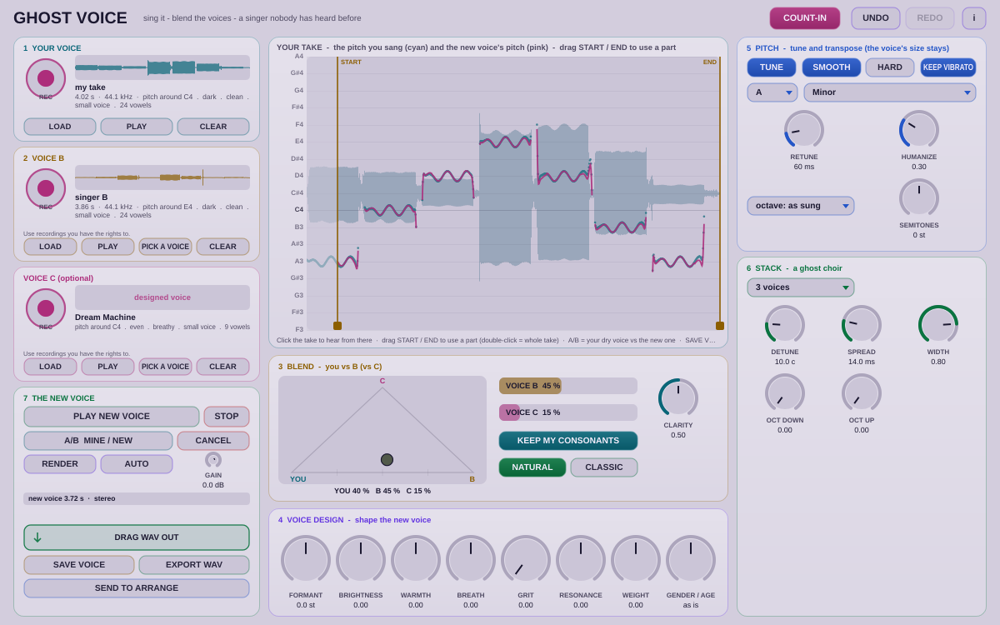

| Control | Range / values | Notes |
|---|---|---|
| VOICE B, VOICE C | 0 to 100 % | together at most 100 %; the rest is you |
| KEEP MY CONSONANTS, CLARITY | on / off, 0 to 1 | unvoiced moments keep your own sound; CLARITY blends back towards you above 5 kHz |
| FORMANT | -12 to +12 semitones | the whole envelope moves; the pitch does not |
| BRIGHTNESS, WARMTH, BREATH, RESONANCE, WEIGHT, GENDER / AGE | -1 to +1 | GENDER / AGE moves size (a quarter octave) and pitch (5 semitones) together |
| GRIT | 0 to 1 | pitch and level wobble plus noise in the mids |
| TUNE | off / SMOOTH / HARD; root, scale; RETUNE 0 to 400 ms; HUMANIZE 0 to 1; KEEP VIBRATO | HARD = flat and instant |
| Octave, SEMITONES | -2 to +2 octaves, -12 to +12 st | formants independent |
| STACK | 1 to 4 voices; DETUNE 0 to 50 cents; SPREAD 0 to 60 ms; WIDTH 0 to 1; OCT DOWN / OCT UP 0 to 1 | 2 or more voices or an octave layer = a stereo result |
| GAIN | -24 to +12 dB | after the automatic normalise |

- **Saved with the project:** the three slots (takes as 24-bit FLAC; designed / saved voices as their fingerprint), every setting, START / END, COUNT-IN and the look. Old projects open with an empty GHOST VOICE page.
- **Files:** Documents/Ghosty/Ghosty Spectrum/Voices/*.ghostvoice (SAVE VOICE); exports are 24-bit WAV at the take's rate.
- **Limits:** 3 minutes per slot (2 minutes per recording), 50 ms minimum; fingerprints hold up to 24 vowel pictures.
- **About:** the **i** button shows the WORLD licence (modified BSD, Copyright (c) 2010 M. Morise), the speech analysis / synthesis library under VOICE and GHOST VOICE. The blend itself is Ghosty's own code.

## Reference: Keyboard shortcuts

Keys work on a page after you click it (so the page has keyboard focus).

### Everywhere

| Key / gesture | Action |
|---|---|
| Right-click a knob | Type a value. |
| Double-click a knob | Back to the default. |
| SPACE | In SYNC: DAW, SPACE goes to your DAW, except on the pages below that use it. In SYNC: OWN and in the Standalone app, SPACE plays and stops Spectrum's own clock. |
| Ctrl/Cmd+Z, Ctrl/Cmd+Shift+Z | Undo / redo on SPECTRAL LAB, PROCESS, ARCS, ARRANGE and VOICE. |
| Esc | Closes HOW IT WORKS. |
| Left / Right (or Up / Down) | Previous / next HOW IT WORKS card. |

### Per page

| Page | Key | Action |
|---|---|---|
| PAINT PADS / LOOP | ALT while letting go of a dot | Keep it off the key |
| PAINT PADS / LOOP | Wheel over a dot | Louder / softer |
| SPECTRAL LAB | B, E, S, F, T, X, L, M | PAINT, ERASE, SMEAR, FREEZE, SHIFT, STRETCH, LOCK, SELECT |
| SPECTRAL LAB | `[` / `]` | Brush smaller / bigger |
| SPECTRAL LAB | SPACE / Enter | PLAY / HEAR |
| SPECTRAL LAB | Del, Esc, 0 | CUT BOX, clear the box, FIT |
| PROCESS | SPACE, P, Enter, Esc | Play, preview, apply, cancel |
| PROCESS | Del / Backspace | Delete region |
| PROCESS | Ctrl/Cmd+B, Ctrl/Cmd+R | Bounce, again |
| PROCESS | A or Ctrl/Cmd+A; + / - / 0 | Select all; zoom in / out / fit |
| PROCESS | Ctrl/Cmd+C / X / V | Copy / cut / paste |
| ARCS | D, L, C, E, S | DRAW, LINE, CURVE, ERASE, SELECT |
| ARCS | M / I | MIRROR / INVERT |
| ARCS | Ctrl/Cmd+D; Ctrl/Cmd+C / X / V; Ctrl/Cmd+A | COPY; copy / cut / paste; select all |
| ARCS | Del, Esc | Delete, clear the selection |
| ARCS | Arrows (Shift = bigger steps) | Nudge in time (grid / bar) and pitch (semitone / octave) |
| ARCS | SPACE | PLAY / PAUSE |
| ARRANGE | SPACE, Home | Play / stop, playhead to the start |
| ARRANGE | Ctrl/Cmd+D or B; Ctrl/Cmd+J | Duplicate; bounce |
| ARRANGE | Ctrl/Cmd+C / X / V; Ctrl/Cmd+A | Copy / cut / paste at the playhead; select all |
| ARRANGE | S, Q, M, L, E, Z | Split, quantise, mute, LOOP, gain envelope, zoom to selection |
| ARRANGE | Left / Right; Up / Down | Move by a grid step; move to the track above / below |
| ARRANGE | + / - | Zoom in / out |
| VOICE | 1 to 5 | PITCH, BORROW, CONTOUR, VOWEL, TUNE |
| VOICE | Space, Tab, L, Z, Esc | Play / stop, A/B, loop, zoom, clear the selection |

## Reference: Automatable parameters

These are the parameters your DAW sees, in its list order.

| Parameter (as your DAW shows it) | On-screen control | Range | Default |
|---|---|---|---|
| **Tempo (no host)** | PAINT tempo bar (only shown when your DAW sends a position but no tempo) | 60 to 200 BPM | 120 |
| **Volume** | (none on screen) | 0 to 1 | 0.8 (unity gain; the maximum is about +1.9 dB) |
| **Pad Bloom** | BLOOM | 0 to 100 % | 45 % |
| **Pad Space** | SPACE (pad) | 0 to 100 % | 65 % |
| **Pad Shimmer** | SHIMMER | 0 to 100 % | 40 % |
| **Pad Tape Delay** | TAPE | 0 to 100 % | 25 % |
| **Pad Drive** | DRIVE (pad) | 0 to 100 % | 12 % |
| **Pad Open Strings** | STRINGS | 0 to 100 % | 35 % |
| **Pad Drift** | DRIFT | 0 to 100 % | 30 % |
| **Pad Level** | LEVEL (pad) | 0 to 100 % | 75 % |
| **Pad Strum** | STRUM | 0 to 100 % | 30 % |
| **Pad Hold** | HOLD | on / off | on |
| **Pad Freeze** | FREEZE | on / off | off |
| **Lab Morph A-B** | MORPH (DNA) | 0 to 100 % | 0 % |
| **Lab Level** | LEVEL (Lab) | 0 to 100 % | 80 % |
| **Lab Width** | WIDTH (Lab) | 0 to 100 % | 35 % |
| **Lab Hear** | HEARING | Canvas, Ghost, Split, Morph | Canvas |
| **Lab Ghost Hit (0 = next each hit)** | hit box (GHOST) | 0 to 32 | 0 |
| **Lab Split Band 1 Mute** to **Lab Split Band 6 Mute** | MUTE per band (SPLIT) | on / off | off |
| **Bypass** | BYPASS | on / off | off |
| **Play** | PLAY: ALWAYS / ON NOTES | ALWAYS, ON NOTES | ALWAYS |

Not parameters, but saved with your project: the look, SYNC, the own tempo, the key and scale, all patterns, the Lab, ARCS pages, the ARRANGE session, VOICE settings and the PROCESS chain. A PAINT canvas file (.ghostspec) also stores the nine pad effect values, HOLD and FREEZE.

## Reference: Factory content

Everything here is made by the plugin in code; there are no recorded samples.

### PAINT LOOP: SYNTHS (52 sounds)

| Group | Count | Sounds |
|---|---|---|
| **Bass** | 17 | 808 Phantom, 808 Slide Wraith, Sub Abyss, Possessed Growl, Wobble Banshee, Riddim Reaper, Reese Specter, Cursed Bass, Yoi Banshee, Talking Wraith, Bubbling Cauldron, Tearout Reaper, Sync Screech, Squeeze Phantom, Comb Specter, Soft Sub, Deep Bass |
| **Keys** | 6 | Ghost Keys, Haunted EP, Lofi Ouija, R&B Velvet, Pop Chord Halo, Glass Keys |
| **Pads** | 6 | Ectoplasm Pad, Cinematic Crypt, Gated Ghost, Minor Chord Crypt, Warm Pad, Air Pad |
| **Leads** | 3 | Lead Wraith, Pop Lead Halo, Saw Lead |
| **Plucks** | 9 | Pluck of the Dead, Glitch Poltergeist, Neon Arp, Bubble Pop, Ghost Arp, Soft Pluck, Kalimba, Arp Spark, Bubble Pluck |
| **Bells** | 5 | Graveyard Bell, Ice Chime, Trap Music Box, Metal Chains, Music Box |
| **Vox** | 2 | Choir of Shadows, Ghost Choir |
| **Brass** | 2 | Brass Spirits, Big Brass |
| **FX** | 2 | Riser from the Grave, Laser Rise |

### PAINT LOOP: DRUMS (61 sounds)

| Group | Count | Sounds |
|---|---|---|
| **Kick** | 8 | Punch Kick, Boom Bap Kick, House Kick, Techno Kick, Lofi Kick, Hard Kick, Soft Kick, Sub Kick |
| **808** | 6 | 808 Long, 808 Short, 808 Dirty, 808 Glide, 808 Boom, 808 Punchy |
| **Snare** | 8 | Trap Snare, Boom Bap Snare, Drill Snare, Lofi Snare, Tight Snare, Big Snare, Rim Snare, Rim |
| **Clap** | 4 | Clap, Trap Clap, Big Clap, Snap |
| **Hat** | 6 | Hat, Trap Hat, Tight Hat, Lofi Hat, Shaker Hat, Pedal Hat |
| **Open Hat** | 3 | Open Hat, Short Open Hat, Long Open Hat |
| **Perc** | 12 | Cowbell, Shaker, Tambourine, Conga High, Conga Low, Bongo, Wood Block, Clave, Triangle, Perc Pop, Tick, Water Drop |
| **Tom** | 3 | Tom High, Tom Mid, Tom Low |
| **Cymbal** | 3 | Crash, Ride, Reverse Crash |
| **FX** | 8 | Zap, Laser, Blip, Glitch, Swell, Riser, Vinyl Crackle, Ghost Vox |

### PAINT pages: other content

- Brushes: BELL, PIANO, PAD, FEEDBACK. Starting points: Bell chord (6 BELL), Grand piano (6 PIANO), Ambient pad (5 PAD + 1 BELL), Feedback rise (2 PAD + 2 FEEDBACK).
- No factory patterns or canvas files: all 8 patterns start empty.
- Scales: Major, Minor, Harmonic minor, Dorian, Pentatonic minor, Pentatonic major, Chromatic. Keys C to B.

### SPECTRAL LAB and PROCESS

- No preset banks, factory sounds or pictures. TRY IT (Lab and PROCESS cards) makes a new 4-second canvas: a minor chord on C (C4, E-flat 4, G4, C5, each with 3 harmonics) that swells and fades, and from halfway a glide rising from 220 Hz by 2.5 octaves.
- Default SPLIT setup: 4 bands, crossovers at 180, 900 and 3500 Hz (9000 and 14000 Hz with 5 or 6 bands), 16 steps all on. Default morph lane: 0, 15, 30, 45, 60, 75, 90, 100 %.
- ENVELOPE presets: **SWELL** (rises to full at 85 %, then drops), **DECAY**, **GATE x4**, **GATE x8**, **RAMP UP**, **TREMOLO x8** (between full and 0.35), **DUCK** (rises to full at 35 %, then holds), **FLAT**. A new ENVELOPE starts with an attack-decay-release shape.

### ARCS: factory pages (22) and patches (16)

| Group | Factory pages |
|---|---|
| **Bass** (6) | Sub dive, Reese drone, FM growl, Wobble pulse, Dive bombs, Neuro stabs |
| **IDM** (3) | Gesture scribble, Ratio clock, Zigzag grains |
| **Melodic** (6) | Drawn melody, Polyrhythm 3:4, Arp 5/4, Pluck sequence, Bell canon, Hypnotic house arp |
| **Riser** (3) | Noise riser, Octave riser, Tension S-curve |
| **Texture** (4) | Glass drone, Cluster swell, Glissando cloud, Metal FM rain |

| Group | Patches |
|---|---|
| **Basic** (1) | Clean sine |
| **Bass** (5) | Square bass, Sub bass, Reese, Driven saw, Acid |
| **FX** (3) | Noise riser, Noise wash, Noise hat |
| **Keys** (1) | Pluck |
| **Lead** (4) | Soft lead, Saw lead, Super saw, Fat pulse |
| **Pad** (2) | Pad swell, Hollow |

Drawn melody is in A minor; Hypnotic house arp is in G minor. Glass drone, Cluster swell, Glissando cloud and Metal FM rain are timed in seconds. TRY IT on the ARCS card replaces the current page with the factory page "Reese drone" (one undo step).

### ARRANGE

- A new project: 4 empty tracks (TRACK 1 to TRACK 4), 120 BPM, 4/4, GRID 1/4, a loop region over bars 1 to 4 (off).
- TRY IT adds "Demo pluck" (4 s, tagged 120 BPM, WARP on) on TRACK 1 and "Demo pad" (6 s, a slow minor-chord swell) on TRACK 2, both at bar 1.
- Marker names, in the order you add them: INTRO, BUILD, DROP, BREAK, then OUTRO for every marker after that. Track and clip colours: Colour 1 to Colour 8.

### VOICE

**Vowel sets: formant targets F1 / F2 / F3 / F4 in Hz**

| Set | A | E | I | O | U |
|---|---|---|---|---|---|
| **Adult male** | 730 / 1090 / 2440 / 3400 | 530 / 1840 / 2480 / 3480 | 270 / 2290 / 3010 / 3700 | 570 / 840 / 2410 / 3400 | 300 / 870 / 2240 / 3400 |
| **Adult female** | 850 / 1220 / 2810 / 4000 | 610 / 2330 / 2990 / 4100 | 310 / 2790 / 3310 / 4200 | 590 / 920 / 2710 / 3900 | 370 / 950 / 2670 / 3900 |
| **Child** | 1030 / 1370 / 3170 / 4500 | 690 / 2610 / 3570 / 4600 | 370 / 3200 / 3730 / 4700 | 680 / 1060 / 3180 / 4400 | 430 / 1170 / 3260 / 4400 |

**Harmony steps (in notes of the scale):** 3rd up +2, 5th up +4, 6th up +5, octave up +7, 3rd down -2, 4th down -3, 6th down -5, octave down -7. H1 sits left, H2 right, H3 centre.

**Scales (semitones from the root):** Chromatic (all 12), Major 0 2 4 5 7 9 11, Minor 0 2 3 5 7 8 10, Pentatonic 0 2 4 7 9, Dorian 0 2 3 5 7 9 10, Mixolydian 0 2 4 5 7 9 10, Whole tone 0 2 4 6 8 10.

**TRY IT voice:** "Ghost demo voice", 3 seconds, made by the plugin: a sung line A3, C4, D4, C4 with light vibrato and the vowels moving ah, oh, ee.

## Reference: Files, folders and limits

### Where files go

"Documents" is your user Documents folder.

| What | Where |
|---|---|
| Saved PAINT canvases (.ghostspec) | Documents/Ghosty/Spectrum |
| Lab bounces (DRAG WAV OUT copies) | Documents/Ghosty/Spectrum/Lab Bounces |
| Lab pictures (PNG, SAVE PICTURE) | Documents/Ghosty/Spectrum/Lab Images |
| ARRANGE renders | Documents/Ghosty/Spectrum/Arrange Bounces |
| Sounds shared with Ghosty Beats (SEND TO BEATS, FROM BEATS, VOICE sets for the shared folder) | Documents/Ghosty/Shared Sounds |
| ARCS pages (.ghostarcs) | Wherever you save them (the dialog opens in Documents) |
| Drag-out files | Your system's temporary folder (subfolders such as GhostySpectrum, GhostyArcs, GhostyVoice, Ghosty Arrange; PROCESS drags go straight into it). VOICE and ARRANGE files older than a day are deleted when the plugin starts; the others stay until your system clears its temporary folder. |
| License file | Mac: ~/Library/GhostBlock. Windows: %APPDATA%\GhostBlock |
| Windows installer | VST3 in C:\Program Files\Common Files\VST3; the Standalone app in C:\Program Files\GhostBlock |
| Mac installer | VST3 in /Library/Audio/Plug-Ins/VST3, AU in /Library/Audio/Plug-Ins/Components, CLAP (when built) in /Library/Audio/Plug-Ins/CLAP, apps in /Applications/GhostBlock |

Everything you make is saved inside your DAW project, not in these folders.

### Limits

| Page | Limits |
|---|---|
| Top bar | Own tempo 20 to 999 BPM. Window 75 % to 200 %. |
| PAINT PADS | 32 dots per pattern, 8 patterns. |
| PAINT LOOP | 8 layers, 1,024 notes per pattern, 1, 2 or 4 bars. Samples: 60 s read, 30 s kept. |
| SPECTRAL LAB | Imports: the first 30 seconds. Up to 32 ghosts (made from the first 8 seconds). 2 to 6 bands, up to 32 steps per band. 12 voices. |
| PROCESS | 64 processes per chain; 600 s of audio per process; 192 MB undo; SOURCE keeps up to 8 sounds. |
| ARCS | 8 pages, 256 lines per page, 16,384 points per line, pitch MIDI 12 to 132, 64 undo steps per page, 7 unison voices, 16 held notes. |
| ARRANGE | 16 tracks, sounds up to 20 minutes, renders up to 60 minutes, 120 undo steps, track height 36 to 160 pixels. |
| VOICE | 5 minutes per slot (at least 50 ms), 16 to 96 kHz kept, 2 channels, DOUBLE up to x8, 3 harmony voices, 20,000 points per lane, 80 undo steps. |

## Reference: Tooltip texts

Hover over any control to read its tooltip. Most tooltips say the same as the control's row in the reference chapters, so they are not repeated here. These are the tooltips of the controls that are on every page.

| Control | Tooltip |
|---|---|
| **?** (top left) | HOW IT WORKS: what Spectrum is, what every tab does, and a TRY IT example for each |
| **PAINT PADS** tab | Paint ringing notes: every dot keeps sounding. / Paint ringing notes and pads (the small ? on the tab = how it works) |
| **PAINT LOOP** tab | Draw a loop in time with synths, drums and your own sounds. / Draw a loop in time with sounds and drums (the small ? on the tab = how it works) |
| **SPECTRAL LAB** tab | Paint the sound itself: up = pitch, across = time, bright = loud. / Paint the sound itself: pictures to sound, ghosts, band rhythms, chaos, morph (the small ? on the tab = how it works) |
| **PROCESS** tab | Change the Lab's sound: reverse, stretch, spectral moves ... then keep it. / Destructive processes on the Lab's sound (reverse, stretch, spectral ...), then BOUNCE NEW (the small ? on the tab = how it works) |
| **ARCS** tab | Draw lines that become voices: each line glides along its path. / Draw lines that become voices (the small ? on the tab = how it works) |
| **ARRANGE** tab | Put the sounds you made on a timeline and build a piece. / Sequence the sounds you made into a piece (the small ? on the tab = how it works) |
| **VOICE** tab | Change a voice: its pitch, its formants (the vowels), its timing. / Pitch and formants of a voice: move, borrow, draw, vowels, tune, double, harmony (the small ? on the tab = how it works) |
| Small **?** on a tab | How [TAB] works: steps, gestures, drag-out, TRY IT |
| BPM box | Spectrum's own tempo (SYNC: OWN): double-click and type 20 - 999, Enter to set |
| **TAP** | Tap the own tempo (SYNC: OWN): click in time, tap 2 or more times |
| **PLAY** (top bar) | Play / stop Spectrum's own clock from bar 1 (SYNC: OWN; SPACE does the same) |
| DAW tempo label | SYNC: DAW - the tempo comes from your project. Switch SYNC to OWN to set Spectrum's own tempo. |
| Look button | The look of every page: BLACK -> PURPLE -> LIGHT (the button shows the next one; saved with the project) |
| **UNLOCK** (demo) | Demo mode: the sound drops out for 2 s every 20 s, projects reopen at the default sound, and export is off. Enter your license key to unlock. |
| **TRY IT** (guide card) | Load a small built-in example for this page and go there (undo / the pattern menu keep your own work) |
| **CLOSE** / **NEXT >** / **< BACK** (guide card) | Close (Esc) / The next card / The previous card |
| **GOT IT** / **HOW IT WORKS** (hint bubble) | Hide this hint (it only shows the first time) / Open this page's HOW IT WORKS card |

In the tab tooltips, " / " marks the line break. In PROCESS, the line under a process's name in the parameter panel is its one-line description.
